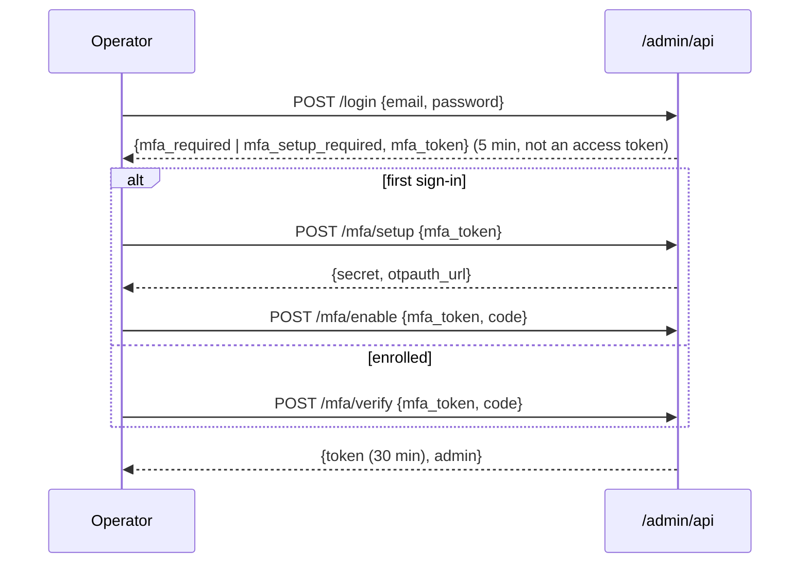

# Platform console (`/admin`)

The platform console is for the **operators of an installation**: people who run Conversations for many workspaces. It is not part of any workspace: platform admins are not members, have their own accounts, tokens and routes, and share nothing with the workspace login. Everything it does is written to the append-only audit log.

* Web: `https://YOUR-HOST/admin` (lazy-loaded; not linked from the product).
* API: `/admin/api/*` ([API.md](API.md)). The route table is `server/src/admin/access.ts`; the code is `server/src/admin/` and `server/src/routes/admin.ts`.

## Creating operators

There is deliberately **no HTTP endpoint that creates an admin**. Use the CLI on a machine that can reach the database:

```bash
cd server
ADMIN_EMAIL=ops@example.com ADMIN_NAME="Ops" npm run admin -- create                 # superadmin, random one-time password printed once
ADMIN_EMAIL=read@example.com ADMIN_PASSWORD='at least 12 characters' npm run admin -- create --role support
npm run admin -- list
npm run admin -- reset-mfa --email ops@example.com                                   # lost authenticator: enrol again at next sign-in
```

Passwords must be at least 12 characters. Two roles:

| Role | Can |
| --- | --- |
| `superadmin` | everything below |
| `support` | read: stats, workspace directory and detail, audit, rate-limit lists, operators; open the read-only support view. Cannot change anything |

## Sign-in: password, then an authenticator code, always



* Two-factor is **mandatory**. An admin without it can only enrol: the step token is not an access token and `GET /me` with it is a 401.
* A TOTP code is accepted once per 30-second step (conditional update), so a captured code cannot be replayed.
* Platform tokens have their own issuer and audience (`conversations-platform` / `platform-admin`) and are signed over a different key derivation than workspace tokens: a workspace token cannot open the console and a platform token cannot open `/api`. They last 30 minutes, are not refreshable, and the web console keeps them **in memory only** (never in localStorage, sessionStorage or a cookie).
* Role and the disabled flag are read from the database on every request, so disabling an operator ends their access immediately.
* Limits (all fail closed): 5 sign-in steps per minute per IP; 5 failed logins per account in 15 minutes lock that account, escalating; 10 per IP; 5 wrong codes per operator lock the second step. Unknown emails and wrong passwords answer identically.

## What the console can do

| Action | Role | Notes |
| --- | --- | --- |
| Workspace directory, search, filters | any | by name, workspace id or an exact member email; keyset paging; `%` and `_` are literal |
| Workspace detail | any | plan, billing state, seats, usage of the last 30 days, members, credit ledger, recent audit. **No message content, no contact details, no card data** |
| Suspend / unsuspend | superadmin | reason required (3+ characters) |
| Adjust credits (add or remove) | superadmin | reason required; `Idempotency-Key` header makes a retried request apply once |
| Rate-limit tier override | superadmin | `free/pro/business` or clear; takes effect on the next request |
| Home region (multi-region routing key) | superadmin | `PUT /admin/api/workspaces/:id/region`; an installation with `REGION` set refuses other regions' workspaces with `421 WRONG_REGION` |
| Block / unblock an entity (`ip:`, `ws:`, `user:`, `key:`, `visitor:`) | superadmin | expiring list entries in the rate limiter ([RATE-LIMITING.md](RATE-LIMITING.md)) |
| Read-only support view | any | see below |
| Audit log (platform-wide, filter by workspace/action/actor) | any | |
| Disable / enable operators | superadmin | not yourself, not the last active superadmin |

### Suspension

`POST /admin/api/workspaces/:id/suspend {reason}` marks the workspace suspended, ends all its sessions, and tells connected clients (`auth:expired`). From then on, everywhere a workspace is entered, the answer is `403 WORKSPACE_SUSPENDED`:

* every authenticated REST request (the check runs before the session check so the owner is told why);
* login and token refresh;
* the widget (`x-api-key` embed tokens);
* the next event on any open team or visitor socket (the socket is then disconnected).

Inbound customer messages (SMS, email) are still stored: a suspension must not lose what customers send. Other workspaces are unaffected. `suspended` is cached for `CACHE_TTL_MS` and invalidated on every node when it changes.

### Read-only support view ("impersonation")

`POST /admin/api/workspaces/:id/impersonate {reason, member_id?}` returns a 15-minute workspace access token for the owner seat (or the given member). It is constrained three ways:

1. its permission set is capped to `conversations:read`, `contacts:read`, `members:read`, `settings:read`, `analytics:read` whatever the seat can normally do (so billing, audit and API keys are refused);
2. **every non-GET REST request is refused** (`403 IMPERSONATION_READ_ONLY`), including the routes that otherwise only need a signed-in user (profile, password, notifications), and a socket opened with it receives live updates but any event it emits is refused;
3. it cannot be refreshed, expires after 15 minutes, and stops working when the admin who minted it is disabled.

The reason is mandatory and recorded as `admin.impersonation_started` in the **workspace's own** audit log (visible to its owners under *audit*), with the operator's id: the customer can see that support looked, who, and why. The web console opens the view in a new tab at `/impersonate#token=...` (the token is in the URL fragment, never sent to a server, and the page removes it from the address bar at once). That tab replaces the browser's stored workspace session, so use a private window if you also use the product yourself. A banner shows "Support access: read-only view".

## Audit trail

Every change writes `audit_log` rows with `actor_type = platform_admin` and the operator's id (`admin.workspace_suspended`, `admin.workspace_unsuspended`, `admin.credits_adjusted`, `admin.impersonation_started`, `ratelimit.*`, `admin.disabled`, `admin.enabled`, `admin.login`, `admin.mfa_enabled`, `admin.created`, `admin.mfa_reset`). Rows about a workspace carry its id, so they appear in that workspace's audit log too. The table is append-only at the database level (triggers reject `UPDATE` and `DELETE`).

## Tests

`server/tests/admin.test.ts` (21 tests, also run on PostgreSQL) covers the declarations (every `/admin/api` route has an access rule, an authorisation entry and a limiter decision; every state-changing route needs superadmin), the sign-in flow, enrolment, code replay, lockouts, token separation and expiry, disabling, role checks, the directory (paging, search, filters, no leakage of content), suspension across API, login, refresh, widget and sockets, credits with idempotency, tier overrides, impersonation (reads allowed, writes refused, audit in the workspace log, expiry, disabled admin, socket read-only) and the audit view. The web console is covered by `web/src/admin/AdminApp.test.tsx`.

## Limitations

No SSO for operators (password + TOTP only); no per-operator IP allow-list (put `/admin` behind your own network controls or Cloudflare Access: see [CLOUDFLARE.md](CLOUDFLARE.md)); no recovery codes (use `reset-mfa`); platform tokens cannot be revoked individually before they expire (30 minutes), only by disabling the operator.
