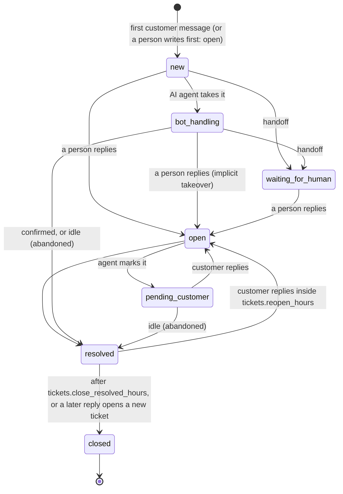

# AI support agents, tickets, departments, visitor details and calls

This document describes the support-automation layer that sits on top of the inbox: **tickets** (an episode of support inside a conversation), **AI agents** that answer first and hand over to people, **departments** and routing, **visitor details** collected in the widget, and **voice and video calls** between an agent and a visitor. It is written feature by feature as each one lands; the section "Status" at the end says what exists, what is only scaffolded and what was never run against a real service.

Vocabulary: a *room* (the UI says *conversation*) is the one thread per contact; a *ticket* is one issue inside it. See [GLOSSARY.md](GLOSSARY.md) and [ADR 0027](adr/0027-tickets-inside-rooms.md).

## 1. Tickets

### What a ticket is

A room stays one per contact (unchanged rule). A ticket opens with the first message of an issue and ends when it is resolved. Closing a ticket never closes the room; closing the room resolves its live ticket. At most one ticket per room is *live* (not `closed`), enforced by the partial unique index `ux_tickets_room_live`, so two simultaneous first messages converge on one ticket (tested on SQLite and PostgreSQL).

| Field | Meaning |
| --- | --- |
| `number` | human-friendly, per workspace, starts at 1, allocated by one `INSERT ... ON CONFLICT ... RETURNING` on `ticket_counters` (rolls back with the transaction, never repeats) |
| `subject` | the first line of the customer's first message until someone edits it (`subject_set_by` becomes `agent`) |
| `status` | `new`, `bot_handling`, `waiting_for_human`, `open`, `pending_customer`, `resolved`, `closed` |
| `handler` | `bot:<agent id>`, `human:<member id>` or null |
| `department_id` | the room's inbox when the ticket opened (departments: section 2 once built) |
| `priority` | 0 low, 1 normal, 2 high, 3 urgent (a priority conversation opens a high ticket; AI triage with urgency 0.8 or more raises it) |
| `resolution` | `bot_resolved`, `human_resolved`, `abandoned`, `auto_closed`, `merged` |
| timestamps | `opened_at`, `first_response_at` (anyone, bots included), `first_human_response_at`, `handoff_at`, `resolved_at`, `closed_at` |
| `csat`, `csat_comment` | the customer's rating of this ticket |
| `tags`, `summary`, `handoff_reason`, `merged_into_id`, `channel` | as named |

Every message carries `ticket_id` (`messages.ticket_id`). Messages written before the feature existed keep `NULL`, and so do lines written before a conversation's first issue (the "Conversation started" line, an away message). There is no backfill: a room opens its first ticket with its next message (verified by an upgrade test on a populated database, [TESTING.md](TESTING.md)).

### Lifecycle

* **Opens**: the first contact message when no ticket is live (any channel: chat, SMS, email); an agent's first message in a room with no live ticket opens a human ticket (`open`, counted as answered).
* **Answers**: a human reply moves `new`, `bot_handling` and `waiting_for_human` to `open` and makes that person the handler; replying to a bot ticket is an implicit takeover and is recorded as `taken_over`. Bot messages only record `first_response_at`. Notes and system lines attach to the live ticket but never open, answer or reopen one.
* **Resolves**: an agent (`POST /api/tickets/:id/resolve`), the room being closed by a person, or the idle sweep. The customer sees the closing message with a 1 to 5 rating card (`tickets.closing_message`, `tickets.csat_prompt`); the card is a visitor-visible system line (`meta.sub_type = "ticket_resolved"`, `meta.card = {type: "csat", ticket_id}`).
* **Reopens**: a customer message on a `resolved` ticket within `tickets.reopen_hours` (default 72) reopens the same ticket (same number); later it closes that ticket (keeping the resolution it earned) and opens a new one. A person replying to a resolved ticket reopens it too.
* **Closes**: `POST /api/tickets/:id/close`, or the sweep after `tickets.close_resolved_hours` (default 72). A ticket nobody answered closes as `auto_closed`, one only the bot answered as `abandoned`, otherwise it keeps its resolution.
* **Idle sweep** (scheduler, every minute, bounded to 200 per pass): `bot_handling` tickets quiet for `tickets.bot_idle_minutes` (default 30, 0 = off, minimum 5) and `pending_customer` tickets quiet for `tickets.pending_idle_hours` (default 72, 0 = off) are resolved as `abandoned` with the closing message. Tickets a person is handling (`open`) are never auto-resolved.
* **Merge** (`tickets:merge`): a duplicate is merged into another ticket **of the same conversation** (a conversation has one live ticket, so duplicates arise from the reopen window): its messages move over, it closes as `merged`, the earlier opening and first response survive. Merged tickets cannot be reopened or rated.

Rating: `POST /public/rooms/:id/ticket-csat` rates the latest ended ticket (or the one named) once; `GET /public/rooms` carries `ticket: {id, number, status, resolved, csat_pending}` for the widget. The visitor never sees handler, department or tags.

### API, permissions, realtime

Routes are under `/api/tickets` (list with filters and keyset paging, counts, detail with event timeline, edit, resolve, close, reopen, merge, bulk) plus `/api/rooms/:id/tickets` and `/api/contacts/:id/tickets` ([API.md](API.md), tag "Tickets"). A ticket follows the visibility of its conversation: an agent sees the tickets of the rooms they can see, anything else is `404` (and so is another workspace). Permissions: `tickets:read`, `tickets:write` (edit, reopen), `tickets:close` (resolve, close, bulk) and `tickets:merge`; the Agent role has the first three, the Viewer role `tickets:read`; custom roles that could read or reply keep that ability ([RBAC.md](RBAC.md)). The room list, `GET /api/rooms/:id` and every room event carry the live ticket (`room.ticket`), the room list filters on it (`ticket_status`, `ticket_handler`, `department_id`), and `ticket:updated` ([REALTIME.md](REALTIME.md)) tells the team the full ticket and the visitor the minimal one.

### In the app

Thread header: the ticket chip (`#12 Open`) is a menu (resolve, close, reopen, waiting for the customer, priority). Contact panel: a Tickets section with the history. **Tickets** page (`/tickets`, `tickets:read`): counts by status, filters (status, handler, department, number or subject; the URL keeps them), a table or cards on phones, multi-select and bulk resolve or close. Settings > Tickets: the numbers above, the closing message and the rating prompt.

### Data

Migration 027 (`tickets`, `ticket_events`, `ticket_counters`, `messages.ticket_id`) and 028 (permissions) are additive: no table is rebuilt and nothing touches the SQLite schema tables ([ADR 0023](adr/0023-sqlite-migrations-defensive-mode.md)). Retention (`retention_days`) and workspace erasure delete tickets and their events together with the messages; the archive keeps `ticket_id` on restored messages.

## 2. Departments, routing and handoff

Departments are inboxes with routing configuration; the engine that gives a ticket to a person (modes, capacity, hours and holidays, overflow, the queue, service levels, transfer, routing rules) is described in [DEPARTMENTS.md](DEPARTMENTS.md) and [ADR 0028](adr/0028-departments-are-inboxes.md). This is what the AI agent calls when it hands a conversation to a person, and what an agent's "transfer" button calls. Handoff reasons are recorded on the ticket (`handoff_reason`, the `handoff` event): `customer_requested_human`, `low_confidence`, `no_answer`, `repeated_rephrase`, `negative_sentiment`, `high_urgency`, `sensitive_topic`, `tool_failure`, `vip_contact`, `outside_hours`, `max_turns`, `transfer`, `agent_unavailable`, `agent_removed`, `sla_escalation`, `queue_drain`. A handoff leaves the person an internal note (reason, department, who got it, what the caller wants them to know) and tells the visitor what happens next: connecting you with a team and the typical wait, the place in the queue, or when the department reopens.

## 3. AI support agents

An AI agent answers the visitor's first messages of a ticket from the workspace's knowledge base, asks for details when it cannot, and hands the ticket to a person when it should. It works in the chat widget and the hosted chat, and, when switched on, by SMS and email ([below](#ai-agents-on-sms-and-email)). Up to five agents per workspace, each with a name, a persona, a tone, languages, a greeting, departments it works for (none selected: all), hours, knowledge collections, an autonomy level, thresholds, the actions it may take, its hand-off triggers and a disclosure label. Decision record: [ADR 0029](adr/0029-ai-agent-pipeline.md).

### What happens on a visitor message

`handleCustomerMessage` runs in the background after the message is stored (the visitor's request never waits for a model). The agent that serves the conversation is the first enabled one whose departments include the ticket's (or that has none); one that is outside its hours still takes the message and hands over at once (`outside_hours`). The turn is two functions so that the sandbox runs exactly production code: `decideTurn` only reads, `applyDecision` writes.

1. **Classify** (deterministic, no model): intent words, urgency, sentiment, whether the visitor asks for a person (en, es, fr, de, ja, pt), the department the message is about.
2. **Hand-off triggers**, each switchable per agent: asks for a person; a sensitive topic (the list is the agent's setting; the default holds refunds, legal, fraud, account takeover, cancellation and similar words in five languages and is the whole list: clearing it clears it); VIP-tagged contact; upset; urgent; the same question rephrased three times; the turn limit; low confidence after `max_attempts`; the agent's hours. An injection attempt ("ignore all previous instructions", hidden-prompt requests, forged delimiters) is answered with a polite refusal once and hands over the second time (`suspicious_input`); the model never sees it.
3. **Retrieve** from the knowledge base (BM25 over question and answer, limited to the agent's collections). If nothing covers the question well enough (`coverage_threshold`) the agent asks for more detail once or twice and then hands over (`no_answer`).
4. **Ask the model** for a structured answer (`answer`, `confidence`, `intent`, `handoff`, `cited_ids`, `actions`), validated with zod. The prompt puts the product's safety rules first, then the workspace's persona, then the retrieved entries and the conversation, both delimited and declared to be data written by third parties. With no model configured, or when the model fails, times out or returns something unusable, the **rules agent** answers from the best entry instead (offline, deterministic); only when that cannot answer either does the ticket go to a person. A workspace whose daily AI budget is used up degrades the same way.
5. **Guard the answer**: banned claims (guarantees, promises, "100% secure", legal advice, asking for passwords or card numbers, claiming to be human), money or schedule commitments the knowledge base does not contain, and links that are not the knowledge-base entry's own address are removed or the answer is replaced by a hand-over (`unsafe_answer`). Confidence below `confidence_threshold` asks for details or hands over.
6. **Apply**: the bot message (sender `bot`, `meta.ai = true`, the agent's name and label, the sources as links, a quick-reply card "Did this solve it?" with Yes / No / Talk to a person), the actions, the turn record (`ai_turns`: outcome, reason, confidence, sources, tokens, latency, redacted visitor words), and the typing indicator while it works.

Autonomy: **suggest only** writes nothing to the visitor and leaves the team a private note with the drafted reply; **answer on its own** answers and hands over; **answer and resolve** also resolves the ticket when the visitor confirms ("thanks, that solved it", the Yes card) or when the model asks to and the agent may. Every resolution by an agent shows the closing message and the rating card of Settings > Tickets.

### Tools (a closed list)

`search_kb` (the agent's own retrieval, up to two calls per turn), `set_department`, `resolve_ticket`, `handoff_to_human`, and the registered-later `collect_contact_info`, `schedule_callback`, `offer_call` (now with a choice of a call with the team or with the AI) and `share_call_link` (a join link, see [CALLS.md](CALLS.md)). The model names a tool, the server validates the arguments with zod, checks the agent's allowed actions and departments, runs it scoped to the workspace, writes an `ai_agent.tool` audit entry and shows the team a line in the conversation ("Aria (AI agent): set the department to Billing"; visitors never see these lines). There is no plugin and no free-form HTTP tool in v1; a new tool is a case in `agents/tools.ts` with its schema and its permission.

### Calls, portraits and presets

With the allowed action `ai_call` (and `calls.ai` on in Settings > Calls) a visitor can speak with the same agent: the browser recognises and speaks, the server sees text and answers through this same pipeline; an optional realtime engine and the animated face are described in [CALLS.md](CALLS.md) (decision records [0033](adr/0033-ai-calls-browser-speech.md), [0034](adr/0034-agent-portraits-and-the-talking-face.md), [0035](adr/0035-optional-realtime-voice-engine.md)). `offer_call` and `share_call_link` are the other call-related actions. An agent can have a picture (Settings > AI agents: upload with crop and alt text; use only pictures you have the right to use), and "New agent" offers **Start from a preset**: Aria and vb (persona, greeting, disclosure, bundled owner-supplied portraits). The AI label stays visible on every picture.

### Visitor controls and disclosure

Visitors are always told: the answer carries the agent's name and label ("AI assistant" by default), `GET /public/widget/config` returns `ai: {name, label, avatar_url}`. **Talk to a person** is always available (`POST /public/rooms/:id/request-human`), whether or not an agent is switched on: it stores the request as the visitor's message and hands the ticket off; asking again while a person has it changes nothing. Quick replies are `POST /public/rooms/:id/quick-reply`; a tap is stored as the visitor's own message, the card closes (a double tap answers once, the second gets `409 ALREADY_ANSWERED`), and the option resolves the ticket, asks the agent to try again or hands over. Thumbs up or down on an answer: `POST /public/rooms/:id/messages/:messageId/feedback`.

### AI agents on SMS and email

An agent can answer texts and emails with the same pipeline as the chat: classification, the knowledge base, the guards, the hand-off triggers, the AI budget and redaction. **Off by default, twice**: the workspace switches a channel on (Settings > AI agents > *SMS and email answers*, `settings.ai_channels.sms.enabled` / `.email.enabled`, `agents:manage` and a manager to save) **and** an agent gets the channel (its *Channels*: Chat, SMS, Email; `channels: ["widget","sms","email"]`). Code: `server/src/agents/channelReply.ts` (when and how), `channelText.ts` (the text rules), hooks in `services/postProcess.ts` and `agents/pipeline.ts`.

**How a reply goes out**: the answer is turned into plain text (markdown removed, links as "text: address"), quick-reply buttons become numbered options ("Reply 1 for Yes, thanks, 2 for Not quite or 3 for Talk to a person."), and it is sent as an ordinary message of the conversation (`sender_type: "bot"`, `source: "sms" | "email"`) through the **existing delivery pipeline**: the workspace's own Twilio or SendGrid connection (else the platform default), pacing, retries, credits and the honest test mode (`not_sent_test_mode`, nothing billed). The model is told the channel ("plain text only, at most three short sentences" for SMS; "short paragraphs, no greeting or signature" for email).

- **Disclosure**: the first SMS of a ticket starts with "Aria (AI assistant): " and ends with "Reply HUMAN for a person."; the first email starts "This is Aria, the AI assistant of Acme (not a person).", and every AI email ends with the sign-off "-- / Aria (AI assistant), Acme / [workspace signature] / Reply HUMAN to reach a person."
- **Customer replies**: "1", "2", "3" pick the open options (resolve with a closing text, try again, hand over); "HUMAN" (or agent, person, humano, persona, Mensch, humain, personne) hands over at once. A hand-off is told to the customer once: "Thanks. I have passed this to our team: a person will reply here." After that a person has the ticket and the AI is quiet.
- **SMS length**: at most `max_segments` (default 3) segments, counted with GSM-7 (160, or 153 per part) and UCS-2 (70, or 67) rules; a longer answer is cut at a sentence or word with "…", keeping the disclosure and the options.
- **Email threading**: replies carry `In-Reply-To` and `References` of the conversation, from the workspace's default sender, with the conversation's subject; the AI reads only the new part of a customer email (quoted history, "On ... wrote:" in several languages, forwarded headers, "Sent from my iPhone" and signatures are stripped before the model and the transcript see it). An answer is cut at `max_chars` (default 2000). AI emails carry `Auto-Submitted: auto-replied` (RFC 3834), `X-Auto-Response-Suppress: All` and `X-Conversations-Bot: 1`, so other auto-responders do not answer them.

**When the AI never answers** (the team gets the message the usual way, with an internal line saying why, once per ticket):

| Case | Detection |
| --- | --- |
| Automatic email | `Auto-Submitted` other than `no`, `X-Autoreply`/`X-Autorespond`, `Precedence: bulk/junk/list/auto_reply`, `List-Id`/`List-Unsubscribe`, `Return-Path: <>`, another bot's header, senders such as mailer-daemon, postmaster, no-reply, do-not-reply, subjects such as "Out of Office", "Automatic reply", "Undeliverable", "Delivery Status Notification" (several languages), delivery reports |
| Automatic text | short codes (no `+` or 6 digits or fewer), automated-notice wording |
| STOP, START and other keywords | the existing SMS keyword rules; opted-out contacts (`sms_opt_out`) and unsubscribed contacts (`unsubscribed`) |
| Night (SMS) | `quiet_hours` (default 21:00 to 08:00, on) in the contact's time zone, else the office-hours zone |
| Too many AI replies | more than `max_replies_per_day` (default 5) AI replies in the conversation in 24 hours: the ticket goes to a person (`bot_reply_limit`) |
| A flood | `ai.channel.contact`: 6 AI replies per contact and channel in 10 minutes |
| A person has it | the ticket is with a person or waiting for one |

**Verified**: `server/tests/ai-channels.test.ts` (SQLite and PostgreSQL) with the fake SMS and email providers and a scripted model: plain text, disclosure, options and the numbered replies, HUMAN, hand-off notice once, STOP/START/opt-out, short codes and automated texts, out-of-office/bounce/list/no-reply/bot emails, unsubscribed contacts, the daily reply cap, the rate limit, quiet hours, both switches, test mode, email threading and headers, quoted-text stripping (the quoted history never reaches the model), the email length limit and signature; the text rules on their own (segments, cutting, options, auto-reply detection). `e2e/tests/18-ai-sms-email.spec.ts` sends a text and two emails through the built server's webhooks and checks the inbox. **Not verified**: a real Twilio or SendGrid account, real carriers (segment billing, concatenation), real mail servers and real out-of-office systems, and any real language model.

### Taking over and handing back

A person takes a ticket the agent is handling with the same `claim` as any queued ticket (`POST /api/tickets/:id/claim`, `tickets:write`); the agent stops at that moment and the visitor sees that a person joined. `POST /api/tickets/:id/hand-back` gives it back to the agent that serves the department (the person who has it, or a manager); the agent answers the visitor's next message. Notes and agent messages never start an agent turn.

### Sandbox and review

The first time a person with `agents:manage` opens Settings > AI agents in a workspace with no agent, the app creates one called Aria, switched on (answers from the knowledge base, hands over when it cannot) and says so on screen. The browser remembers it did, so deleting the agent is final in that browser. It is created by the web app through the ordinary `POST /api/agents`; the server never creates agents on its own.

Settings > AI agents (`agents:manage`: owner and manager). **Try an agent**: `POST /api/agents/:id/sandbox` runs one message through exactly the production decision and reports the reply, the sources, the confidence, the hand-off and the routing it would lead to (department, mode, person), with the steps in plain words. Nothing is stored (no room, ticket, message, turn or audit entry); a model call counts against the workspace's AI budget and the per-user AI limits. **Review** lists every turn (`GET /api/agents/turns`, filters: agent, outcome, rated up or down; keyset paging) with the visitor's words, the answer, the sources and the votes of visitors and team members; team members rate answers from the conversation view (`POST /api/messages/:id/feedback`). **Unanswered** (`GET /api/agents/unanswered`) groups the questions the knowledge base could not answer (a question joins the first group it shares at least half its words with), biggest first, with a button that starts a knowledge-base entry from the question. Knowledge-base entries have an optional `collection` and `url`.

### Settings and data

Migration 031 (`ai_agents`, `ai_turns`, `ai_feedback`, `kb_entries.collection` and `url`) and 032 (permission) are additive. Turns are deleted with their ticket; feedback is kept per message and rater. With *redact personal data* on (Settings > AI assistant) emails and phone numbers are masked before text reaches a model and in the stored turn words, and the visitor's name, email and phone are not sent to the model at all.

## 4. Visitor details in the chat

The workspace chooses which details the chat collects and when (Settings > Visitor details; a department can override the three fields and the moments under Departments & routing). Each of name, email and phone is `off`, `optional` (asked, the visitor may skip), `required` or `ask_when_needed`; up to five custom fields (text, a choice or a checkbox) have the same modes and are stored on the contact under `attrs`. Defaults: everything off, so nothing changes until someone configures it.

- **Before the chat starts**: fields set to `required` (and the older `required_info` list) are asked in the pre-chat form, and the session refuses to start without them (`422 REQUIRED_INFO_MISSING`).
- **In the thread**: at the moments `handoff` (a ticket goes to a person), `no_agent` (nobody can take it: department closed or all busy), `callback` (a callback or call is requested) and `after` (the ticket was resolved: an email to follow up; off by default) the server puts a **form card** in the conversation with the fields that are on and that the contact lacks. A moment asks at most once per ticket, nothing is asked that is already known, and the AI agent can ask for details itself (`collect_contact_info`, limited to fields that are not `off`) or for a callback number (`schedule_callback`, phone required). The card is a structured message (`meta.card.type = "contact_form"`), never free text read out of the chat.
- **Answering**: `POST /public/rooms/:id/forms/:messageId` with `{values, consent, country, website}`. Validated on the server (and in the widget first): email syntax (lower-cased), phone parsed with libphonenumber to E.164 with the country the visitor picked (default: the browser's region, else the workspace's `default_region`), name charset and length, choice fields against their options, custom text without control characters or angle brackets, unknown keys refused; `422 INVALID_FORM` with `details.errors` per field. When the workspace asks for consent, a checkbox (with an optional privacy-policy link) is required before an email or phone is saved; its text and time are kept on the contact. `website` is a honeypot: a filled one stores nothing and reports success. `POST .../skip` closes an optional card. A card is answered once (`409 ALREADY_ANSWERED`), also under two submits at once.
- **Contacts**: the details go to the visitor's own contact. If an email or phone already belongs to **another** contact, it is not linked: it is kept as `attrs.unverified_email` / `unverified_phone` for the team, the response is the same as for a new address (nothing reveals that it exists) and no history is shared. Linking to an existing contact stays with the signed identity and the OTP checks of the session. The visitor's message shows what was shared (names of fields, not values), the team gets a line in the conversation, `info_requested`, `info_submitted` and `callback_requested` events on the ticket, and an audit entry with the field names.
- **Privacy**: values reach a language model only when the workspace does not redact personal data (the existing `ai_redact_pii` setting), and never appear in logs.
- **In the apps**: the widget and the hosted chat render the card (labels, errors with `role=alert`, a country picker next to the phone field, consent, skip; a half-filled card survives incoming messages). The hosted chat is translated into en, es, fr, de and ja and tells the host app with the bridge events `form_requested`, `contact_info_submitted` (field names only), `handoff_started` and `agent_joined` ([MOBILE-BRIDGE.md](MOBILE-BRIDGE.md)).

Copies of the conversation by email are built ([TRANSCRIPTS.md](TRANSCRIPTS.md)): the `after` moment's address is used for the automatic copy when the workspace switches it on.

**Custom fields in the pre-chat form**: up to five workspace custom fields of type **text**, **choice** (two to twenty options) or **checkbox** (stored as `yes` or `no`; a required one must be ticked, for example "I accept the terms") use the same schema and validation as the form cards in the thread. Their mode decides where they are asked: `required` and `optional` fields are asked **before the chat** in the widget's and the hosted chat's pre-chat form (the form appears when any of them exists), `ask_when_needed` fields in a thread card at the moments that are on, `off` never. The server enforces the required ones when the session starts (`POST /public/sessions` with `attrs: {key: value}`): a missing one is `422 REQUIRED_INFO_MISSING` with `details.missing` (the same error as for name, email and phone), a wrong value, a key that is not asked before the chat or an unknown key is `422 INVALID_FORM` with `details.errors`. Answers are stored on the contact under `attrs` (the team sees them on the contact), and a field already answered, or shown in the pre-chat form and left empty, is not asked again in the thread (`attrs.prechat_at`; a client that does not send `attrs` at all, such as an older app, leaves the fields to the thread). When the workspace asks for **consent** and the visitor gives an email or phone number in the pre-chat form, the consent box is required there too (`consent: true`, else `INVALID_FORM` `errors.consent`), and the agreement is recorded on the contact with `via: "prechat"` (it does not confirm the address for a copy by email: anyone can type an address). The form is labelled and keyboard-usable, errors are announced (`role="alert"`, `aria-invalid`), the workspace's labels are shown as written and the surrounding words are translated in the hosted chat's five languages; an automated WCAG 2.1 AA check runs on it in `e2e/tests/20-prechat-fields.spec.ts`.

**Per department**: Departments & routing > a department > Visitor details overrides name, email and phone, **each custom field's mode** (`visitor_info.custom_fields: {key: mode}`) and the **consent wording and privacy-policy address** (`visitor_info.consent`, for a department run by another company or with its own policy); the rest stays the workspace's. The pre-chat form follows the widget's default department; thread cards follow the ticket's department. Verified by `server/tests/prechat.test.ts` (SQLite and PostgreSQL), `web/src/widget.test.ts`, `DepartmentSettings.test.tsx` and the browser test above.

## 7. Measuring and trying it

**Analytics**: containment rate, hand-off reasons, queue length, wait for a person, service-level breaches, rating by handler and department, calls (count, duration, missed), and tickets and calls as exports ([ANALYTICS.md](ANALYTICS.md)); Analytics > Support in the app.

**Evals**: `npm run eval:agent` (in `server/`) runs 51 golden cases through the production decision (the sandbox path: nothing is stored): answerable questions that must cite the right entry, unanswerable ones that must not be answered, requests for a person in five languages, sensitive topics, urgency and anger, eight injection attempts, and ordinary messages that look like triggers but must not hand over. It prints each case and the metrics (answer accuracy, false-answer rate, hand-off recall, false hand-offs, injection leaks) and fails below the thresholds (0.95, 0.05, 1.0, 0.05, 0). The same cases run in the normal test suite (`agents.eval.test.ts`), together with a check that no hand-off or injection case ever reaches the model and that a hostile model's banned claims, ungrounded promises and invented links never reach a visitor. The harness accepts any `AiProvider`, so a real model can be compared with the rules agent; **only the rules agent and scripted models have been run**: no real model has been evaluated, so nothing here says how a real model scores.

**Try it in a minute**: `SEED_AI=1 npm run seed` (development only) builds the demo workspace with three departments (Sales, Billing, Technical support), knowledge-base entries with collections and links, the AI agent "Aria" switched on, browser calls on, and email asked for when a conversation goes to a person. Open Settings > Chat widget > Try it now: ask how to reset a password (an answer with a link and quick replies), ask for a refund (a person is asked for, the email card appears), tap Talk to a person, request a voice call. The plain `npm run seed` leaves the AI agent out on purpose, so the demo and the browser tests never have an AI answering visitors.

## Status

| Part | State |
| --- | --- |
| Tickets (section 1) | built and tested on SQLite and PostgreSQL; the widget and the hosted chat render the rating card |
| Departments and the handoff engine (section 2) | built and tested on SQLite and PostgreSQL including parallel handoffs; nothing here talks to a real mail or SMS provider beyond the existing offline email job |
| AI agents (section 3) | built and tested on SQLite and PostgreSQL with scripted models and the offline rules agent: pipeline, guards, hand-off triggers, tools, quick replies, take over and hand back, sandbox, review, unanswered questions, widget and hosted chat UI, settings UI. **Not verified against a real LLM**: the prompt and the JSON contract are exercised only with scripted providers, so answer quality, latency and token use with a real model are unmeasured. SMS and email agent replies are built and tested with the fake providers (see [AI agents on SMS and email](#ai-agents-on-sms-and-email)); streaming of answers is not built |
| Visitor details (section 4) | built and tested on SQLite and PostgreSQL (settings, moments, validation, contact conflicts, honeypot, races) and in the widget under jsdom; the hosted chat form is covered by the browser tests only; the native iOS and Android SDK decoders were not updated for the four new bridge events (they are additive, old hosts ignore them) |
| Browser calls ([CALLS.md](CALLS.md)) | built and tested on SQLite and PostgreSQL (state machine, signalling, races, TURN credentials with a mocked Twilio), under jsdom and in two real Chrome contexts with synthetic media. Not verified: real NATs, a live TURN relay, other browsers, mobile, real devices |
| Phone calls ([CALLS.md](CALLS.md)) | built and tested on SQLite and PostgreSQL with a mocked Twilio (requests, signatures, TwiML, callbacks, races, guards). **Never run against real Twilio or a real phone**: TwiML attributes and callback ordering follow the documentation only |
| Analytics, evals, demo seed (section 7) | built and tested on SQLite and PostgreSQL (support overview, tickets and calls exports against their JSON Schemas, keyed people, scopes, isolation; golden cases and the guards under a hostile model; the seed). The dashboard section is covered under jsdom. Real-model quality is unmeasured |
