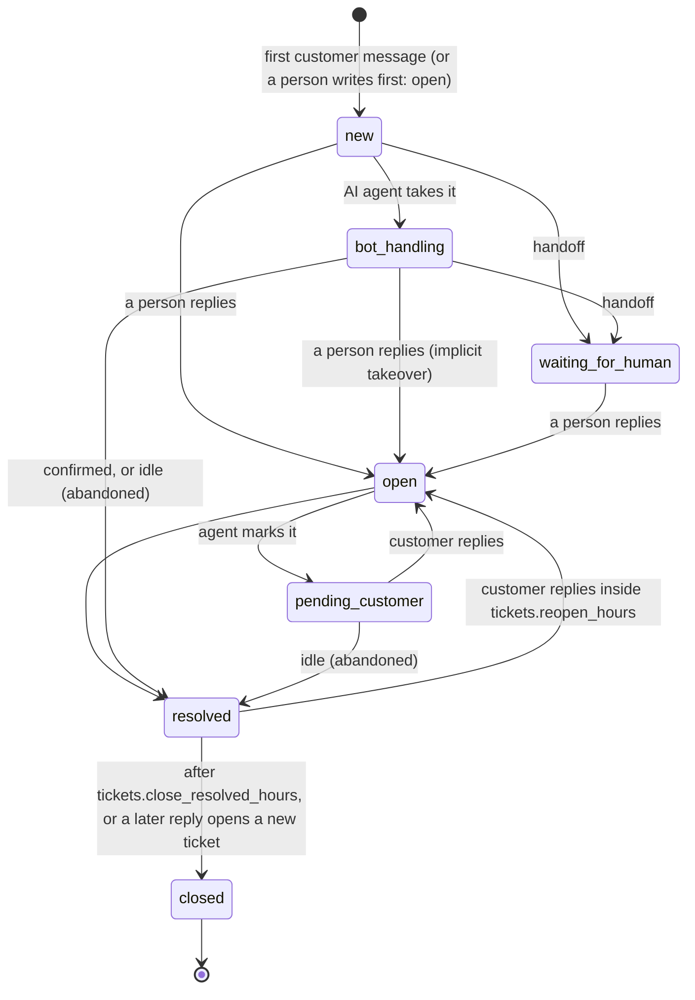

# AI support agents, tickets, departments, visitor details and calls

This document describes the support-automation layer that sits on top of the inbox: **tickets** (an episode of support inside a conversation), **AI agents** that answer first and hand over to people, **departments** and routing, **visitor details** collected in the widget, and **voice and video calls** between an agent and a visitor. It is written feature by feature as each one lands; the section "Status" at the end says what exists, what is only scaffolded and what was never run against a real service.

Vocabulary: a *room* (the UI says *conversation*) is the one thread per contact; a *ticket* is one issue inside it. See [GLOSSARY.md](GLOSSARY.md) and [ADR 0027](adr/0027-tickets-inside-rooms.md).

## 1. Tickets

### What a ticket is

A room stays one per contact (unchanged rule). A ticket opens with the first message of an issue and ends when it is resolved. Closing a ticket never closes the room; closing the room resolves its live ticket. At most one ticket per room is *live* (not `closed`), enforced by the partial unique index `ux_tickets_room_live`, so two simultaneous first messages converge on one ticket (tested on SQLite and PostgreSQL).

| Field | Meaning |
| --- | --- |
| `number` | human-friendly, per workspace, starts at 1, allocated by one `INSERT ... ON CONFLICT ... RETURNING` on `ticket_counters` (rolls back with the transaction, never repeats) |
| `subject` | the first line of the customer's first message until someone edits it (`subject_set_by` becomes `agent`) |
| `status` | `new`, `bot_handling`, `waiting_for_human`, `open`, `pending_customer`, `resolved`, `closed` |
| `handler` | `bot:<agent id>`, `human:<member id>` or null |
| `department_id` | the room's inbox when the ticket opened (departments: section 2 once built) |
| `priority` | 0 low, 1 normal, 2 high, 3 urgent (a priority conversation opens a high ticket; AI triage with urgency 0.8 or more raises it) |
| `resolution` | `bot_resolved`, `human_resolved`, `abandoned`, `auto_closed`, `merged` |
| timestamps | `opened_at`, `first_response_at` (anyone, bots included), `first_human_response_at`, `handoff_at`, `resolved_at`, `closed_at` |
| `csat`, `csat_comment` | the customer's rating of this ticket |
| `tags`, `summary`, `handoff_reason`, `merged_into_id`, `channel` | as named |

Every message carries `ticket_id` (`messages.ticket_id`). Messages written before the feature existed keep `NULL`, and so do lines written before a conversation's first issue (the "Conversation started" line, an away message). There is no backfill: a room opens its first ticket with its next message (verified by an upgrade test on a populated database, [TESTING.md](TESTING.md)).

### Lifecycle

* **Opens**: the first contact message when no ticket is live (any channel: chat, SMS, email); an agent's first message in a room with no live ticket opens a human ticket (`open`, counted as answered).
* **Answers**: a human reply moves `new`, `bot_handling` and `waiting_for_human` to `open` and makes that person the handler; replying to a bot ticket is an implicit takeover and is recorded as `taken_over`. Bot messages only record `first_response_at`. Notes and system lines attach to the live ticket but never open, answer or reopen one.
* **Resolves**: an agent (`POST /api/tickets/:id/resolve`), the room being closed by a person, or the idle sweep. The customer sees the closing message with a 1 to 5 rating card (`tickets.closing_message`, `tickets.csat_prompt`); the card is a visitor-visible system line (`meta.sub_type = "ticket_resolved"`, `meta.card = {type: "csat", ticket_id}`).
* **Reopens**: a customer message on a `resolved` ticket within `tickets.reopen_hours` (default 72) reopens the same ticket (same number); later it closes that ticket (keeping the resolution it earned) and opens a new one. A person replying to a resolved ticket reopens it too.
* **Closes**: `POST /api/tickets/:id/close`, or the sweep after `tickets.close_resolved_hours` (default 72). A ticket nobody answered closes as `auto_closed`, one only the bot answered as `abandoned`, otherwise it keeps its resolution.
* **Idle sweep** (scheduler, every minute, bounded to 200 per pass): `bot_handling` tickets quiet for `tickets.bot_idle_minutes` (default 30, 0 = off, minimum 5) and `pending_customer` tickets quiet for `tickets.pending_idle_hours` (default 72, 0 = off) are resolved as `abandoned` with the closing message. Tickets a person is handling (`open`) are never auto-resolved.
* **Merge** (`tickets:merge`): a duplicate is merged into another ticket **of the same conversation** (a conversation has one live ticket, so duplicates arise from the reopen window): its messages move over, it closes as `merged`, the earlier opening and first response survive. Merged tickets cannot be reopened or rated.

Rating: `POST /public/rooms/:id/ticket-csat` rates the latest ended ticket (or the one named) once; `GET /public/rooms` carries `ticket: {id, number, status, resolved, csat_pending}` for the widget. The visitor never sees handler, department or tags.

### API, permissions, realtime

Routes are under `/api/tickets` (list with filters and keyset paging, counts, detail with event timeline, edit, resolve, close, reopen, merge, bulk) plus `/api/rooms/:id/tickets` and `/api/contacts/:id/tickets` ([API.md](API.md), tag "Tickets"). A ticket follows the visibility of its conversation: an agent sees the tickets of the rooms they can see, anything else is `404` (and so is another workspace). Permissions: `tickets:read`, `tickets:write` (edit, reopen), `tickets:close` (resolve, close, bulk) and `tickets:merge`; the Agent role has the first three, the Viewer role `tickets:read`; custom roles that could read or reply keep that ability ([RBAC.md](RBAC.md)). The room list, `GET /api/rooms/:id` and every room event carry the live ticket (`room.ticket`), the room list filters on it (`ticket_status`, `ticket_handler`, `department_id`), and `ticket:updated` ([REALTIME.md](REALTIME.md)) tells the team the full ticket and the visitor the minimal one.

### In the app

Thread header: the ticket chip (`#12 Open`) is a menu (resolve, close, reopen, waiting for the customer, priority). Contact panel: a Tickets section with the history. **Tickets** page (`/tickets`, `tickets:read`): counts by status, filters (status, handler, department, number or subject; the URL keeps them), a table or cards on phones, multi-select and bulk resolve or close. Settings > Tickets: the numbers above, the closing message and the rating prompt.

### Data

Migration 027 (`tickets`, `ticket_events`, `ticket_counters`, `messages.ticket_id`) and 028 (permissions) are additive: no table is rebuilt and nothing touches the SQLite schema tables ([ADR 0023](adr/0023-sqlite-migrations-defensive-mode.md)). Retention (`retention_days`) and workspace erasure delete tickets and their events together with the messages; the archive keeps `ticket_id` on restored messages.

## Status

| Part | State |
| --- | --- |
| Tickets (this section) | built and tested on SQLite and PostgreSQL; widget rating card not yet rendered by the widget (it shows the closing line as text until the widget work lands) |
