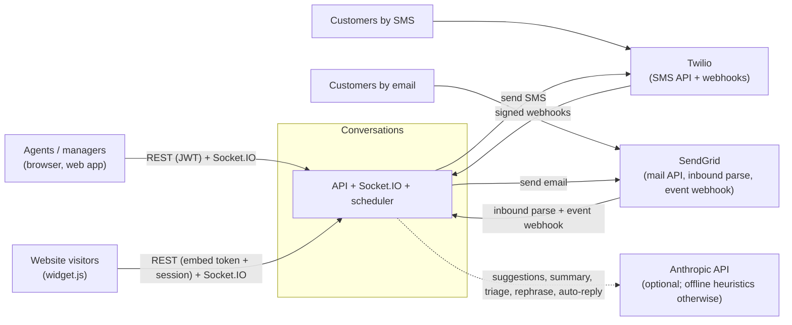
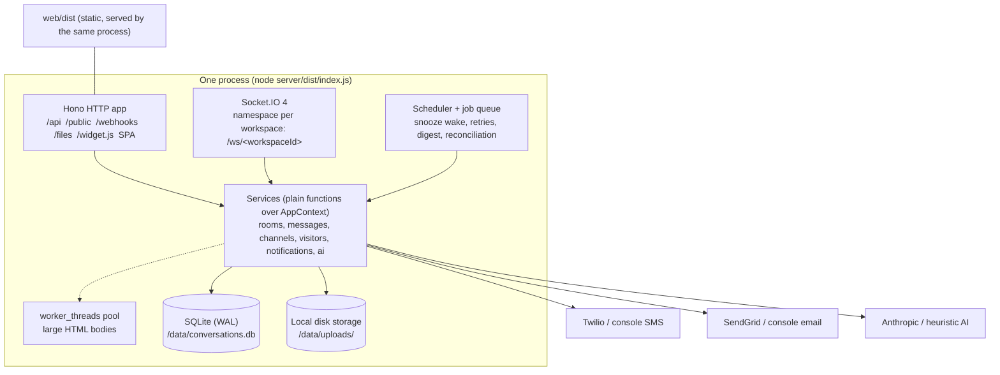
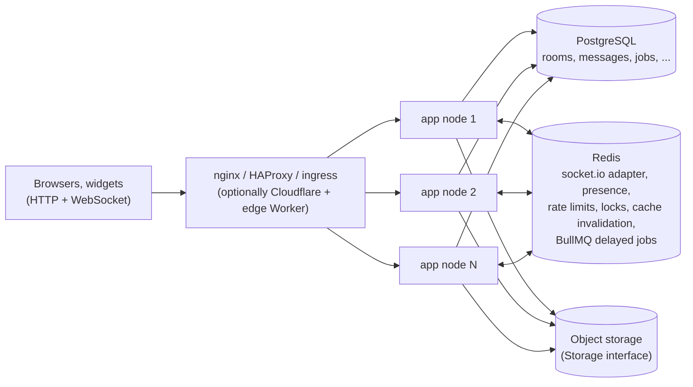
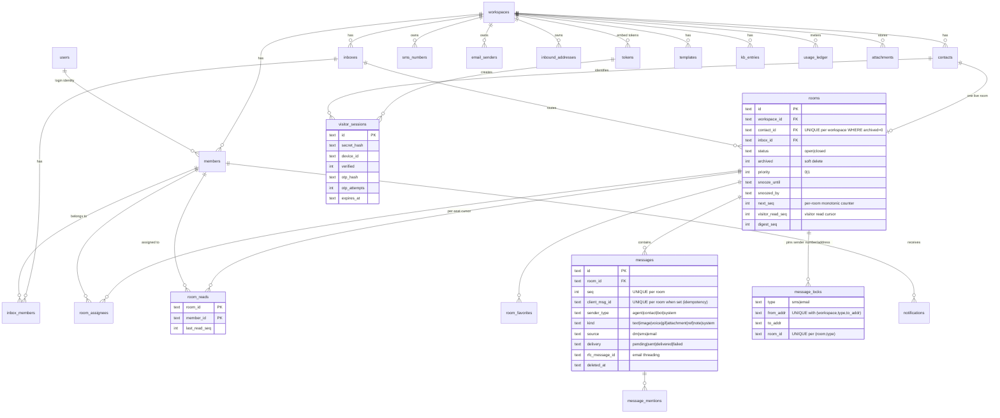
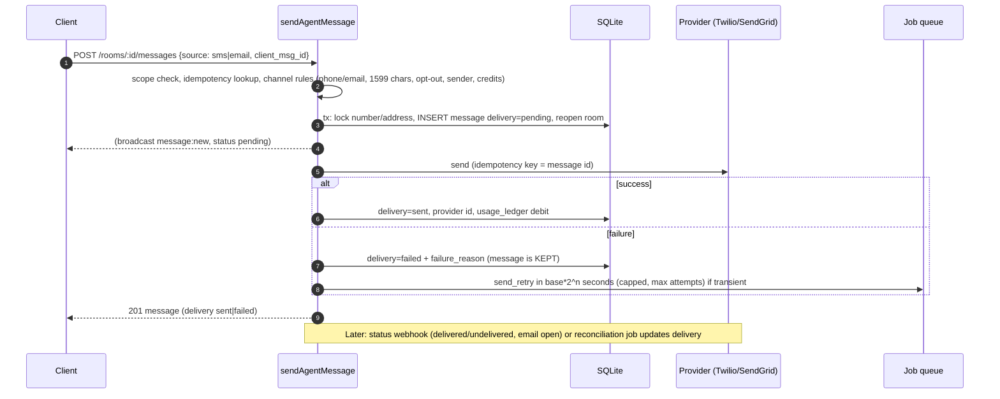
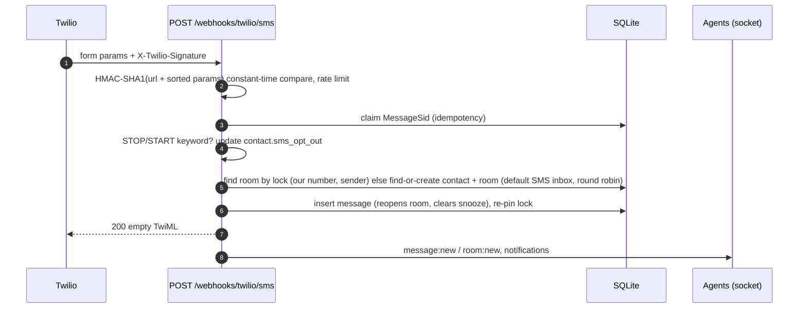
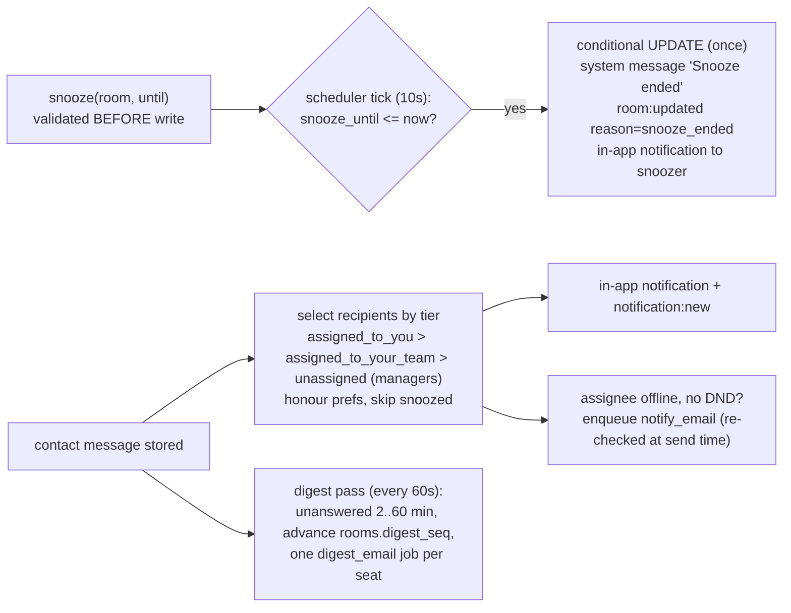

# Architecture

Conversations is a unified customer inbox: **live chat** (embeddable widget), **SMS** (Twilio) and **email** (SendGrid) land in one inbox that a team works together. It is a standalone product with its own auth, tenancy, contacts, jobs and AI; it knows nothing about any other application.

- Server: Node >= 22.13, TypeScript (strict), Hono + `@hono/node-server`, Socket.IO 4 on the **same HTTP server**, built-in `node:sqlite` (WAL, foreign keys), `zod`, `jose`.
- Web: React 19, Vite, react-router, TanStack Query, plain CSS.
- One process serves the REST API, the Socket.IO namespaces, the widget script, the built web app and the background scheduler.

## 1. System context



## 2. Containers and deployment

Two topologies, same code. `DATABASE_URL` and `REDIS_URL` are the only switches (both auto-detected):

**Single node** (default; no external services): SQLite (WAL) file, in-process socket adapter, presence, limiter and cache, DB-backed job queue.



**Scaled out** (`docker-compose.yml`, `deploy/k8s`): N identical stateless app nodes behind a load balancer, PostgreSQL as the system of record and Redis for everything that must be shared between nodes.



What Redis carries, and what happens without it:

| Concern | With `REDIS_URL` | Without (one node) |
| --- | --- | --- |
| Socket fan-out between nodes | `@socket.io/redis-adapter` (sharded pub/sub not required) | in-process |
| Presence (online/offline, multi-tab refcount) | ZSET per seat with per-socket TTL heartbeat; exactly-once "came online" announcement via `HSETNX` | in-memory refcount |
| Rate limits | Lua token bucket using Redis `TIME`, so every node agrees | in-memory bucket |
| Cache (settings, member rows, counts, workspace existence) | TTL cache plus pub/sub invalidation so a write on node A is visible on node B immediately | in-memory TTL |
| Delayed jobs (snooze wake, SMS reconcile, retries) | BullMQ delayed jobs; periodic sweep under a distributed lock as the safety net | `jobs` table polled by the scheduler |
| Locks | `SET NX PX` with token | in-process mutex |

A Redis outage degrades rather than stops the app: limiters fail open (and log), cached values simply expire after `CACHE_TTL_MS` (default 3 s) instead of being invalidated instantly, and sockets keep working on their own node. Cross-node fan-out and cross-node presence pause until Redis returns. (Limiters failing open and the cache TTL bound are tested; a full mid-run Redis kill is not part of the automated suite.)

Development runs the same thing with `npm run dev` (API on :3000, Vite on :5173 proxying `/api`, `/public`, `/files`, `/socket.io`). The `Dockerfile` builds one image used for both topologies.

### Code layout (`server/src`)

| Path | Responsibility |
| --- | --- |
| `config.ts`, `logger.ts`, `errors.ts` | zod-validated env, JSON logs, `AppError` (`{error:{code,message}}`) |
| `db/` | async `Db` interface with `SqliteDb` and `PgDb`; `tx` is async-context aware (AsyncLocalStorage); one migration set applied at boot under an advisory lock (`db/migrations/*.sql`) |
| `context.ts`, `app-context.ts` | `AppContext` (db, clock, bus, presence, limiters, cache, locks, queue, metrics, workers, providers, storage, ai) and its wiring; tests inject fakes here |
| `infra/` | Redis hub, presence, limiter, cache, locks: each with an in-memory and a Redis implementation behind one interface |
| `workers/` | `worker_threads` pool (HTML sanitising of large bodies); see `docs/PERFORMANCE.md` for when it pays off |
| `metrics.ts`, `telemetry.ts` | Prometheus `/metrics`; optional OpenTelemetry (loaded only if installed and configured) |
| `services/*` | all business rules; every query is workspace-scoped; `roomStore.roomVisibility` is the single definition of scope |
| `channels/rules.ts` | SMS/email rules: keyword classification, number choice and locking, subject derivation, threading |
| `providers/` | `SmsProvider`/`EmailProvider`/`Storage` interfaces, Fake/Console providers, Twilio/SendGrid `fetch` adapters, `LocalDiskStorage` |
| `realtime/` | `RealtimeBus` interface, `SocketBus` (Socket.IO: admission control, limits, backpressure, drain, event coalescing) |
| `webhooks/signatures.ts` | Twilio HMAC-SHA1, SendGrid ECDSA / shared secret, replay + idempotency table |
| `jobs/` | `JobQueue` (`DbJobQueue` / `BullJobQueue`) with backoff, scheduler passes |
| `ai/` | `AiProvider`, Anthropic + heuristic providers, BM25 retrieval, prompt safety, features |
| `routes/` | thin Hono routers: validate, call a service, serialise |
| `server/public/widget.js` | the embeddable widget (framework-free, Shadow DOM) |

Services never touch Socket.IO directly: they call the `RealtimeBus` interface. Tests plug in a `RecordingBus`; the server plugs in `SocketBus`.

## 3. Data model

All business rows carry `workspace_id`; timestamps are ISO-8601 UTC strings (lexicographically sortable). Unread counts are never stored.



Notable constraints (all enforced by the database, not just by code):

| Constraint | Purpose |
| --- | --- |
| `ux_rooms_contact` (partial, `archived = 0`) | exactly one live room per contact, even under races; archiving frees the slot |
| `ux_messages_qid` (`room_id, client_msg_id`) | server-side idempotency for retried sends |
| `ux_messages_room_seq` (`room_id, seq`) | monotonic per-room ordering independent of timestamps |
| `ux_locks_pair`, `ux_locks_room` | a sender number/address is pinned to one conversation per recipient; also the inbound routing key |
| `ux_contacts_email/phone` (partial, not deleted) | contact dedupe per workspace |
| `ux_tokens_domain` (partial, active) | one active embed token per domain per workspace |
| `webhook_events (provider, event_key)` | provider-message-id idempotency and signature replay protection |
| `notifications (member, message, type)` unique | one notification per seat per message |

## 4. Access model

Roles: `owner | manager | agent`. A **seat** is a workspace member (`members.id`); it has a `live_seat` flag (needed for inbox features), availability `active|away|inactive`, `dnd_until`, notification preferences and `inbox_visibility`.

| Capability | owner | manager | agent |
| --- | --- | --- | --- |
| See rooms | all | all | rooms assigned to them, plus rooms in inboxes they belong to when `inbox_visibility = assigned_inbox` |
| Manage inboxes, tokens, numbers, senders, KB, widget settings | yes | yes | no |
| Reassign any room / change a room's inbox | yes | yes | no (may assign themselves or unassign themselves) |
| Create managers / change roles | yes | no (can add agents) | no |
| Delete (archive) conversations | yes | yes | no |
| Delete messages | any | any | own |

Rooms outside a seat's scope return **404, not 403**, on every REST route and socket event (existence is not leaked). Cross-tenant access is also 404. Unassigned rooms that have no inbox are visible to owners/managers only.

## 5. Key flows

### 5.1 Visitor chat round trip (socket) with receipts

```mermaid
sequenceDiagram
  autonumber
  participant V as Visitor widget
  participant S as Socket.IO /ws/<ws>
  participant M as Message service
  participant DB as SQLite
  participant A as Agent web app
  V->>S: message:send {room_id, content, client_msg_id}
  S->>S: rate limit, re-validate session (expiry, workspace)
  S->>M: visitorSend
  M->>DB: tx: seq++ , INSERT message (unique room+client_msg_id), reopen/unsnooze
  M-->>V: ack {ok, message}
  M->>A: message:new {message, room patch}   (room:<id> channel)
  M->>M: background: notifications, triage, auto-responder, away message
  A->>S: message:send {room_id, content, client_msg_id}
  S->>M: sendAgentMessage (scope re-checked from DB)
  M->>DB: tx insert, auto-assign if unassigned
  M->>V: message:new {message}   (vroom:<id> channel; notes never go here)
  V->>S: message:read {room_id, message_id}
  S->>DB: UPDATE rooms SET visitor_read_seq = max(...)
  S->>A: message:receipt {reader: contact}
```

### 5.2 Outbound SMS/email send (transactional, failure-tolerant)



### 5.3 Inbound SMS webhook



### 5.4 Widget session and OTP

```mermaid
sequenceDiagram
  autonumber
  participant W as widget.js
  participant API as /public
  participant DB as SQLite
  W->>API: GET /widget/config (x-api-key, Origin)
  API->>API: token lookup + Origin vs token domain (exact / *.wildcard / port rules)
  W->>API: POST /sessions {name,email,phone} (x-device-id)
  API->>DB: find-or-create contact, expire previous session for contact+device, create session (30d)
  API-->>W: session_token, requires_verification
  alt contact already has a conversation from another device
    W->>API: POST /otp/send  (email, else SMS)
    API->>DB: store HMAC(code), expires +120s, attempts 0, cooldown 30s
    W->>API: POST /otp/verify {code}
    API->>DB: constant-time compare, max 5 attempts, single use, verified=1
    API-->>W: rooms of the whole contact become visible
  end
  W->>API: Socket.IO /ws/<workspaceId> with {session, deviceId}
  API->>API: session must belong to THIS workspace; device-or-IP check; Origin vs token
```

### 5.5 Snooze, notifications and digest



## 6. Realtime protocol (Socket.IO 4)

**Namespace**: one per workspace, `/ws/<workspaceId>` where the id must match `^ws_[0-9a-f]{24}$` (a dynamic namespace regexp; anything else is refused before auth). The workspace must exist.

**Handshake auth** (`auth` object of `io(...)`):

| Client | `auth` | Verified against the namespace's workspace |
| --- | --- | --- |
| Team | `{ token: <access JWT> }` | JWT `wid` must equal the namespace workspace and the seat must still exist (role is re-read from the DB) |
| Visitor | `{ session: <session token>, deviceId }` | session row must belong to the namespace workspace, not expired, same device **or** same IP; the browser `Origin` must match the embed token's domain; the token must still be active |

Failures are `connect_error` with `err.data.code` (`UNAUTHORIZED`, `INVALID_TOKEN`, `WRONG_WORKSPACE`, `UNKNOWN_WORKSPACE`, `INVALID_SESSION`, `SESSION_EXPIRED`, `SESSION_DEVICE_MISMATCH`, `ORIGIN_NOT_ALLOWED`).

**Channels** inside a namespace (server-side only; clients never join anything): `room:<id>` (team seats that may see the room), `vroom:<id>` (visitor sockets allowed in that room), `member:<id>` (all tabs of one seat), `inbox:<id>`, `managers`, `team`. Membership is recomputed when scope changes (assignment, inbox membership, role change, OTP verification, removal) and sockets are disconnected when a seat is removed.

### Server to client

| Event | Audience | Payload |
| --- | --- | --- |
| `message:new` | room team; visitors of the room (never for notes) | `{ message, room: { id, status, priority, snooze_until, last_message_at, last_contact_message_at, updated_at, last_message } }` (visitor payload: stripped message DTO, `room: {id,status}`) |
| `message:updated` | same | `{ message, room }` (delivery change, email open, edit, triage meta) |
| `message:deleted` | same | `{ message_id, room_id }` |
| `message:receipt` | room team (+ visitors for agent reads) | `{ room_id, reader: {type: agent\|contact, id?}, up_to_seq, up_to_message_id, at, channel? }` |
| `room:new` | seats that can see the room (incl. newly assigned) | `{ room }` |
| `room:updated` | room team; visitors get `{room:{id,status}}` | `{ room, reason? }` |
| `room:deleted` | seats that lost access / archived | `{ room_id }` |
| `room:unread` | the reading seat (all its tabs) | `{ room_id, unread_count }` |
| `inbox:new`, `inbox:updated` | team | inbox DTO (`{id, deleted:true}` on delete) |
| `presence:update` | team | `{ member_id, online, availability? }` (agents only) |
| `visitor:presence` | room team | `{ room_id, contact_id, online }` |
| `typing` | room team / visitors | `{ room_id, typing, who: {type, id?, name?} }` (volatile; `internal` typing never reaches visitors) |
| `notification:new` / `notification:read` | one seat | `{ notification, unread_count }` / `{ id?, all?, unread_count }` |
| `member:updated`, `member:removed`, `contact:updated` | team | DTOs |
| `session:verified` | visitor | `{ verified }` after OTP |

### Client to server (all take an ack `{ ok: true, ... } | { ok: false, error: { code, message } }`)

| Event | Who | Payload | Ack |
| --- | --- | --- | --- |
| `message:send` | team, visitor | team: `{ room_id, kind, source, content, format?, subject?, from?, ref_message_id?, attachment_ids?, client_msg_id }`; visitor: `{ room_id, kind:"text", source:"dm", content, client_msg_id }` | `{ ok, message, created }` (`created:false` = idempotent replay) |
| `message:read` | both | `{ room_id, message_id }` | `{ ok, moved, ... }` (+ `last_read_seq`, `unread_count` for seats) |
| `room:create` | both | team: `{ contact_id \| contact, inbox_id?, subject? }`; visitor: `{ inbox_id? }` | `{ ok, room, created }` |
| `room:update` | team | `{ room_id, status?, priority?, subject?, snooze_until? (ISO or null) }` | `{ ok, room }` |
| `room:assign` | team | `{ room_id, member_ids?, inbox_id?, auto? }` | `{ ok, room }` |
| `typing` | both | `{ room_id, typing, internal? }` | `{ ok }` |
| `otp:verify` | visitor | `{ code }` (5 digits) | `{ ok, verified }` |
| `presence:list` | team | none | `{ ok, online: [memberId] }` |

**Per-event guarantees** (`realtime/socket.ts`): every event passes (1) a per-socket token bucket (`SOCKET_RATE_PER_SEC`/`SOCKET_RATE_BURST`, over limit -> `RATE_LIMITED` ack), (2) audience check (team-only / visitor-only events), (3) a fresh DB read of the seat (removed seats are disconnected; token expiry disconnects), (4) zod validation (`VALIDATION_ERROR`), then the same service functions REST uses, which re-check room scope (`NOT_FOUND` outside scope). Events without an ack callback are tolerated.

**Presence** is refcounted per seat across tabs/devices (`realtime/presence.ts`): a seat is online while it has at least one socket; after the last socket closes it stays online for `PRESENCE_GRACE_MS` (default 5 s) so reloads do not flap, then `presence:update {online:false}` is emitted. Visitor presence is tracked the same way per contact.

**Adapter point**: the default is Socket.IO's in-memory adapter. With `SOCKET_ADAPTER=redis` and `REDIS_URL` the server dynamically imports the optional packages `@socket.io/redis-adapter` and `redis` (declared as `optionalDependencies`, not needed to run) and switches `io.adapter(createAdapter(pub, sub))`. Access-refresh requests are fanned out to peers with `serverSideEmit("access:refresh")`. Presence is per node today (see limitations).

## 7. REST API (all errors are `{ "error": { "code", "message", "details?" } }`)

Auth: `Authorization: Bearer <JWT>` on `/api/*`; lists return `{ data, pagination }` (max 100 per page; messages use `before`/`after` cursors, max 50).

| Area | Endpoints |
| --- | --- |
| Auth | `POST /api/auth/register`, `POST /api/auth/login`, `GET /api/auth/me` |
| Workspace | `GET/PATCH /api/workspace` (settings: widget, office hours, region, edit window, AI flags), `GET /api/credits`, `POST /api/credits/grant`, `GET /api/dashboard/counts` |
| Seats | `GET/POST /api/members`, `PATCH/DELETE /api/members/:id`, `GET/PATCH /api/members/me` (availability, DND, notification prefs), `GET /api/presence` |
| Contacts | `GET/POST /api/contacts`, `GET/PATCH/DELETE /api/contacts/:id`, notes `/api/contacts/:id/notes`, `GET /api/contacts/:id/rooms`, `POST /api/contacts/import` (CSV) |
| Inboxes | `GET/POST /api/inboxes`, `GET /api/inboxes/counts`, `GET/PATCH/DELETE /api/inboxes/:id`, `POST/DELETE /api/inboxes/:id/members/:memberId` |
| Rooms | `GET/POST /api/rooms` (filters: `status`, `filter`, `inbox_id`, `contact_id`, `search`, `sort`, `page`, `limit`), `GET/PATCH/DELETE /api/rooms/:id`, `POST /api/rooms/:id/assign`, `POST/DELETE /api/rooms/:id/snooze`, `PUT/DELETE /api/rooms/:id/favorite`, `POST /api/rooms/:id/read`, `POST /api/rooms/bulk` |
| Messages | `GET/POST /api/rooms/:id/messages`, `GET /api/messages/search?q=`, `PATCH/DELETE /api/messages/:id`, `POST /api/messages/:id/retry`, `POST /api/attachments` (multipart), `GET /files/<key>?exp&sig` (signed) |
| Channels & admin | `/api/sms-numbers`, `/api/email-senders`, `/api/inbound-addresses`, `/api/tokens` (+`/:id/rotate`), `/api/templates` (+`/:id/render`), `/api/kb` |
| Notifications | `GET /api/notifications`, `POST /api/notifications/read-all`, `POST /api/notifications/:id/read` |
| AI | `GET /api/ai/status`, `POST /api/ai/suggest-replies`, `/api/ai/summary`, `/api/ai/rephrase` (503 `AI_UNAVAILABLE` when the provider fails) |
| Widget (public) | `GET /public/widget/config`, `POST /public/sessions`, `GET /public/session`, `GET/POST /public/rooms`, `GET/POST /public/rooms/:id/messages`, `POST /public/rooms/:id/read`, `POST /public/otp/send`, `POST /public/otp/verify`; assets `GET /widget.js`, `GET /widget-demo.html` |
| Webhooks | `POST /webhooks/twilio/sms`, `/webhooks/twilio/status`, `/webhooks/sendgrid/inbound`, `/webhooks/sendgrid/events` |
| Ops | `GET /healthz`, `GET /readyz` |

## 8. Background work

Work is a set of idempotent jobs plus a periodic sweep. On one node the scheduler polls the `jobs` table; with Redis, BullMQ delayed jobs fire at the right moment and the sweep is the safety net. Either way the **sweep runs under a distributed lock**, so every node can run the scheduler (`SCHEDULER_ENABLED` stays true everywhere) and exactly one does each pass. Every pass is also callable directly by tests with an injected clock.

| Pass | Trigger | What |
| --- | --- | --- |
| snooze wake | delayed job `wake_room` at `snooze_until` (+ 10 s sweep) | `wakeRoom`: conditional `UPDATE ... WHERE snooze_until = <seen>` so each room wakes exactly once, system message, event, in-app notification |
| job queue | immediate or delayed | `send_retry`, `notify_email`, `digest_email`, `reconcile_sms`; claim is atomic (conditional update or BullMQ); failure -> exponential backoff (2^n s, max 15 min) up to `max_attempts` then `failed` |
| digest | 60 s sweep | `collectDigests` (see 5.5); candidates come from the `digest_due` outbox flag set when a message is stored, not from scanning all rooms |
| delivery reconciliation | delayed job 2 min after send (+ 60 s sweep) | asks the SMS provider for the state of messages still `sent` (replaces legacy 5 s polling) |

Message send retries use their own backoff (`SEND_RETRY_BASE_SECONDS * 2^(n-1)`, capped at `SEND_RETRY_CAP_SECONDS`, `SEND_RETRY_MAX_ATTEMPTS` total attempts); permanent provider errors (4xx) are not retried automatically but can be retried by hand (`POST /api/messages/:id/retry`).

## 9. Scaling, limits and plug-in points

Capacity numbers, the sizing model and what to change when you outgrow a topology live in [SCALING.md](SCALING.md); measurements and how they were taken in [PERFORMANCE.md](PERFORMANCE.md). The design rules that make scale-out safe:

- **The database is the arbiter.** Nothing relies on in-process state for correctness: per-room `seq` comes from an `UPDATE ... RETURNING`, idempotency from a unique `(room_id, client_msg_id)` index, round robin from a row lock (`FOR NO KEY UPDATE` on PostgreSQL), one-room-per-contact from a unique index. Concurrent requests on different nodes are therefore as safe as concurrent requests on one (`tests/concurrency.test.ts`, run on SQLite and PostgreSQL; `loadtest` idempotency scenario across nodes).
- **Nodes are stateless.** Anything a second node needs to see goes through Postgres or Redis. The only per-node state is the sockets themselves and caches that are invalidated over pub/sub.
- **WebSocket hardening** (`realtime/socket.ts`, config `WS_*`): admission control before any DB work (draining, global cap, per-IP cap, per-IP connect rate), 256 KiB inbound frame limit, per-socket and per-actor event rate limits, slow-consumer detection (a socket whose outbound queue exceeds `WS_MAX_WRITE_BUFFER` packets is dropped and re-syncs over REST), token-expiry notice (`auth:expired`) for team sockets, and graceful drain on SIGTERM (`server:draining` with a random reconnect delay, readiness flips to 503 first). Clients (web app and widget) reconnect with exponential backoff and 80% jitter.
- **Event coalescing**: bursty idempotent events (presence flips, read receipts) are collected for a short window and only the newest state per key is sent. Message events are never coalesced.
- **Pagination** is keyset everywhere a list can be large (rooms, contacts, notifications, messages); the web inbox virtualises its list above 100 rows.
- **Storage**: implement `Storage` (`put/read/remove/signedUrl`) for S3 (presigned GET) and select it in `createContext`; `LocalDiskStorage` is per node, so multi-node deployments need an object store or a shared volume (see Limits).
- **Providers**: `SmsProvider`/`EmailProvider` are tiny interfaces; real adapters are selected only by env (`SMS_PROVIDER=twilio`, `EMAIL_PROVIDER=sendgrid`).
- **AI**: `AiProvider.complete(request)`; Anthropic when `ANTHROPIC_API_KEY` is set, otherwise the deterministic heuristic provider.

### Limits (known, measured where possible)

- A team socket joins one channel per visible room, so memory and connect time grow with *rooms x team sockets*. Fine for dozens of agents and tens of thousands of rooms; see SCALING.md for the measured cost and the mitigation if you outgrow it.
- `LocalDiskStorage` is not shared between nodes. Use an object-store `Storage` or a shared volume when running more than one node.
- SQLite remains single-node by design. The topology that scales is PostgreSQL + Redis.

## 10. Security summary

zod on every input; body size limits; `secureHeaders`; CORS allow-list for the team API; token-bucket limits on login, public widget, webhook, send, upload and AI endpoints; scrypt password hashes; JWT HS256 with role re-read from the DB; widget embed tokens are public identifiers protected by an Origin allow-list (exact, `*.wildcard`, port-aware, `null`/missing origins refused); visitor sessions stored hashed, bound to a workspace, device-or-IP checked, 30-day expiry; OTP stored as HMAC, constant-time compare, 5 attempts, 120 s expiry, 30 s resend cooldown, single use; webhooks verified by Twilio HMAC-SHA1 or SendGrid ECDSA / shared secret with timestamp tolerance, replay detection and idempotency; HTML allow-list sanitiser for dm/email content, plain text for SMS; uploads validated by magic bytes + extension + size, stored under server-generated keys, served through expiring HMAC-signed URLs with `nosniff` and a sandbox CSP; AI input is delimited as untrusted data, redacted on request and its output validated.
