# Architecture

Conversations is a unified customer inbox: **live chat** (embeddable widget), **SMS** (Twilio) and **email** (SendGrid) land in one inbox that a team works together. It is a standalone product with its own auth, tenancy, contacts, jobs and AI; it knows nothing about any other application.

- Server: Node >= 22.13, TypeScript (strict), Hono + `@hono/node-server`, Socket.IO 4 on the **same HTTP server**, built-in `node:sqlite` (WAL, foreign keys), `zod`, `jose`.
- Web: React 19, Vite, react-router, TanStack Query, plain CSS.
- One process serves the REST API, the Socket.IO namespaces, the widget script, the built web app and the background scheduler.

## 1. System context

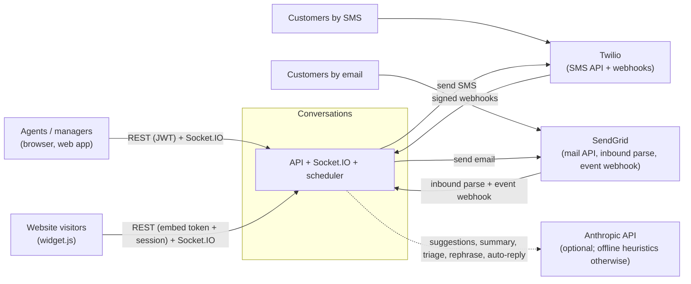

## 2. Containers and deployment

Two topologies, same code. `DATABASE_URL` and `REDIS_URL` are the only switches (both auto-detected):

**Single node** (default; no external services): SQLite (WAL) file, in-process socket adapter, presence, limiter and cache, DB-backed job queue.

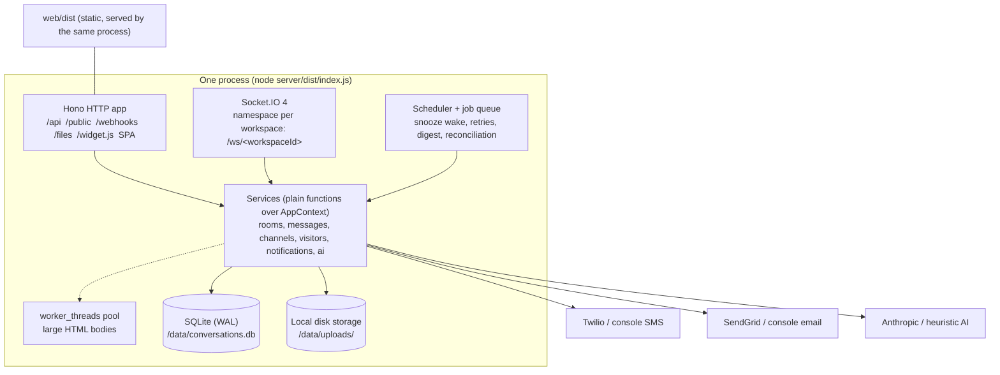

**Scaled out** (`docker-compose.yml`, `deploy/k8s`): N identical stateless app nodes behind a load balancer, PostgreSQL as the system of record and Redis for everything that must be shared between nodes.

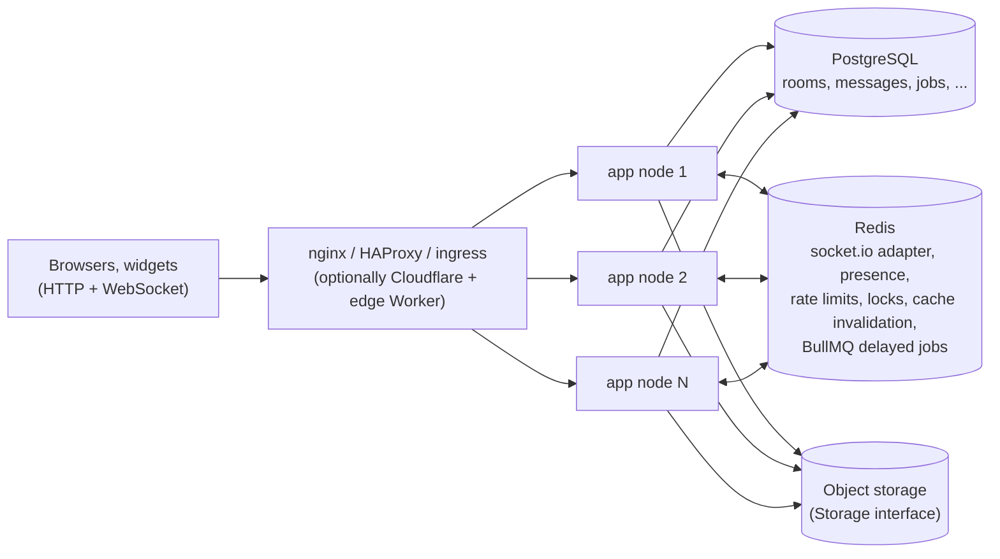

What Redis carries, and what happens without it:

| Concern | With `REDIS_URL` | Without (one node) |
| --- | --- | --- |
| Socket fan-out between nodes | `@socket.io/redis-adapter` (sharded pub/sub not required) | in-process |
| Presence (online/offline, multi-tab refcount) | ZSET per seat with per-socket TTL heartbeat; exactly-once "came online" announcement via `HSETNX` | in-memory refcount |
| Rate limits | Lua token bucket using Redis `TIME`, so every node agrees | in-memory bucket |
| Cache (settings, member rows, counts, workspace existence) | TTL cache plus pub/sub invalidation so a write on node A is visible on node B immediately | in-memory TTL |
| Delayed jobs (snooze wake, SMS reconcile, retries) | BullMQ delayed jobs; periodic sweep under a distributed lock as the safety net | `jobs` table polled by the scheduler |
| Locks | `SET NX PX` with token | in-process mutex |

A Redis outage degrades rather than stops the app: limiters fail open (and log), cached values simply expire after `CACHE_TTL_MS` (default 3 s) instead of being invalidated instantly, and sockets keep working on their own node. Cross-node fan-out and cross-node presence pause until Redis returns. (Limiters failing open and the cache TTL bound are tested; a full mid-run Redis kill is not part of the automated suite.)

Development runs the same thing with `npm run dev` (API on :3000, Vite on :5173 proxying `/api`, `/public`, `/files`, `/socket.io`). The `Dockerfile` builds one image used for both topologies.

### Code layout (`server/src`)

| Path | Responsibility |
| --- | --- |
| `config.ts`, `logger.ts`, `errors.ts` | zod-validated env, JSON logs, `AppError` (`{error:{code,message}}`) |
| `db/` | async `Db` interface with `SqliteDb` and `PgDb`; `tx` is async-context aware (AsyncLocalStorage); one migration set applied at boot under an advisory lock (`db/migrations/*.sql`) |
| `context.ts`, `app-context.ts` | `AppContext` (db, clock, bus, presence, limiters, cache, locks, queue, metrics, workers, providers, storage, ai) and its wiring; tests inject fakes here |
| `infra/` | Redis hub, presence, limiter, cache, locks: each with an in-memory and a Redis implementation behind one interface |
| `workers/` | `worker_threads` pool (HTML sanitising of large bodies); see `docs/PERFORMANCE.md` for when it pays off |
| `metrics.ts`, `telemetry.ts` | Prometheus `/metrics`; optional OpenTelemetry (loaded only if installed and configured) |
| `services/*` | all business rules; every query is workspace-scoped; `roomStore.roomVisibility` is the single definition of scope |
| `channels/rules.ts` | SMS/email rules: keyword classification, number choice and locking, subject derivation, threading |
| `providers/` | `SmsProvider`/`EmailProvider`/`Storage` interfaces, Fake/Console providers (`simulated` = test mode), Twilio/SendGrid `fetch` adapters with timeouts and normalised errors, `ProviderRegistry` (per-workspace credentials, else the platform default; [CHANNELS.md](CHANNELS.md)), `LocalDiskStorage` |
| `realtime/` | `RealtimeBus` interface, `SocketBus` (Socket.IO: admission control, limits, backpressure, drain, event coalescing) |
| `services/tickets.ts`, `routes/tickets.ts` | tickets: the state machine run by `insertMessage`, resolve/close/reopen/merge, listing and counts, the idle sweep, rating ([AI-AGENTS.md](AI-AGENTS.md), [ADR 0027](adr/0027-tickets-inside-rooms.md)); web: `pages/TicketsPage.tsx`, `components/tickets/`, `api/ticketHooks.ts` |
| `services/departments.ts`, `services/routing.ts`, `services/routingRules.ts`, `routes/departments.ts` | departments (hours, availability, status, configuration), the handoff engine (`routeTicket`, handoff, transfer, claim, queue drain, seat changes, SLA sweep) and routing rules ([DEPARTMENTS.md](DEPARTMENTS.md), [ADR 0028](adr/0028-departments-are-inboxes.md)); web: `pages/settings/DepartmentSettings.tsx`, `components/settings/HoursEditor.tsx` |
| `agents/*.ts`, `routes/agents.ts` | AI support agents: configuration (`config.ts`), the turn pipeline (`pipeline.ts`: `decideTurn` reads, `applyDecision` writes), classification, hand-off and injection rules, guards, tools, visitor quick replies and "talk to a person", take over and hand back, sandbox and review ([AI-AGENTS.md](AI-AGENTS.md), [ADR 0029](adr/0029-ai-agent-pipeline.md)); web: `pages/settings/AiAgentsSettings.tsx` |
| `calls/*.ts`, `routes/calls.ts` | voice and video calls: the pure state machine, the service (invite, accept, signalling relay, resume, sweeps, thread cards), TURN credentials ([CALLS.md](CALLS.md), [ADR 0031](adr/0031-calls-signalling-over-sockets.md)); phone calls (`phone.ts`), AI calls and the realtime engine (`aiCall.ts`, `realtime*.ts`), teammate calls (`teamCall.ts`), group calls (`groupCall.ts`, pure rules in `groupMachine.ts`, [ADR 0038](adr/0038-group-calls-mesh.md)), call links (`links.ts`); clients: `web/src/calls/*` (team, including `groupEngine.ts` and `GroupCallProvider.tsx`) and `server/public/chat/calls.js`, `aicall.js` (visitor) |
| `avatar/` | the optional photoreal avatar: `AvatarProvider` interface, the D-ID adapter (`did.ts`), a fake, and the service (encrypted per-workspace key, avatars, per-call sessions, budget and concurrency, sweep) ([ADR 0039](adr/0039-optional-photoreal-avatar.md)); web: `pages/settings/PhotorealAvatarSettings.tsx` |
| `push/` | Web Push for team members: RFC 8291 encryption and RFC 8292 VAPID on `node:crypto` and `jose` (`webpush.ts`), subscriptions, the `push_send` job and the hooks called by notifications and missed calls (`service.ts`) ([NOTIFICATIONS.md](NOTIFICATIONS.md)); clients: `web/public/sw.js`, `web/src/lib/push.ts`, `pages/settings/PushSettings.tsx` |
| `agents/channelReply.ts`, `agents/channelText.ts` | AI agents on SMS and email: when to answer (loop protection, opt-outs, quiet hours, daily cap) and how the answer is shaped for the channel; replies go through the normal delivery pipeline |
| `services/transcripts.ts` | copies of a conversation by email: recipient confirmation, contents as the visitor saw them, masking, limits, unsubscribe tokens ([TRANSCRIPTS.md](TRANSCRIPTS.md)) |
| `services/teamChat.ts`, `routes/teamChat.ts` | internal team chat: channels, direct and group messages, threads, reactions, pins, search, read cursors, notifications ([TEAM-CHAT.md](TEAM-CHAT.md), [ADR 0021](adr/0021-team-chat.md)); web: `web/src/team/`, `pages/TeamPage.tsx` |
| `webhooks/signatures.ts` | Twilio HMAC-SHA1, SendGrid ECDSA / shared secret, replay + idempotency table; per-workspace endpoints `/webhooks/c/:id/...` verify with the connection's own credentials |
| `jobs/` | `JobQueue` (`DbJobQueue` / `BullJobQueue`) with backoff, scheduler passes |
| `ai/` | `AiProvider`, Anthropic + heuristic providers, BM25 retrieval, prompt safety, features |
| `routes/` | thin Hono routers: validate, call a service, serialise |
| `authz/` | permission catalogue, immutable system roles, the route and socket-event access tables (deny by default) |
| `ratelimit/` | policy registry, GCRA/window/concurrency/strike algorithms, memory and Redis (Lua) stores, route and event declarations |
| `events/outbox.ts`, `infra/eventbus.ts` | transactional outbox, relay, idempotent consumers, `EventBus` with Redis Streams and Kafka/NATS stubs |
| `billing/` | `BillingProvider` (Stripe, fake, null), plans, credits and auto-recharge, webhooks, payment requests (Connect), soft lock |
| `admin/` | platform operator accounts (TOTP), workspace directory, suspension, credit adjustments, support access |
| `analytics/`, `services/analytics.ts`, `services/roomMetrics.ts` | JSON Schemas of the analytics API, per-room metrics maintained in the write path, exports |
| `apidoc/` | the documented route list, curated intro and generators' inputs |
| `server/public/widget.js` | the embeddable widget (framework-free, Shadow DOM) |

### Code layout (`web/src`)

The web app is a React 19 single-page app (Vite, React Router, TanStack Query) styled with Tailwind CSS v4 ([ADR 0017](adr/0017-tailwind-and-headless-primitives.md)); the design system is documented in [design/DESIGN.md](design/DESIGN.md) and the legacy ideas it adapted in [PROVENANCE.md](PROVENANCE.md).

| Path | Responsibility |
| --- | --- |
| `styles/index.css` | the only stylesheet: `@theme` tokens, semantic colours with `light-dark()`, base styles, reduced-motion rule |
| `ui/` | design-system components owned by the repo: Radix primitives wrapped with `class-variance-authority` and `tailwind-merge` (button, input, select, tabs, dialog, sheet, popover, tooltip, dropdown menu, command palette, toast, badge, avatar with presence dot, table, card, skeleton, empty state, switch, scroll area, accordion), `theme.ts` (light/dark/system, stored per browser) |
| `components/layout/`, `components/AppLayout.tsx` | the shell after sign-in: nav rail (md and up) or bottom navigation (below md), realtime connection banner, billing and support banners, shortcuts help, account menu |
| `components/palette/` | Cmd/Ctrl+K command palette: server-side conversation search, page jumps, actions registered by whichever screen is mounted |
| `components/inbox/`, `pages/InboxPage.tsx` | three columns (views sidebar, virtualised room list, thread) plus a collapsible contact panel; breakpoints decide inline column, drawer or separate screen |
| `components/chat/`, `components/composer/` | thread (grouping, day separators, ticks, failed + retry, notes, system lines, quotes, images with viewer, voice notes, payment card), header actions, composer (channel tabs, From/Subject, templates, emoji, mentions, rephrase, suggestions) |
| `pages/settings/`, `components/settings/` | settings shell (grouped navigation, list-then-detail on phones), pages, widget customiser with live preview |
| `pages/` (auth, analytics), `admin/`, `components/charts/` | sign-in and password flows, analytics dashboard with accessible SVG charts, the operator console (its own dark chrome) |
| `state/`, `api/`, `realtime/`, `workers/` | unchanged by the redesign: optimistic sends and cache patching from socket events, REST client with refresh rotation, Socket.IO provider, worker pool for search/diff/email splitting |

Responsive behaviour: from 1280 px the views sidebar and the contact panel are inline columns; between 768 and 1279 px they are drawers (the list and the thread stay side by side); below 768 px the list and the thread are separate screens selected by the URL, with bottom navigation on the list screen. Header toolbars use container queries, so they adapt to the width of the pane, not the window. Everything behind sign-in is a lazy chunk (initial JavaScript is about 157 KB gzip against a 170 KB budget, `npm run check:bundle`).

Services never touch Socket.IO directly: they call the `RealtimeBus` interface. Tests plug in a `RecordingBus`; the server plugs in `SocketBus`.

## 3. Data model

All business rows carry `workspace_id`; timestamps are ISO-8601 UTC strings (lexicographically sortable). Unread counts are never stored.

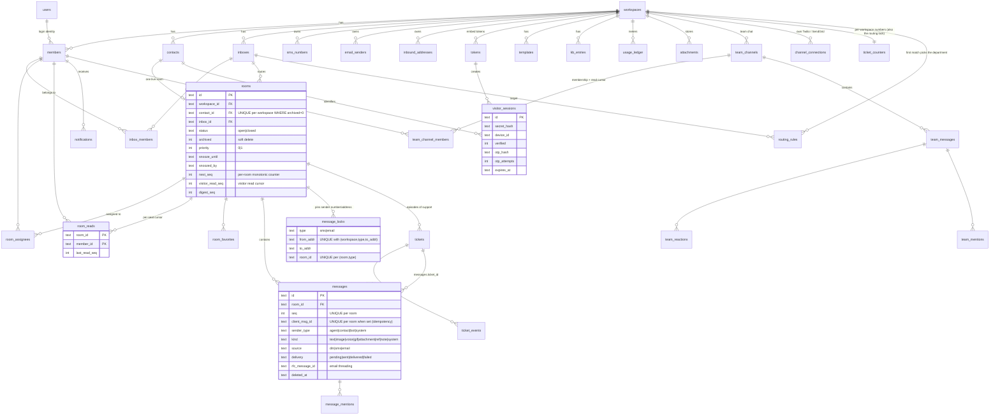

Notable constraints (all enforced by the database, not just by code):

| Constraint | Purpose |
| --- | --- |
| `ux_rooms_contact` (partial, `archived = 0`) | exactly one live room per contact, even under races; archiving frees the slot |
| `ux_messages_qid` (`room_id, client_msg_id`) | server-side idempotency for retried sends |
| `ux_messages_room_seq` (`room_id, seq`) | monotonic per-room ordering independent of timestamps |
| `ux_locks_pair`, `ux_locks_room` | a sender number/address is pinned to one conversation per recipient; also the inbound routing key |
| `ux_contacts_email/phone` (partial, not deleted) | contact dedupe per workspace |
| `ux_tokens_domain` (partial, active) | one active embed token per domain per workspace |
| `webhook_events (provider, event_key)` | provider-message-id idempotency and signature replay protection |
| `notifications (member, message, type)` unique | one notification per seat per message |
| `ux_tickets_room_live` (partial) | at most one live ticket per conversation |
| `group_calls (channel_id)` unique where live | one live group call per channel |
| `group_call_participants (member_id)` unique where joined | a member is in at most one group call at a time |
| `push_subscriptions (member_id, endpoint)` | a device is subscribed once per member |
| `avatar_sessions (call_id)` unique while starting or live | at most one photoreal stream per call |
| `transcript_sends (ticket_id)` unique for the automatic copy | the copy after resolution goes once per ticket |

The full table list with an ER diagram of every entity (including calls, team chat, tickets, AI agents, push and avatars) is in [FUNCTIONS.md](FUNCTIONS.md#data-model); the diagram above covers the core conversation model.

## 4. Access model

Access is **permission based**: 29 `resource:action` permissions, four immutable built-in roles (Owner, Manager, Agent, Viewer) and custom roles; the same `can()` check guards every REST route and socket event from one declaration table, deny by default. The full model (catalogue, roles, sessions, refresh-token rotation, MFA, invitations, audit) is [RBAC.md](RBAC.md).

A **seat** is a workspace member (`members.id`) with a role, a `live_seat` flag (needed for inbox features), availability `active|away|inactive`, `dnd_until`, notification preferences and `inbox_visibility`. Which *conversations* a seat sees is a separate, single definition (`roomStore.roomVisibility`): Owner, Manager and Viewer see every conversation of the workspace; an Agent sees the rooms assigned to them, plus rooms in inboxes they belong to when `inbox_visibility = assigned_inbox`.

Rooms outside a seat's scope return **404, not 403**, on every REST route and socket event (existence is not leaked). Cross-tenant access is also 404. Unassigned rooms that have no inbox are visible to managers and owners only. A workspace can be **suspended** by a platform operator ([ADMIN.md](ADMIN.md)): every entry point then answers `403 WORKSPACE_SUSPENDED`.

Money is a separate concern from access: plans, credits, the failed-payment grace period and the soft lock, and customer payment requests are in [STRIPE.md](STRIPE.md); the rate-limit tier of a workspace follows its plan ([RATE-LIMITING.md](RATE-LIMITING.md)).

## 5. Key flows

### 5.1 Visitor chat round trip (socket) with receipts

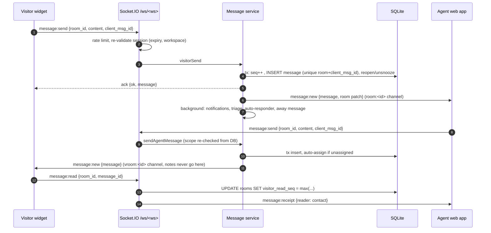

### 5.2 Outbound SMS/email send (transactional, failure-tolerant)

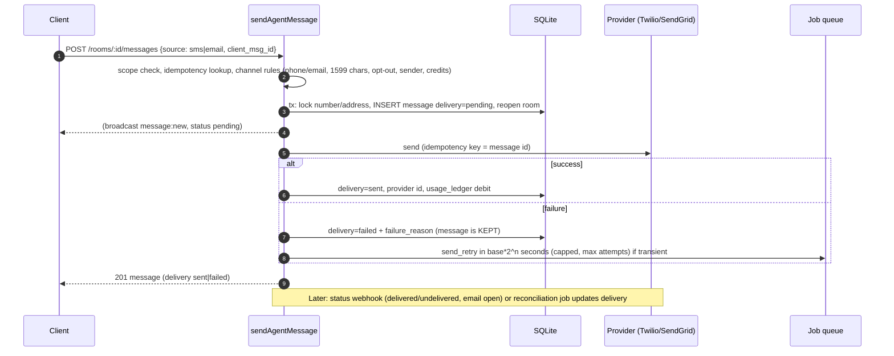

### 5.3 Inbound SMS webhook

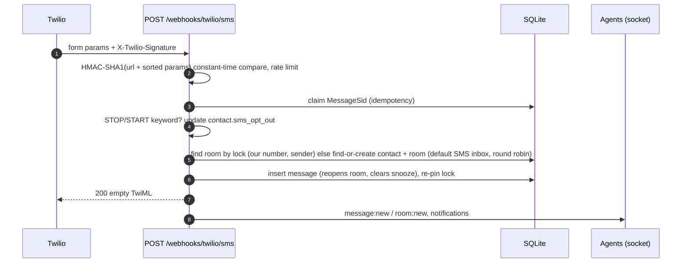

### 5.4 Widget session and OTP

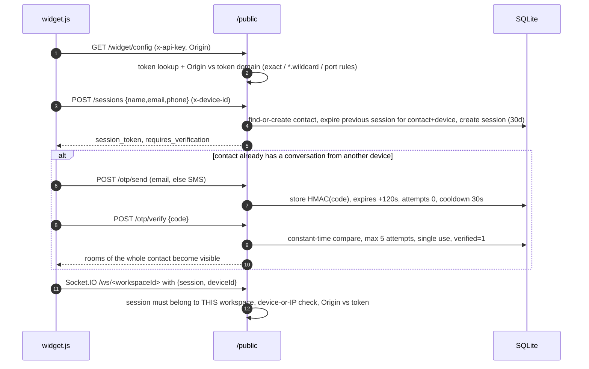

### 5.4b Hosted chat for mobile web views

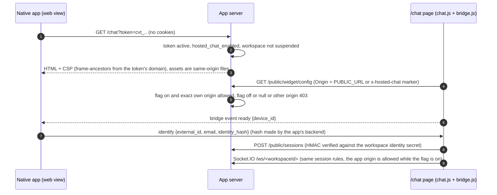

Details: [MOBILE-BRIDGE.md](MOBILE-BRIDGE.md), decisions [ADR 0024](adr/0024-hosted-chat-origin-model.md) to [0026](adr/0026-bridge-protocol-v1.md). Server pieces: `routes/chat.ts` (page and assets), `services/hostedChat.ts` (CSP, page templates), `services/identity.ts` (secret and verification), `services/visitors.ts` (origin rules, signed identity in `createSession`), `server/public/chat/` (the page: `chat.js`, `bridge.js`, `i18n.js`, `chat.css`, conformance page). Data: `tokens.hosted_chat_enabled`, `contacts.external_id`, table `workspace_identity` (migration 026).

### 5.5 Snooze, notifications and digest

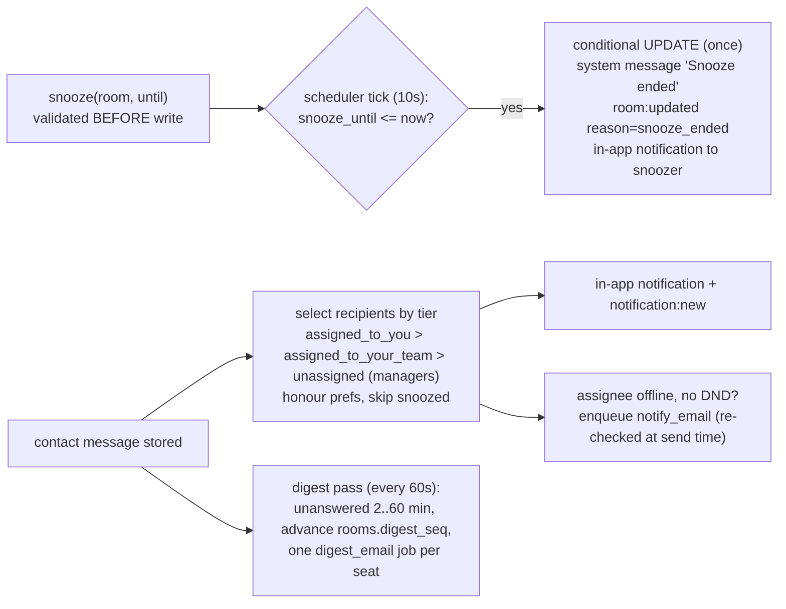

### 5.6 Team chat message

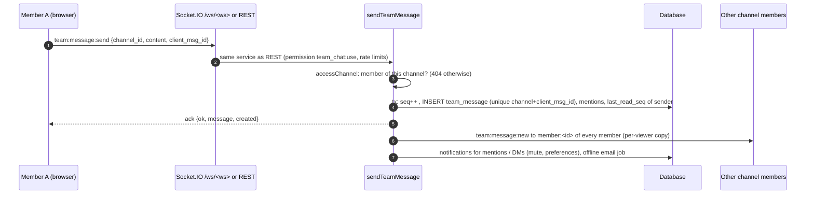

## 6. Realtime protocol (Socket.IO 4)

One namespace per workspace (`/ws/<workspaceId>`), team sockets authenticate with the access token and visitor sockets with their session secret. The complete protocol (handshake, who receives what, client-to-server events generated from the registry, server-to-client events) is [REALTIME.md](REALTIME.md). The design points that matter for the architecture:

- **Computed audiences.** Sockets join only a few per-workspace channels (`managers`, `inbox:<id>`, `member:<id>`, plus the room's visitor); the audience of an event is computed from visibility rules when it is published, so an agent does not hold one subscription per conversation ([ADR 0005](adr/0005-computed-room-audiences.md)). Membership is recomputed when scope changes (assignment, inbox membership, role change, removal).
- **Per-event guarantees** (`realtime/socket.ts`): every event passes a per-socket cost-weighted budget (strikes disconnect abusers), the same permission table as REST, a fresh read of the seat (removed seats and suspended workspaces are cut off on the next event), zod validation, and then the same service functions REST uses, which re-check room scope.
- **Correctness comes from REST, not from the socket.** Delivery over the socket is at-most-once; per-room `seq` is contiguous so clients detect gaps and repair them over REST; after a Redis outage every node sends `server:resync` ([ADR 0011](adr/0011-resync-over-rest.md)).
- **Presence** is shared through Redis when configured (refcounted per seat across tabs and nodes, with a grace period so reloads do not flap).
- **Admission control and drain**: connections are shed (503 with jittered retry) when a node nears its connection or event-loop-lag budget; SIGTERM flips readiness first, tells clients to reconnect with a staggered delay, then closes.

## 7. REST API

Reference generated from the route declarations: [API.md](API.md) and [openapi.json](openapi.json) (conventions, errors, pagination, idempotency, rate-limit headers, curl examples). Routers in `server/src/routes/` are thin: validate with zod, call a service, serialise. Every route is declared three times, and tests keep the declarations in step with the registered routes: authorisation (`authz/routePerms.ts`), rate limiting (`ratelimit/routePolicies.ts`) and documentation (`apidoc/meta.ts`).

## 8. Background work

Work is a set of idempotent jobs plus a periodic sweep. On one node the scheduler polls the `jobs` table; with Redis, BullMQ delayed jobs fire at the right moment and the sweep is the safety net. Either way the **sweep runs under a distributed lock**, so every node can run the scheduler (`SCHEDULER_ENABLED` stays true everywhere) and exactly one does each pass. Every pass is also callable directly by tests with an injected clock.

| Pass | Trigger | What |
| --- | --- | --- |
| snooze wake | delayed job `wake_room` at `snooze_until` (+ 10 s sweep) | `wakeRoom`: conditional `UPDATE ... WHERE snooze_until = <seen>` so each room wakes exactly once, system message, event, in-app notification |
| job queue | immediate or delayed | `send_retry`, `paced_send`, `notify_email`, `digest_email`, `reconcile_sms`, `push_send` (one per device, 4 attempts, deduplicated per device and notification); claim is atomic (conditional update or BullMQ); failure -> exponential backoff (2^n s, max 15 min) up to `max_attempts` then `failed` |
| digest | 60 s sweep | `collectDigests` (see 5.5); candidates come from the `digest_due` outbox flag set when a message is stored, not from scanning all rooms |
| delivery reconciliation | delayed job 2 min after send (+ 60 s sweep) | asks the SMS provider for the state of messages still `sent` (replaces legacy 5 s polling) |
| outbox relay | every 200 ms under a distributed lock | publishes committed `outbox_events` rows to the event bus in order; consumers (rollups, analytics) are idempotent on the event id |
| `auto_recharge` | queued by a balance change, at most one per workspace per 10 minutes | charges the saved card, credits idempotently ([STRIPE.md](STRIPE.md)) |
| call sweeps | every 5 s, no lock (every transition is a compare-and-set) | ring time-outs, reconnect grace and connect time-outs of visitor, phone, AI, teammate and group calls; photoreal streams past their budget or call |
| daily housekeeping | every 6 h under a lock | creates the next monthly message partitions, runs retention/archival, prunes the outbox |

Job scheduling is **fair across tenants**: each pass takes at most a small quantum of jobs per workspace, round-robin, so one tenant enqueueing a million sends delays others by one rank, not by its backlog; a workspace with a huge send backlog gets `429` on new external sends while others are unaffected.

Message send retries use their own backoff (`SEND_RETRY_BASE_SECONDS * 2^(n-1)`, capped at `SEND_RETRY_CAP_SECONDS`, `SEND_RETRY_MAX_ATTEMPTS` total attempts); permanent provider errors (4xx) are not retried automatically but can be retried by hand (`POST /api/messages/:id/retry`).

## 9. Scaling, limits and plug-in points

Capacity numbers, the sizing model and what to change when you outgrow a topology live in [SCALING.md](SCALING.md); measurements and how they were taken in [PERFORMANCE.md](PERFORMANCE.md). The design rules that make scale-out safe:

- **The database is the arbiter.** Nothing relies on in-process state for correctness: per-room `seq` comes from an `UPDATE ... RETURNING`, idempotency from a unique `(room_id, client_msg_id)` index, round robin from a row lock (`FOR NO KEY UPDATE` on PostgreSQL), one-room-per-contact from a unique index. Concurrent requests on different nodes are therefore as safe as concurrent requests on one (`tests/concurrency.test.ts`, run on SQLite and PostgreSQL; `loadtest` idempotency scenario across nodes).
- **Nodes are stateless.** Anything a second node needs to see goes through Postgres or Redis. The only per-node state is the sockets themselves and caches that are invalidated over pub/sub.
- **WebSocket hardening** (`realtime/socket.ts`, config `WS_*`): admission control before any DB work (draining, global cap, per-IP cap, per-IP connect rate), 256 KiB inbound frame limit, per-socket and per-actor event rate limits, slow-consumer detection (a socket whose outbound queue exceeds `WS_MAX_WRITE_BUFFER` packets is dropped and re-syncs over REST), token-expiry notice (`auth:expired`) for team sockets, and graceful drain on SIGTERM (`server:draining` with a random reconnect delay, readiness flips to 503 first). Clients (web app and widget) reconnect with exponential backoff and 80% jitter.
- **Event coalescing**: bursty idempotent events (presence flips, read receipts) are collected for a short window and only the newest state per key is sent. Message events are never coalesced.
- **Pagination** is keyset everywhere a list can be large (rooms, contacts, notifications, messages); the web inbox virtualises its list above 100 rows.
- **Storage**: implement `Storage` (`put/read/remove/signedUrl`) for S3 (presigned GET) and select it in `createContext`; `LocalDiskStorage` is per node, so multi-node deployments need an object store or a shared volume (see Limits).
- **Providers**: `SmsProvider`/`EmailProvider` are tiny interfaces. A workspace connects its own Twilio / SendGrid account in Settings > Channels (`channel_connections`, encrypted, [ADR 0019](adr/0019-per-workspace-channel-connections.md)); `SMS_PROVIDER`/`EMAIL_PROVIDER` in the environment are only the platform default for workspaces without a connection, and the console default means messages are stored as `not_sent_test_mode` ([ADR 0018](adr/0018-test-mode-delivery.md)).
- **AI**: `AiProvider.complete(request)`; Anthropic when `ANTHROPIC_API_KEY` is set, otherwise the deterministic heuristic provider.

### Limits (known, measured where possible)

- Messages are hash-partitioned by room and monthly (PostgreSQL); lookups that do not know the room go through a locator table (`message_refs`, [ADR 0008](adr/0008-message-refs-locator.md)) because probing every partition does not scale.
- A single very hot room serialises on its sequence counter; the measured curve is in [PERFORMANCE.md](PERFORMANCE.md).
- `LocalDiskStorage` is not shared between nodes. Use an object-store `Storage` or a shared volume when running more than one node.
- SQLite remains single-node by design. The topology that scales is PostgreSQL + Redis.

## 10. Security summary

The threat model, mitigations and evidence are [SECURITY.md](SECURITY.md). In short: zod on every input; body and upload limits; layered rate limiting with fail-closed policies on authentication, OTP and webhooks; scrypt passwords, short-lived access tokens with single-use rotating refresh tokens, optional TOTP; deny-by-default permissions; tenant scoping on every query with 404 for foreign ids; signed webhooks (Twilio, SendGrid, Stripe) with replay protection and idempotency; HTML allow-list sanitiser and sandboxed, signed attachment downloads; AI input delimited as untrusted data; append-only audit log; separate, MFA-protected operator accounts with read-only support access.
