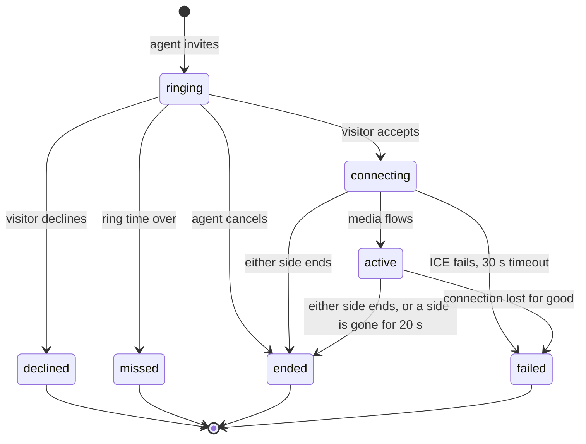

# Voice and video calls

Three kinds of call, all off until a manager switches them on and all without recording. Two are a team member talking to a visitor; the third is the visitor talking to the AI agent:

1. **Browser calls** (WebRTC): voice and video between the inbox and the visitor's page (the embedded widget, the hosted chat or a mobile web view). Built and tested; real-network behaviour is not verified (see [What is verified](#what-is-verified)).
2. **Phone calls** (Twilio Voice click-to-call): the app rings the agent's phone and then bridges the visitor's phone. Built and tested against a mocked Twilio only. See [Phone calls](#phone-calls).

3. **Calls with the AI assistant** (voice, and "video" with an animated avatar): the visitor's browser listens and speaks, the server receives text. See [Calls with the AI assistant](#calls-with-the-ai-assistant).

Decisions: [ADR 0031](adr/0031-calls-signalling-over-sockets.md), [ADR 0032](adr/0032-phone-calls-through-the-workspaces-twilio.md), [ADR 0033](adr/0033-ai-calls-browser-speech.md).

## Browser calls

### What a visitor and an agent see

An agent with the `calls:make` permission sees a phone and a camera button in the conversation header while the visitor is in the chat and has a live ticket; "Call now" appears next to a call request in the thread. The visitor sees an incoming-call screen over the chat (name of the agent, Accept, Decline, a ring tone where the browser allows sound) and, once connected, a timer, mute, camera on/off, screen sharing (video calls), a device chooser (microphone, camera, speaker where the browser supports it) and a connection-quality dot (good, fair, poor, from packet loss and round-trip time). The agent's side is a floating panel with the same controls. Either side can end the call; the agent can cancel while it rings; the visitor can decline.

The thread gets one card per call, updated as it moves: `Voice call: ringing`, `Video call, 2 min, ended by the agent`, `Missed voice call`, `Voice call declined`, `Video call failed to connect`. A missed or declined call offers the visitor a **callback form** (phone number, see [AI-AGENTS.md](AI-AGENTS.md) section 4). The visitor can also **ask for a call** from the chat ("Request a voice call"): a card appears for the team, the conversation goes to a person if it is not with one, and "Call now" starts the call. An AI agent can offer a call (`offer_call`) with a Yes / No card that becomes the same request.

Media never goes through this server: it flows between the two browsers directly or through a TURN relay. Nothing is recorded or stored; the server stores only the call row (who, when, how long, how it ended).

### States



`src/calls/machine.ts` is a pure function: every other combination of state and event is an error, final states have no way out, and a random-walk test checks that. Each transition in the service is a compare-and-set on the stored state, so two events at the same moment (accept and cancel, two ends, a timeout and an accept) end in exactly one outcome and the loser is told (`409 CALL_STATE` or `CALL_STATE_CHANGED`). The database allows one live call per conversation (partial unique index), also under two simultaneous invitations (`409 CALL_IN_PROGRESS`).

### Signalling (Socket.IO)

Authenticated like every socket event, one entry per event in the permission and rate-limit tables ([REALTIME.md](REALTIME.md) lists them with payloads):

| Event | Who | Effect |
| --- | --- | --- |
| `call:invite` `{room_id, kind}` | team, `calls:make` | creates the call (ringing), answers `{call, ice}` |
| `call:request` `{room_id, kind}` | visitor | asks for a call (a card, a handoff to a person) |
| `call:accept` / `call:decline` `{call_id}` | visitor | answers a ringing call; accept returns `{call, ice}` |
| `call:offer`, `call:answer`, `call:ice` `{call_id, data}` | both | relayed to the other side's bound socket only |
| `call:connected`, `call:failed`, `call:end` | both | media flows / lost for good / hang up |
| `call:resume` `{call_id}` | both | after a reconnect: binds the new socket, returns fresh ICE servers; the other side gets `call:peer {resumed}` and restarts ICE |

Server to client: `call:state` (to everyone who may see the room; the visitor gets a copy without member ids), `call:offer|answer|ice` and `call:peer` (to one socket).

What is enforced on every signalling event: the sender must be the seat that placed the call (a manager cannot take over someone else's call: `403 NOT_YOUR_CALL`) or the visitor of that conversation (anyone else gets `404`, so call ids are not probes); the call must be connecting or active; the sender's socket must be the one the call is bound to (`403 NOT_THIS_DEVICE`: a second tab cannot inject or listen in); an SDP is at most 16 KiB and must be of the type the event says, a candidate at most 2 KiB. A visitor can only be rung while a socket of theirs is connected in that conversation (`409 VISITOR_OFFLINE`), the conversation needs a live ticket (`409 NO_CONVERSATION`), and the workspace must have calls and that kind switched on (`403 CALLS_DISABLED`, `CALL_KIND_DISABLED`). A seat without `calls:make` is refused (`PERMISSION_DENIED`). Timeouts run in the scheduler every 5 seconds, on every node, idempotently: ringing past the ring time (default 45 s, 15 to 120) becomes missed, connecting for more than 30 s becomes failed, and a call from which one side has been gone for 20 s (no `call:resume`) ends.

### Negotiation in the browsers

The agent offers, the visitor answers; both use the "perfect negotiation" pattern for renegotiation (screen sharing, ICE restarts): the visitor is the polite peer (it rolls back its own offer on a collision), the agent keeps its own. On `disconnected` or `failed` the agent restarts ICE; if nothing recovers within 15 s the call is reported failed. After a socket reconnect (network change) the page sends `call:resume`, receives fresh credentials and the agent restarts ICE. If the camera is refused a video call continues with audio only; a refused microphone declines the call and tells the visitor why. The browser engine is `web/src/calls/engine.ts` (team) and `server/public/chat/calls.js` (visitor, shared by the widget and the hosted chat; the widget loads it from `/chat/assets/calls.js` only when calls are on).

### TURN and STUN (required for real networks)

STUN lets a browser learn its public address; a **TURN relay** is needed whenever peers cannot reach each other directly (symmetric NATs, many corporate and mobile networks). Without TURN, calls fail for those visitors. Render's free plan cannot host UDP TURN. The server hands out ICE servers per call through a `TurnProvider` choice in Settings > Calls:

| Provider | What it does | Needs |
| --- | --- | --- |
| `none` (default) | STUN only, with a plain warning in Settings and in the agent's call panel | `STUN_URLS` (default `stun:stun.l.google.com:19302`, a public server: set your own if visitors' addresses must not reach a third party) |
| `static` | coturn-style time-limited credentials: username `<expiry>:<call id>`, password base64(HMAC-SHA1(`TURN_SECRET`, username)); the secret never leaves the server | `TURN_URLS`, `TURN_SECRET`, `TURN_TTL_SECONDS` |
| `twilio` | Twilio Network Traversal Service token, minted with the workspace's own connected Twilio credentials (Settings > SMS & email); Twilio bills relayed media to that account | a verified Twilio connection |

A provider that is chosen but not usable falls back to STUN with a warning, so the call still rings; it never falls back to another workspace's account. Credentials are minted for each invitation, acceptance and resume, and never logged.

**coturn with Docker** (own server, not Render):

```yaml
# docker-compose.yml on a host with a public IP; open 3478 udp+tcp, 5349 tcp and 49160-49200 udp
services:
  coturn:
    image: coturn/coturn:4.6
    network_mode: host
    command: >
      -n --realm=turn.example.com --fingerprint --lt-cred-mech --use-auth-secret
      --static-auth-secret=${TURN_SECRET} --listening-port=3478 --tls-listening-port=5349
      --min-port=49160 --max-port=49200 --no-multicast-peers --no-cli
      --cert=/certs/fullchain.pem --pkey=/certs/privkey.pem
    volumes: ["/etc/letsencrypt/live/turn.example.com:/certs:ro"]
    restart: unless-stopped
```

Then set `TURN_URLS=turn:turn.example.com:3478?transport=udp,turns:turn.example.com:5349?transport=tcp` and the same `TURN_SECRET` on the app, and choose "Your own TURN server" in Settings > Calls.

**Kubernetes**: run the same image as a `DaemonSet` or a `Deployment` with `hostNetwork: true` (TURN needs a stable public IP and the UDP relay port range, which a normal `Service` cannot forward efficiently), put the secret in a `Secret` and pass `--static-auth-secret=$(TURN_SECRET)` through `env`, and give it `--external-ip=<node public IP>` when the node sits behind NAT. Both samples are untested here.

### Settings, permissions, privacy

Settings > Calls (`calls:settings`: owner and manager): browser calls on or off, voice, video, screen sharing, ring time, TURN provider. Placing calls needs `calls:make` (owner, manager and agent roles; custom roles do not get it automatically). The visitor must grant the microphone (and camera) and can always decline; nothing is recorded, and recording is deliberately not offered (it would need an explicit consent flow). Call rows, thread cards, ticket events (`call_started`, `call_ended`, `call_missed`, `call_declined`, `call_requested`) and audit entries (`call.invited`, `call.ended`, ...) are kept with the ticket and conversation and removed with them (retention and deletion).

Browsers only allow the microphone and camera on HTTPS pages. A site that embeds the hosted chat in an iframe must allow it with `allow="microphone; camera"`; a native web view needs the microphone (and camera) permission ([MOBILE-SDKS.md](MOBILE-SDKS.md)). The hosted chat tells the host app about calls with the bridge events `call_requested` and `call_state` ([MOBILE-BRIDGE.md](MOBILE-BRIDGE.md)).

### What is verified

- Service and signalling: unit and socket tests on SQLite and PostgreSQL (state machine properties, authorisation, races, resume, timeouts, TURN credentials including a mocked Twilio) in `calls.machine.test.ts` and `calls.test.ts`.
- Browser engines under jsdom with a fake `RTCPeerConnection` (`web/src/calls/*.test.ts`).
- Real browsers: `e2e/tests/11-calls.spec.ts` runs two Chrome contexts (an agent in the inbox, a visitor in the widget) against the built server over loopback with a **synthetic** camera, microphone and screen (`e2e/support/fakeMedia.ts`): the peers connect, decoded video frames and audio energy increase on both sides, muting stops the audio on the other side, ending closes both peers and leaves the card; decline, missed call, callback form and call requests are covered.
- **Not verified**: calls across real NATs, any TURN relay (coturn or Twilio) against a live service, Safari and Firefox, mobile browsers and native web views, real microphones and cameras, call quality under loss, and more than one call at a time under load. Chrome's own fake-device flags were not used because audio capture never answered on the development machine's sandboxed audio stack.

## Phone calls

Click-to-call through the workspace's **own** Twilio account (there is no platform fallback: without a verified Twilio connection nothing is called). The design is "call my phone, then connect the visitor": the app asks Twilio to ring the team member's phone from the workspace's caller ID; when they answer, Twilio fetches instructions from the app (`POST /webhooks/c/:id/twilio/voice/connect?call=...`) and the app answers TwiML that says "Connecting you to the customer" and dials the contact's number with `answerOnBridge`, a time limit and the same caller ID. Both legs report progress to `.../voice/status?call=...&leg=agent|visitor`. The team member needs no browser audio; the thread card follows the call (`Phone call: calling the agent's phone`, `calling the contact`, `Phone call, 3 min, ended by the visitor`, `Missed phone call`, ...), and the inbox shows a small status panel with a hang-up button. Placing one: Call by phone in the conversation header (needs `calls:make`), your own number is asked each time and remembered only in your browser.

**Webhooks** are verified like the SMS ones: the connection id in the URL selects the workspace's Twilio credentials and the `X-Twilio-Signature` is checked over the exact URL (the call id is in the query string, so it is signed); unknown ids, bad signatures and a missing call id answer the same refusal and count toward the IP block. A call id of another workspace gets a "no longer available" hang-up TwiML, never a connection. Repeats are dropped by event key, out-of-order callbacks are harmless (every transition is a compare-and-set), and a status callback whose call sid is not the agent's leg or a child of it is ignored.

**What has to be true before a call is placed** (each refusal has its own code and a sentence for the agent; Twilio is not contacted when any fails):

| Guard | Code |
| --- | --- |
| phone calls switched on in Settings > Calls | `PHONE_CALLS_DISABLED` |
| the workspace has its own verified Twilio connection | `NO_TWILIO` |
| a caller ID is chosen, and it is one of the workspace's imported numbers (checked when saved) | `NO_CALLER_ID`, `UNKNOWN_CALLER_ID` |
| the contact has a phone number | `CONTACT_NO_PHONE` |
| **explicit consent recorded before calling**: the contact agreed, in the chat, to be called on that exact number (`attrs.call_consent = {at, phone, text}`; a changed number needs a new agreement) | `NO_CALL_CONSENT` |
| the contact did not opt out: STOP or unsubscribed (the existing opt-out flags) | `DO_NOT_CALL` |
| destination country is on the workspace's allow-list (empty list = nothing is called), and the number is not premium-rate, shared-cost, UAN, personal, pager or voicemail (libphonenumber types) | `DESTINATION_BLOCKED` |
| not night for the contact: quiet hours (default 21:00 to 08:00) in their browser's time zone, kept on the contact when they answer a form, else the office-hours zone | `QUIET_HOURS` |
| the agent's own number is valid and differs from the contact's | `INVALID_AGENT_PHONE` |
| per-agent limit of 10 phone calls an hour (fails closed if the limiter store is down) | `429` |
| per-workspace daily limit (setting, default 50, UTC day): the call row is written first and the day's calls are counted up to it, so parallel requests can only over-refuse, never over-spend; refused attempts do not count | `DAILY_LIMIT` |
| one live call per conversation | `CALL_IN_PROGRESS` |

**Consent** is collected with the callback form card (AI-AGENTS.md section 4): "Ask the visitor to agree" in the call dialog posts a card that shows the number to confirm (pre-filled when known), a required checkbox "I agree that you may call me on this number." and the visitor's time zone is sent with the answer. A number the visitor types that already belongs to another contact is never used as a call target.

**Time limits** (every node, every 5 s): an agent who does not pick up within 45 s fails the call (`agent_no_answer`) and Twilio is asked to hang up; a bridge that has not completed 90 s after the agent answered fails (`connect_timeout`); `max_duration_s` (default 30 min) is passed to Twilio as the dial time limit. Outcomes of the contact's phone map to the same states as browser calls: no answer is missed, busy is declined, unreachable is failed.

**Privacy and cost**: full numbers are not written to the audit log, ticket events or the call row (last four digits only); Twilio sees them, necessarily. Relayed media of browser calls and the minutes of phone calls are billed by Twilio to the workspace's account, not by this app, and credits are not charged. Twilio's own geo-permissions must also allow the destination, and a trial account only calls verified numbers (the refusal text from Twilio is shown).

**Not verified**: any real Twilio call. Tested with a mocked Twilio (request bodies, signatures, TwiML, every callback status, races and guards). The TwiML attributes (`answerOnBridge`, `timeLimit`, `<Number statusCallbackEvent>`) follow Twilio's documentation but were not run against Twilio. Voice-capable caller IDs are not checked (Twilio refuses a number without voice and the message is shown). No browser-based Twilio Voice SDK for the agent side (optional in the design).

## Calls with the AI assistant

A visitor can talk to the AI agent that answers their chat ([AI-AGENTS.md](AI-AGENTS.md) section 3): the same agent, the same knowledge base, the same safety rules, spoken. Decision record: [ADR 0033](adr/0033-ai-calls-browser-speech.md).

### What the visitor needs, said plainly

- A browser with **speech recognition**: Chrome, Edge and Safari have it (under the name `SpeechRecognition` or `webkitSpeechRecognition`); **Firefox does not**. Without it the widget says so and opens the same assistant in the text chat instead. Speaking the replies (`speechSynthesis`) is available in all current browsers.
- **Microphone permission** and an HTTPS page. A refused microphone ends the voice call with a message; the visitor can type to the assistant inside the call instead.
- The speech-to-text is done by the browser's own recognizer. In Chrome that is a Google service and in Safari an Apple one, so the browser vendor may process the audio. This app never receives, stores or forwards audio; it only receives the text the recognizer produced.

### What the visitor sees

The widget and the hosted chat show **Talk to our AI assistant (voice)** and, when video is on, **Video call with our AI assistant (avatar)** under the message list, when the workspace has switched AI calls on and an agent may take them. The AI is disclosed three times: in the button, in the greeting (spoken and written in the thread: "Hi, I'm Aria (AI assistant), not a person. This call is not recorded.") and in the call screen header. During the call: live captions of both sides, a level indicator, a **push-to-talk** toggle, **barge-in** (speaking while the assistant talks cuts its voice at once), a text box ("type instead"), mute, **Talk to a person** (always visible) and **End call**. "Video" shows the agent's avatar, moving with its voice. It never claims to see the visitor: the visitor's camera is not requested unless they press "Show my camera", which is a local self-view that is not sent anywhere (no video leaves the browser in an AI call).

If nothing is heard for about 20 seconds the assistant asks whether the visitor is still there; after a longer silence (server: `idle_timeout_s`, default 2 minutes) the call ends. A call also ends at the hard maximum duration (default 10 minutes), and the assistant says why.

**Talk to a person** (button, spoken request or any hand-off trigger such as a sensitive topic) ends the AI call with a reason, hands the ticket to a person through the routing engine, and, when browser calls are on, leaves the usual call request for the team: the call screen stays open as "waiting for a person" and the incoming-call screen of a human call takes its place when a person rings. With browser calls off it tells the visitor that a person will answer in the chat.

### What is stored

The call row (`transport ai`, `kind ai_voice` or `ai_video`, the agent, `engine`, duration, how it ended, `handoff_reason`), one card in the thread ("AI voice call, 2 min, handed to a person"), ticket events (`call_started`, `call_ended`) and audit entries (`call.ai_started`, `call.ended`). What was said and answered is stored as **ordinary visitor and bot messages tagged with the call id** (`meta.call_id`, `meta.via` = `voice` or `typed`), so the thread reads as a transcript and retention and erasure treat it like any message. With *redact personal data* on (Settings > AI assistant) emails and phone numbers are masked before anything is stored or reaches a model, which matters because recognizers mishear numbers and a transcript should not hold them. No audio, no video, no recording.

### Settings and limits (`calls.ai`, Settings > Calls)

| Setting | Default | Meaning |
| --- | --- | --- |
| `enabled` | off | switch calls with the AI on; the agent also needs the allowed action `ai_call` (Settings > AI agents), and must not be "suggest only" |
| `voice`, `video` | on, on | which kinds are offered (video is the avatar) |
| `max_duration_s` | 600 | hard limit of one call (60 to 1800) |
| `idle_timeout_s` | 120 | a call without speech this long ends (30 to 600) |
| `max_concurrent` | 3 | AI calls at once per workspace (also bounded by the `ai.concurrency` policy) |
| `daily_limit` | 100 | AI calls started per UTC day: the row is written first and counted up to it, so parallel starts can only over-refuse; refused starts do not count |

Also: 6 call starts per visitor per hour (`calls.ai.visitor`), 20 utterances per visitor per minute (`calls.ai.say`), the existing per-workspace daily AI budget (`ai.workspace`: past it the rules agent answers, so the call still works), 600 characters per utterance. Refusals: `AI_CALLS_DISABLED`, `AI_CALL_KIND_DISABLED`, `AI_CALL_UNAVAILABLE` (no agent, not allowed, outside its hours, suggest only), `HUMAN_HANDLING` (a person has the conversation), `CALL_IN_PROGRESS`, `AI_DAILY_LIMIT`, `AI_BUSY`, `RATE_LIMITED`.

### Socket events (visitor session only)

| Event | Payload | Answer |
| --- | --- | --- |
| `aicall:start` | `{room_id, kind, locale?, speech?: {stt, tts}}` | `{call, ai: {agent, greeting, disclosure, engine, speech_lang, max_duration_s, idle_timeout_s, max_utterance_chars}}`; opens a ticket if there is none |
| `aicall:say` | `{call_id, text, seq, via?: voice\|typed}` | `{reply: {kind, text, speech, message_id, ended}, call}`; `speech` is the text without links and markdown, `text` is the caption; `ended` is set when this reply closes the call (hand-off, resolved, time limit, person took over). Idempotent per `seq` |
| `aicall:end` | `{call_id, reason?: completed\|silence\|unsupported\|error}` | `{call}` |
| `aicall:handoff` | `{call_id}` | `{call, ticket, human_call, text}` |

`call:resume` re-binds a reconnected visitor socket to a running AI call (the server ends a call whose visitor has been gone for 20 seconds). The team sees `call:state` with `transport: "ai"`. Nothing else about AI calls is visible to team members except the thread and the card; they cannot control or join an AI call.

### Speech engines

Two engines, chosen by `calls.ai_engine` (Settings > Calls):

- **`browser`** (default, free): the visitor's browser recognises and speaks; the server sees only text. `SpeechProvider` (`server/src/calls/speech.ts`) is the seam for a server-side engine; only the browser engine and a fake for tests exist.
- **`realtime`** (optional, off until configured; [ADR 0035](adr/0035-optional-realtime-voice-engine.md)): the visitor's browser talks to OpenAI's realtime voice service over WebRTC with a short-lived client secret this server mints per call (`OPENAI_API_KEY`, `OPENAI_REALTIME_MODEL`, optional `OPENAI_BASE_URL` and `OPENAI_REALTIME_VOICE`; no model name is built in, and the key never reaches a browser or a log). Audio only: the camera is never sent. The model can act only through tools this server runs (`search_kb`, `handoff_to_human`, `resolve_ticket`, `set_department`, `collect_contact_info`, `schedule_callback`, `share_call_link`). A transcript monitor cuts the session (ends the call or hands it to a person) on banned claims, prompt injection or sensitive topics. Limits: the maximum duration, a daily budget of realtime minutes, a realtime concurrency cap and an instance kill switch (`AI_REALTIME_ENABLED`); past any of them, or when the key, the model, WebRTC or the provider is missing or failing, the call silently uses the browser engine. Transcripts are stored as ordinary messages tagged with the call. A cost estimate (`AI_REALTIME_COST_PER_MINUTE_USD`) appears in analytics. **The guarantee is weaker than the text pipeline's**: with the browser engine nothing unsafe is spoken, with realtime an unsafe sentence can be spoken once before the monitor cuts the call. **The real OpenAI service was NOT run against this code**: the tests use a local fake of its endpoints and events, and the page listens for `conversation.item.input_audio_transcription.completed` for the visitor's words, a name that was not confirmed against the live service. Try it with a test key before relying on it.
- **A hosted photoreal avatar** (D-ID, optional, off until connected and switched on): see [Photoreal avatar](#photoreal-avatar). The built-in face below stays the default.

### The face, portraits and presets

An AI "video" call shows an animated face, never the visitor: **the visitor's camera is never sent for an AI call** and the page never claims the AI can see them (an optional self-view stays in the visitor's own page). The face has two looks and one rule: a **photo avatar** is not lip-synced and does not blink (a glow ring and a small scale follow the audio level, with bars, thinking dots and a state colour); without a photo, or if it fails to load, a stylised **SVG face** is drawn whose mouth follows the voice. States: idle, listening, thinking, speaking; reduced motion is respected. The AI disclosure label ("AI assistant" by default, at least two characters) is part of the face and next to the avatar in the header and every bubble; no setting removes it.

Agents get a picture in Settings > AI agents: PNG, JPEG (baseline) or WebP up to 1 MB, 64 to 4096 pixels, crop to a square in the editor, alt text; the server checks the magic bytes, refuses animation and rewrites the file to drop every metadata block (EXIF, XMP, ICC, text, comments); it is stored per workspace and served with safe headers (`nosniff`, a sandboxing CSP). **Use only pictures you have the right to use**: a photograph of a real person as the face of an AI is your responsibility, and the label stays on it. Two portraits, `server/public/avatars/aria.webp` and `vb.webp`, are bundled defaults supplied by the repository owner; the presets **Aria** and **vb** (persona, greeting and disclosure; "Start from a preset" when creating an agent) use them, and the first agent a workspace gets is Aria with her photo. Tests and screenshots use generated placeholder images, not these photographs.

### What is verified

Server (SQLite and PostgreSQL): `ai-calls.test.ts` (start and its refusals, the loop, idempotent retries, hand-over by request, by trigger and by button, a person taking over, resolution, redaction, the budget fallback, time limits and sweeps, resume, daily, concurrency and rate limits, isolation) and migration 036 upgrade tests. **Not verified**: speech quality, recognizer accuracy and latency in any real browser, Safari and Firefox behaviour, real devices and real microphones, and any real language model (the tests use the offline rules agent and scripted models).

## Calls between teammates

A team member can call another from the app: voice or video, between the two members of a direct message. Decision record: [ADR 0036](adr/0036-teammate-calls.md). It reuses the call state machine, the TURN credentials and the signalling rules of calls with visitors, with these differences:

- **Who may call**: a member with `calls:internal` (owner, manager and agent by default; custom roles do not get it by themselves; viewers do not have it), and only into a direct message they belong to. The permission is needed on both ends: a teammate without it cannot be rung (`CALLEE_CANNOT_RECEIVE`). Someone who cannot see the conversation, or belongs to another workspace, gets `404` (so ids reveal nothing); a public channel the member has not joined gives `NOT_A_MEMBER`. A group message, a channel and #general are group calls (below): `tcall:invite` there answers `USE_GROUP_CALL`.
- **Presence and do-not-disturb**: a teammate who is offline (`CALLEE_OFFLINE`), has do-not-disturb on or set their status to inactive (`CALLEE_UNAVAILABLE`), or is already in a call (`CALLEE_BUSY`: another teammate call, or a call with a visitor as the agent) is not rung. "Away" counts as idle, not unavailable. A member can be in one call at a time (`CALL_IN_PROGRESS`), also under two callers at once: the database allows one live call per conversation, per caller and per callee.
- **Ringing**: the callee's every tab gets `tcall:state` and shows the incoming-call screen anywhere in the app (Accept, Decline, a ring tone where the browser allows it); the first tab to accept binds the call, the others stop ringing. Unanswered calls are missed after the ring time (`calls.internal.ring_seconds`, default 30 s, 10 to 90); the card in the direct message follows the call ("Voice call: ringing", "Missed voice call", "Video call, 4 min").
- **During the call**: mute, camera, screen sharing (video, when `calls.internal.screen_share` is on), a connection-quality dot, ICE restart and a socket reconnect (`tcall:resume`) with the same 15 s and 20 s limits as visitor calls. Media goes between the two browsers (or a TURN relay); nothing is recorded or stored.
- **Limits**: 20 calls an hour per member and 5 in 5 minutes to the same person (`RATE_LIMITED`), against ring spam.
- **Settings**: Settings > Calls > calls between teammates (`calls.internal`: on or off, voice, video, screen sharing, ring time), off by default; `GET /api/team-calls/config` tells the app what is on and a call this member is already in.

| Event | Who | Effect |
| --- | --- | --- |
| `tcall:invite` `{channel_id, kind}` | team, `calls:internal` | rings the other member of the direct message; answers `{call, ice}` |
| `tcall:accept` / `tcall:decline` `{call_id}` | the callee | answer (returns `{call, ice}`) or refuse |
| `tcall:offer`, `tcall:answer`, `tcall:ice` `{call_id, data}` | both | relayed to the other side's bound socket only |
| `tcall:connected`, `tcall:failed`, `tcall:end`, `tcall:resume` | both | as for calls with visitors |

Verified: `team-calls.test.ts` (SQLite and PostgreSQL: the flow, signalling isolation, refusals, presence and DND, busy, races, rate limits, tenant isolation, timeouts and resume, a randomized state-machine test), migrations 038 and 039 upgrade tests, jsdom tests of the team engine and screens, and two Chrome contexts in `e2e/tests/13-team-calls.spec.ts` with the synthetic media. Not verified: real networks and TURN, other browsers, real devices.

## Call links

A call link lets a person join a voice or video call from a web address, without a login, a password or a form. Decision record: [ADR 0037](adr/0037-call-links.md). Off by default (`calls.links.enabled`, Settings > Calls > Call links, with separate switches for links to the AI assistant and to the team, and a lifetime of 5 minutes to 24 hours, 30 by default).

**Who makes one**: a team member with `calls:make` ("Copy call link" and "Copy AI call link" in the conversation menu: the link is copied once and a card with a **Join** button appears in the thread), the AI agent through the `share_call_link` tool (an allowed action on the agent, off by default; it is refused when links are off or the mode is not allowed), or, for a contact who agreed to be contacted, an email or SMS (`send: "email" | "sms"` on creation: the workspace's own providers, `not_sent_test_mode` in test mode; the address then also stays in that message). It works for a call with the AI, from the team to a visitor, and for an agent inviting a visitor who closed the chat.

**What the visitor sees**: the card in the widget, the hosted chat or the mobile bridge shows who is calling, the kind, the time it is valid until and a Join button that opens `/call/<token>` in a new tab (the bridge event `call_link_received` carries no address; Join sends `link_clicked` with source `call_link`). The page shows who is calling (for the AI: its name and that it is an AI, not a person, first), asks for an optional display name and the browser's microphone/camera consent, and starts the same call as everywhere else with the same engines, TURN and state machine. A used, expired, revoked, mismatched or unknown link shows one message: "This link is not available. Ask for a new one."

**Security properties** (tested): at least 128 random bits plus an HMAC; only the SHA-256 is stored; one conversation, one workspace, one device (a second device is refused), used up when the call ends, revocable (`DELETE /api/rooms/:id/call-links/:linkId` ends its call at once), replaced by a newer link, 10 links per conversation per hour, failed guesses escalate to a block; the page is identical for every address and never cached, framed or sent with a referrer; the token leaves the address bar immediately and travels only in POST bodies; it never reaches the access log, error reports, analytics or the audit log; the session it mints can take part in the call and nothing else (`403 LINK_SESSION` on REST, a short socket allow-list, no history).

| Route / event | Who | Effect |
| --- | --- | --- |
| `POST /api/rooms/:id/call-links` `{mode: ai\|team, kind, ttl_minutes?, send?}` | `calls:make` | creates (replaces) the link, posts the card, returns the address once |
| `GET /api/rooms/:id/call-links`, `DELETE .../:linkId` | `calls:make` | status without addresses; revoke |
| `POST /public/call-links/preview` `{token}` | anyone | who is on the other end, or the generic refusal |
| `POST /public/call-links/redeem` `{token, device_id, name?}` | anyone | a call-scoped session |
| `GET /call/:token` | anyone | the page |

Verified: `call-links.test.ts` (SQLite and PostgreSQL: token properties, expiry, reuse, revocation, wrong room and cross-tenant, one device, the session's limits, the whole call with the team and with the AI, brute force, scrubbing of logs, error reports and the audit log, consent for email and SMS, the AI tool, settings), the migration 040 upgrade tests, jsdom tests of the page (`callpage.test.ts`) and of the settings, the bridge contract tests, and two Chrome contexts in `e2e/tests/14-call-links.spec.ts`. Not verified: real email or SMS delivery, real speech, other browsers, real devices.

## Group calls

Voice or video between **up to four teammates** (the host included), started from a group message or a team channel. Decision record: [ADR 0038](adr/0038-group-calls-mesh.md). **It is a WebRTC mesh, not an SFU**: every browser sends its audio and video to every other browser, so with four people each browser uploads three copies (and decodes three streams). That is why the cap is four (`calls.internal.group_max`, 2 to 4, default 4, enforced by the server) and why quality drops on a weak connection. Nothing is mixed, recorded or stored on the server; the server only keeps who is in the call and relays signalling. Visitor calls stay 1:1. Direct messages stay 1:1 team calls (`tcall:*`).

- **Starting**: `gcall:start {channel_id, kind, invite_ids?}`. A group message rings its other members by default (at most `group_max - 1`); in a channel the host picks who to ring, or nobody (the card lets channel members join). People who cannot be rung (offline, do-not-disturb, inactive, busy in another call, no `calls:internal`, not in a private conversation) are skipped and named in `skipped`; if nobody can be rung, `NOBODY_TO_RING`. One live group call per conversation (`GROUP_CALL_EXISTS`), one call at a time per person (`CALL_IN_PROGRESS`, across 1:1, visitor and group calls).
- **Ringing**: every invitee's every tab gets `gcall:state` and the incoming screen; the first tab to join binds the call (the others get `ALREADY_IN_THIS_CALL`). Invitees who do not answer within the ring time are `missed`; a host left alone after everyone rang out ends the call as missed.
- **Joining mid-call**: anyone who can see the conversation (a channel member, or any member for a public channel), also after declining, missing or leaving, joins from the card in the thread (`gcall:join`) while the call is live and has room (`GROUP_CALL_FULL` otherwise). **Inviting more people**: `gcall:invite` by anyone in the call, up to the cap (invited people count toward it).
- **Signalling**: the person who joins sends an offer to everyone already in the call (`gcall:offer|answer|ice` with `to`); each pair is an independent link with its own ICE. The newer joiner is the offerer of a link and restarts ICE on that link when it fails or when the other side resumes. Messages go only to the bound socket of the addressee, only between two people who are in the call.
- **In the call**: per-person mute and camera flags (`gcall:media`, shown on every tile), a speaker highlight (computed in each browser from the audio level of each stream; nothing is sent), screen sharing by **one person at a time** (`gcall:share`; the first to ask holds it, `SHARE_IN_USE` for the second, freed when they stop or leave; video calls only and when `screen_share` is on).
- **Leaving**: the host leaving does not end the call; the last person leaving ends it (`ended`, or `missed` when nobody but the host ever joined). A closed socket is noted and the person is removed after 20 s unless `gcall:resume` re-binds them. Leaving twice is harmless.
- **Card**: "Group video call: 3 in the call", "Group voice call, 12 min", "Missed group voice call" in the conversation, with Join.
- **Permission and isolation**: `calls:internal` for every `gcall:*` event; other workspaces and non-members of a private conversation get `404`. Rate limit: `calls.internal.member` (20 calls an hour) on start.
- **Concurrency**: every change takes a row lock on the call first, so two joins at the cap, a leave during an offer and a duplicate join are decided by the database (tested on SQLite and PostgreSQL, plus a randomised sequence test that checks the cap, one-call-per-person, live-calls-have-people and one-sharer invariants).

| Event | Who | Effect |
| --- | --- | --- |
| `gcall:start` `{channel_id, kind, invite_ids?}` | `calls:internal` | answers `{call, ice, skipped}` |
| `gcall:join` / `gcall:resume` `{call_id}` | same | answers `{call, ice, peers}` (people to offer to) |
| `gcall:leave` / `gcall:decline` `{call_id}`, `gcall:invite` `{call_id, member_ids}` | same | membership changes |
| `gcall:media` `{call_id, muted?, camera_off?}`, `gcall:share` `{call_id, on}` | in the call | flags, the screen |

Verified: `group-calls.test.ts`, migration 041 upgrade tests, jsdom tests of the engine and screens, three Chrome contexts with the synthetic media (`15-group-calls.spec.ts`). Not verified: real networks and TURN with four people, bandwidth and CPU on real devices, other browsers.

## Photoreal avatar

An **option** for AI video calls: a hosted service (D-ID) shows the AI assistant as a realistic talking video instead of the built-in face. Decision record: [ADR 0039](adr/0039-optional-photoreal-avatar.md). **The built-in face (the agent's photo or the drawn face) is the default everywhere** and is used whenever photoreal is not connected, not switched on, not chosen for the agent, over its limits, killed, or failing.

**Connecting it (Settings > Calls > Photoreal avatar, permission `calls:settings`)**:

1. Create a D-ID account at studio.d-id.com (streaming spends your D-ID credits).
2. In D-ID Studio, create an API key; it is shown once as `username:password`.
3. Paste it into **D-ID API key** and press **Save key**. It is stored encrypted with `DATA_ENCRYPTION_KEY` (the same store and pattern as the workspace's Twilio and SendGrid credentials), never returned by the API (the screen shows only "Connected, ends ...1234"), never written to logs, error reports or the audit log. Saving tests it at once; **Test connection** repeats the test.
4. **Add an avatar**: a D-ID stock presenter id, or the https address of a photo. A photo needs the box "I have the right to use this photo, and the person in it has agreed to be shown as an AI assistant" ticked; who confirmed it and when is stored. D-ID's own terms and consent rules for real people apply as well. Optional voice (Microsoft/Azure, ElevenLabs) and voice id.
5. **Which agent uses which avatar**: per AI agent, "Built-in face" or one of the avatars.
6. Switch **Use the photoreal avatar in AI video calls** on; set **Minutes per day** (default 10) and **At the same time** (default 1).

The status chip says what a call would show: *Not connected*, *Key saved, not tested*, *Connected, switched off*, *Connected and on*, *Failing: using the built-in face* (with the provider's reason), *Switched off on this server*. **Disconnect** deletes the key (it is not kept disabled) and returns every call to the built-in face.

**Test connection spends no streaming**: it calls D-ID's `GET /credits`, an authenticated read of the balance. D-ID's reference does not say whether that read costs credits; it is a read, and we assume it is free. It shows the remaining credits.

**Instance fallback**: `DID_API_KEY` in the server's environment is used for a workspace that has not connected its own key; the workspace switch is still required. `AVATAR_PHOTOREAL_ENABLED=false` is the kill switch (new sessions refused, running ones stopped at their next step). `AVATAR_COST_PER_MINUTE_USD` gives the cost estimate in analytics. `DID_API_BASE`, `DID_AUTH_ENCODE` and `AVATAR_TEST_PROVIDER=fake` (tests and demos, refused in production) are in [CONFIGURATION.md](CONFIGURATION.md).

**During a call**: when the visitor starts an AI **video** call on the **browser speech engine** (the realtime engine speaks for itself, so photoreal is not used with it) and everything allows it, the server creates the provider's agent for the avatar (once), starts a stream and gives the visitor's browser **only** the stream's SDP offer and ICE servers. The browser answers through this server (`aicall:avatar` with `op: answer | ice | connected | failed`), which relays to D-ID: the browser never sees a key or a provider id. **The browser's peer connection has no tracks: the visitor's camera and microphone are never sent to the provider.** When the video connects, the server makes the avatar say the greeting (with the AI disclosure); each answer of the AI is then said by the avatar (the same text as the captions), and the browser's own voice is silent. **Any failure** (no video within 12 seconds, ICE failure, a refused SDP, a provider error while speaking, the budget or the kill switch during the call) ends the photoreal session, tells the page (`aicall:avatar_state`), and the call continues with the built-in face and the browser voice: "The video avatar is not available, so I switched to the simple avatar." The call itself never ends because of the avatar.

**Disclosure stays**: the "AI assistant" label chip stays on the face (around the video, not inside it), the header badge "..., not a person" and the spoken disclosure are unchanged, and photoreal mode adds a line: "You are seeing a computer-generated video of an AI assistant, not a real person. Your camera is not sent." No setting removes them (an agent's label needs at least two characters).

**Limits and accounting**: minutes per workspace per UTC day (finished sessions by length, live ones by how long they ran), sessions at the same time (with a race-safe count), the kill switch, 5 avatars per workspace, 5 connection tests a minute. Analytics (`ai_calls.photoreal`) count sessions, minutes, sessions that fell back, and the estimate.

| Route / event | Who | Effect |
| --- | --- | --- |
| `GET /api/calls/avatar` | `calls:settings` | status, settings, today's usage, avatars, agents |
| `PUT /api/calls/avatar/connection` `{provider: "did", api_key}` / `DELETE` / `POST .../test` | `calls:settings` | store (write-only), delete, test |
| `POST /api/calls/avatar/avatars`, `DELETE .../:id`, `PUT /api/agents/:id/photoreal-avatar` | `calls:settings` | avatars and the per-agent choice |
| `aicall:avatar` `{call_id, op, data?}` | the visitor of that call | the WebRTC answer and candidates, connected, failed |
| `aicall:avatar_state` (server to visitor) | | photoreal stopped: use the built-in face |

**What was confirmed about D-ID and what was assumed** (from D-ID's published API reference, read 2026-10-21; the adapter is `server/src/avatar/did.ts`):

- Confirmed from the reference: `Authorization: Basic <API_USERNAME:API_PASSWORD>` (the reference's example uses the key as given); `GET /credits` returns `remaining` and `total`; `POST /agents` with `presenter: {type: "clip", presenter_id}` or `{type: "talk", source_url, thumbnail}` and an optional `voice: {type, voice_id}`; `POST /agents/{agentId}/streams` returns `{id, jsep: {type: "offer", sdp}, ice_servers, session_id}` (409 when the agent is still being built); `POST .../streams/{streamId}/sdp` `{answer, session_id}`; `POST .../ice` `{candidate, sdpMid, sdpMLineIndex, session_id}`; `POST .../streams/{streamId}` `{script: {type: "text", input (3 to 40000 characters), provider?}, session_id}`; `DELETE .../streams/{streamId}` `{session_id}`.
- **Assumed** (what the first real call might still break): that the raw key works in the Basic header (if D-ID answers 401 to a key that works in its own explorer, set `DID_AUTH_ENCODE=base64`); that reading `/credits` spends nothing; that a freshly created agent can stream at once (if not, the first call falls back and a later one works); that the text script on a stream makes the avatar say it; that `thumbnail` may be the same photo as `source_url`; the stream's idle timeout and maximum length (not documented beyond `session_timeout` up to 300 s); how credits are counted per second of video; rate limits.
- **NOT verified**: nothing here was run against the real D-ID service. The tests use a recording fake of these endpoints (`server/tests/avatar.test.ts`), a fake provider in the server tests and in real Chrome (`e2e/tests/17-photoreal.spec.ts`, where the fake's offer cannot connect, which proves the fallback), and jsdom tests of the page (`web/src/calls/aicall.photoreal.test.ts`). A real talking-head stream, its look, lip-sync, latency and cost were never seen. Try it with a few credits and a short minutes limit before switching it on for visitors.
