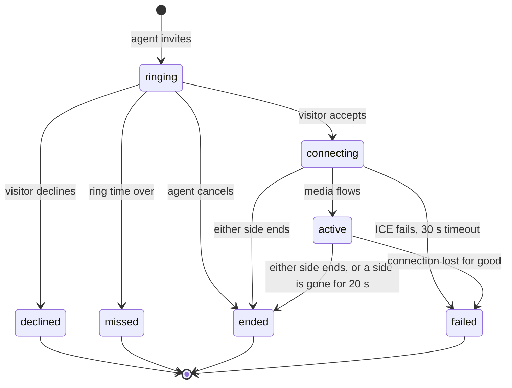

# Voice and video calls

Two ways for a team member to talk to a visitor, both off until a manager switches them on and both without recording:

1. **Browser calls** (WebRTC): voice and video between the inbox and the visitor's page (the embedded widget, the hosted chat or a mobile web view). Built and tested; real-network behaviour is not verified (see [What is verified](#what-is-verified)).
2. **Phone calls** (Twilio Voice click-to-call): the app rings the agent's phone and then bridges the visitor's phone. See [Phone calls](#phone-calls).

Decisions: [ADR 0031](adr/0031-calls-signalling-over-sockets.md).

## Browser calls

### What a visitor and an agent see

An agent with the `calls:make` permission sees a phone and a camera button in the conversation header while the visitor is in the chat and has a live ticket; "Call now" appears next to a call request in the thread. The visitor sees an incoming-call screen over the chat (name of the agent, Accept, Decline, a ring tone where the browser allows sound) and, once connected, a timer, mute, camera on/off, screen sharing (video calls), a device chooser (microphone, camera, speaker where the browser supports it) and a connection-quality dot (good, fair, poor, from packet loss and round-trip time). The agent's side is a floating panel with the same controls. Either side can end the call; the agent can cancel while it rings; the visitor can decline.

The thread gets one card per call, updated as it moves: `Voice call: ringing`, `Video call, 2 min, ended by the agent`, `Missed voice call`, `Voice call declined`, `Video call failed to connect`. A missed or declined call offers the visitor a **callback form** (phone number, see [AI-AGENTS.md](AI-AGENTS.md) section 4). The visitor can also **ask for a call** from the chat ("Request a voice call"): a card appears for the team, the conversation goes to a person if it is not with one, and "Call now" starts the call. An AI agent can offer a call (`offer_call`) with a Yes / No card that becomes the same request.

Media never goes through this server: it flows between the two browsers directly or through a TURN relay. Nothing is recorded or stored; the server stores only the call row (who, when, how long, how it ended).

### States



`src/calls/machine.ts` is a pure function: every other combination of state and event is an error, final states have no way out, and a random-walk test checks that. Each transition in the service is a compare-and-set on the stored state, so two events at the same moment (accept and cancel, two ends, a timeout and an accept) end in exactly one outcome and the loser is told (`409 CALL_STATE` or `CALL_STATE_CHANGED`). The database allows one live call per conversation (partial unique index), also under two simultaneous invitations (`409 CALL_IN_PROGRESS`).

### Signalling (Socket.IO)

Authenticated like every socket event, one entry per event in the permission and rate-limit tables ([REALTIME.md](REALTIME.md) lists them with payloads):

| Event | Who | Effect |
| --- | --- | --- |
| `call:invite` `{room_id, kind}` | team, `calls:make` | creates the call (ringing), answers `{call, ice}` |
| `call:request` `{room_id, kind}` | visitor | asks for a call (a card, a handoff to a person) |
| `call:accept` / `call:decline` `{call_id}` | visitor | answers a ringing call; accept returns `{call, ice}` |
| `call:offer`, `call:answer`, `call:ice` `{call_id, data}` | both | relayed to the other side's bound socket only |
| `call:connected`, `call:failed`, `call:end` | both | media flows / lost for good / hang up |
| `call:resume` `{call_id}` | both | after a reconnect: binds the new socket, returns fresh ICE servers; the other side gets `call:peer {resumed}` and restarts ICE |

Server to client: `call:state` (to everyone who may see the room; the visitor gets a copy without member ids), `call:offer|answer|ice` and `call:peer` (to one socket).

What is enforced on every signalling event: the sender must be the seat that placed the call (a manager cannot take over someone else's call: `403 NOT_YOUR_CALL`) or the visitor of that conversation (anyone else gets `404`, so call ids are not probes); the call must be connecting or active; the sender's socket must be the one the call is bound to (`403 NOT_THIS_DEVICE`: a second tab cannot inject or listen in); an SDP is at most 16 KiB and must be of the type the event says, a candidate at most 2 KiB. A visitor can only be rung while a socket of theirs is connected in that conversation (`409 VISITOR_OFFLINE`), the conversation needs a live ticket (`409 NO_CONVERSATION`), and the workspace must have calls and that kind switched on (`403 CALLS_DISABLED`, `CALL_KIND_DISABLED`). A seat without `calls:make` is refused (`PERMISSION_DENIED`). Timeouts run in the scheduler every 5 seconds, on every node, idempotently: ringing past the ring time (default 45 s, 15 to 120) becomes missed, connecting for more than 30 s becomes failed, and a call from which one side has been gone for 20 s (no `call:resume`) ends.

### Negotiation in the browsers

The agent offers, the visitor answers; both use the "perfect negotiation" pattern for renegotiation (screen sharing, ICE restarts): the visitor is the polite peer (it rolls back its own offer on a collision), the agent keeps its own. On `disconnected` or `failed` the agent restarts ICE; if nothing recovers within 15 s the call is reported failed. After a socket reconnect (network change) the page sends `call:resume`, receives fresh credentials and the agent restarts ICE. If the camera is refused a video call continues with audio only; a refused microphone declines the call and tells the visitor why. The browser engine is `web/src/calls/engine.ts` (team) and `server/public/chat/calls.js` (visitor, shared by the widget and the hosted chat; the widget loads it from `/chat/assets/calls.js` only when calls are on).

### TURN and STUN (required for real networks)

STUN lets a browser learn its public address; a **TURN relay** is needed whenever peers cannot reach each other directly (symmetric NATs, many corporate and mobile networks). Without TURN, calls fail for those visitors. Render's free plan cannot host UDP TURN. The server hands out ICE servers per call through a `TurnProvider` choice in Settings > Calls:

| Provider | What it does | Needs |
| --- | --- | --- |
| `none` (default) | STUN only, with a plain warning in Settings and in the agent's call panel | `STUN_URLS` (default `stun:stun.l.google.com:19302`, a public server: set your own if visitors' addresses must not reach a third party) |
| `static` | coturn-style time-limited credentials: username `<expiry>:<call id>`, password base64(HMAC-SHA1(`TURN_SECRET`, username)); the secret never leaves the server | `TURN_URLS`, `TURN_SECRET`, `TURN_TTL_SECONDS` |
| `twilio` | Twilio Network Traversal Service token, minted with the workspace's own connected Twilio credentials (Settings > SMS & email); Twilio bills relayed media to that account | a verified Twilio connection |

A provider that is chosen but not usable falls back to STUN with a warning, so the call still rings; it never falls back to another workspace's account. Credentials are minted for each invitation, acceptance and resume, and never logged.

**coturn with Docker** (own server, not Render):

```yaml
# docker-compose.yml on a host with a public IP; open 3478 udp+tcp, 5349 tcp and 49160-49200 udp
services:
  coturn:
    image: coturn/coturn:4.6
    network_mode: host
    command: >
      -n --realm=turn.example.com --fingerprint --lt-cred-mech --use-auth-secret
      --static-auth-secret=${TURN_SECRET} --listening-port=3478 --tls-listening-port=5349
      --min-port=49160 --max-port=49200 --no-multicast-peers --no-cli
      --cert=/certs/fullchain.pem --pkey=/certs/privkey.pem
    volumes: ["/etc/letsencrypt/live/turn.example.com:/certs:ro"]
    restart: unless-stopped
```

Then set `TURN_URLS=turn:turn.example.com:3478?transport=udp,turns:turn.example.com:5349?transport=tcp` and the same `TURN_SECRET` on the app, and choose "Your own TURN server" in Settings > Calls.

**Kubernetes**: run the same image as a `DaemonSet` or a `Deployment` with `hostNetwork: true` (TURN needs a stable public IP and the UDP relay port range, which a normal `Service` cannot forward efficiently), put the secret in a `Secret` and pass `--static-auth-secret=$(TURN_SECRET)` through `env`, and give it `--external-ip=<node public IP>` when the node sits behind NAT. Both samples are untested here.

### Settings, permissions, privacy

Settings > Calls (`calls:settings`: owner and manager): browser calls on or off, voice, video, screen sharing, ring time, TURN provider. Placing calls needs `calls:make` (owner, manager and agent roles; custom roles do not get it automatically). The visitor must grant the microphone (and camera) and can always decline; nothing is recorded, and recording is deliberately not offered (it would need an explicit consent flow). Call rows, thread cards, ticket events (`call_started`, `call_ended`, `call_missed`, `call_declined`, `call_requested`) and audit entries (`call.invited`, `call.ended`, ...) are kept with the ticket and conversation and removed with them (retention and deletion).

Browsers only allow the microphone and camera on HTTPS pages. A site that embeds the hosted chat in an iframe must allow it with `allow="microphone; camera"`; a native web view needs the microphone (and camera) permission ([MOBILE-SDKS.md](MOBILE-SDKS.md)). The hosted chat tells the host app about calls with the bridge events `call_requested` and `call_state` ([MOBILE-BRIDGE.md](MOBILE-BRIDGE.md)).

### What is verified

- Service and signalling: unit and socket tests on SQLite and PostgreSQL (state machine properties, authorisation, races, resume, timeouts, TURN credentials including a mocked Twilio) in `calls.machine.test.ts` and `calls.test.ts`.
- Browser engines under jsdom with a fake `RTCPeerConnection` (`web/src/calls/*.test.ts`).
- Real browsers: `e2e/tests/11-calls.spec.ts` runs two Chrome contexts (an agent in the inbox, a visitor in the widget) against the built server over loopback with a **synthetic** camera, microphone and screen (`e2e/support/fakeMedia.ts`): the peers connect, decoded video frames and audio energy increase on both sides, muting stops the audio on the other side, ending closes both peers and leaves the card; decline, missed call, callback form and call requests are covered.
- **Not verified**: calls across real NATs, any TURN relay (coturn or Twilio) against a live service, Safari and Firefox, mobile browsers and native web views, real microphones and cameras, call quality under loss, and more than one call at a time under load. Chrome's own fake-device flags were not used because audio capture never answered on the development machine's sandboxed audio stack.

## Phone calls

Not built yet in this revision: see the status table in [AI-AGENTS.md](AI-AGENTS.md).
