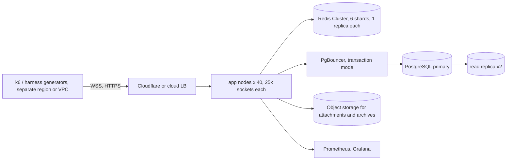

# Cloud load test: validating the full figures

This repository **has not been run at the target scale**. One laptop cannot hold 1,000,000 connections: loopback connections cost two file descriptors each in a kernel table of about 30,000 here. What was run, and what is only a model, is in [SCALING.md](SCALING.md#measured-versus-extrapolated) and [PERFORMANCE.md](PERFORMANCE.md). This guide is how to turn the extrapolated figures into measured ones in a cloud account. **None of the manifests or commands below were applied or executed from this repository's environment** (no cloud account, no Kubernetes cluster, no k6 here); they are written to be run, reviewed first.

## Targets to validate

| Target | Pass criterion |
| --- | --- |
| 1,000,000 concurrent WebSockets | the cluster holds them for 30 minutes at steady state with no unplanned disconnects (reconnects only from planned drains) |
| 25,000 connections per node | RSS per node below the node memory limit with 25% headroom; event-loop lag p99 below 100 ms |
| 10,000 messages/s ingest (peak 25,000/s) | ack p99 below 400 ms, server fan-out p99 below 150 ms, end-to-end p99 below 400 ms |
| Zero lost, zero duplicated, order preserved | the harness's sequence check reports `seq_gaps = 0`, `duplicates = 0` and the database audit (distinct client ids == stored messages) agrees, including through a node kill, a Redis failover and a rolling deploy |
| Tail latency under a hot room | other rooms' p99 unchanged while one room takes 1,000 writers |

## Topology to build



| Component | Starting size (a sketch to adjust after the first run) |
| --- | --- |
| App nodes | 40 x 4 vCPU / 16 GB (for example `c7i.xlarge`), 1 process per node, `UV_THREADPOOL_SIZE=8`, `--max-old-space-size=3072`; kernel tuning from [SCALING.md](SCALING.md#node-tuning) |
| Redis | Redis Cluster, 6 primaries x 2 vCPU / 8 GB (`m7g.large`-class) with replicas, or a managed cluster (ElastiCache) |
| PostgreSQL | 16 vCPU / 64 GB primary (`r7i.4xlarge`-class) with provisioned IOPS, 2 replicas; `MESSAGE_HASH_PARTITIONS=64` before first start; PgBouncer on dedicated 2 vCPU nodes, `DATABASE_PGBOUNCER=true` |
| Generators | 60 x 8 vCPU (`c7i.2xlarge`) so each opens about 17,000 sockets from its own address range; ephemeral-port limits apply per source address and destination, so use several destination addresses (several LB IPs or a hostname fan) |
| Load balancer | L4/L7 with WebSocket support and an idle timeout above 120 s (`deploy/nginx.conf` and `deploy/haproxy.cfg` show the settings used locally) |

A Kubernetes layout is in `deploy/k8s` (Deployment with preStop drain, PodDisruptionBudget, topology spread, HPA) and `deploy/k8s-keda` (a `ScaledObject` that scales on connections per pod, not CPU). A Terraform skeleton, as a starting point only:

```hcl
# NOT VALIDATED. Replace names, CIDRs and sizes. Module names are placeholders for your own modules.
module "network"  { source = "./modules/vpc"      cidr = "10.20.0.0/16" azs = ["a", "b", "c"] }
module "redis"    { source = "./modules/redis"    shards = 6 replicas_per_shard = 1 node_type = "cache.m7g.large" }
module "postgres" { source = "./modules/postgres" instance_class = "db.r7i.4xlarge" replicas = 2 iops = 20000 }
module "eks"      { source = "./modules/eks"      node_group = { instance = "c7i.xlarge", min = 40, max = 60 } }
module "loadgen"  { source = "./modules/asg"      instance = "c7i.2xlarge" count = 60 region = "us-west-2" } # separate region: honest RTT
```

## Run it

1. **Prepare data.** Load a realistic dataset first: `node loadtest/dataset.mjs --rows 50000000 --url postgres://...` (the same loader that produced the 50M-row figures; see PERFORMANCE.md) so partitions, indexes and caches have realistic size.
2. **Deploy** the app with `kubectl apply -k deploy/k8s-keda`, set the environment from [CONFIGURATION.md](CONFIGURATION.md) (at least `DATABASE_URL`, `REDIS_URL`, `JWT_SECRET`, `TRUST_PROXY=true`, `TRUSTED_PROXY_HOPS`), and set `RATE_LIMIT_SCALE` high **only for the generators' source addresses' sake** or, better, add them to the limiter's allow list (`POST /admin/api/ratelimit/allow` for `ip:` entries) so the limits under test stay the product's.
3. **Create the workspace and embed token** (register, then *Settings > Embed tokens* for the generators' Origin) and export `API_KEY`/`ORIGIN`.
4. **Run the generators** with k6 and the k6 operator (`loadtest/k6/chat.js`, `loadtest/k6/testrun.yaml`):

   ```bash
   kubectl apply -f https://github.com/grafana/k6-operator/releases/latest/download/bundle.yaml
   kubectl create configmap chat-script --from-file=loadtest/k6/chat.js
   kubectl apply -f loadtest/k6/testrun.yaml          # parallelism = number of generator pods
   # or one box at a time:
   k6 run -e BASE=https://chat.example.com -e API_KEY=cvt_... -e ORIGIN=https://shop.example.com -e VUS=17000 -e RATE=0.2 loadtest/k6/chat.js
   ```

   The Node harness (`loadtest/run.mjs`) does the same with sequence checking (gaps, duplicates, order) and per-node CPU/RSS sampling; use it for the correctness scenarios (`multinode`, `fault`, `storm`, `idempotency`) at the largest size one generator fleet can drive, and k6 for the connection count.
5. **Ramp** in steps (100k, 250k, 500k, 750k, 1M) holding 10 minutes each; record at every step the table below. Stop a step when a threshold fails and note the first bottleneck.
6. **Faults at the 250k step:** kill one node (`kubectl delete pod --force --grace-period=0`), fail over a Redis shard, fail over PostgreSQL (managed failover), run a rolling deploy. Expect: reconnects spread by jitter, zero loss, zero duplicates (verify with the audit query: stored messages equal distinct client ids per room, `seq` contiguous).
7. **Soak** at the 1M step (or the highest passing step) for at least 60 minutes; watch RSS growth, event-loop lag, GC pauses and Redis memory.

## Result tables to fill in

| Step | Open sockets | Nodes | RSS/node (p100) | CPU/node (avg) | Loop lag p99 | Connect p99 | Ack p99 | Fan-out p99 | Gaps | Dups |
| --- | ---: | ---: | ---: | ---: | ---: | ---: | ---: | ---: | ---: | ---: |
| 1 | 100,000 | | | | | | | | | |
| 2 | 250,000 | | | | | | | | | |
| 3 | 500,000 | | | | | | | | | |
| 4 | 750,000 | | | | | | | | | |
| 5 | 1,000,000 | | | | | | | | | |

| Ingest | Messages/s | DB insert p99 | Redis ops/s per shard | Replica lag p99 | Outbox lag p99 |
| --- | ---: | ---: | ---: | ---: | ---: |
| steady 10,000/s | | | | | |
| peak 25,000/s | | | | | |

| Fault | Duration | Disconnected | Lost | Duplicated | Time to 99% reconnected |
| --- | --- | ---: | ---: | ---: | ---: |
| kill 1 node | | | | | |
| Redis shard failover | | | | | |
| PostgreSQL failover | | | | | |
| rolling deploy | | | | | |

Compare against the model constants in [SCALING.md](SCALING.md): if a measured constant is worse by more than 30%, the sizing table must be updated, and the first super-linear cost found is the next thing to fix.

## Rough monthly cost (on-demand, us-east-1-class list prices, **assumptions, not a quote**)

| Item | Quantity | Approx. USD / month |
| --- | --- | ---: |
| App nodes 4 vCPU / 16 GB | 40 | 40 x 125 = 5,000 |
| Redis Cluster (6 x 2 primaries+replicas) | 12 nodes | 12 x 110 = 1,300 |
| PostgreSQL 16 vCPU / 64 GB + 2 replicas + 5 TB io2 | 3 instances | 3 x 1,500 + 5,000 storage/IOPS = 9,500 |
| PgBouncer nodes | 3 | 3 x 60 = 180 |
| Load balancer and data transfer (1M sockets, light traffic) | | 1,500 to 4,000 |
| Observability (metrics, logs) | | 500 to 1,500 |
| Object storage (attachments, archives) | 20 TB | 460 |
| **Total steady state** | | **about 18,000 to 22,000** |

Assumptions: list prices without reserved-instance or savings-plan discounts (30 to 50% lower is typical for steady load), 25,000 sockets per node, 10,000 messages/s sustained, 100M messages/day retained for 30 days online then archived. The load-test fleet (60 generators) adds roughly 60 x 0.34 USD/hour of use: a four-hour run costs about 80 USD. Ten billion retained rows are an archival problem, not an online-storage one: keep 30 to 90 days in PostgreSQL and the rest as compressed NDJSON in object storage ([RUNBOOK.md](RUNBOOK.md), disk playbook).
