# Functions: modules, background work, events and data model

This is a map of the code. It tells you which module does what, what runs in the background, which socket events exist and how the tables relate. It is written by hand from the source in `server/src` and `web/src`. When it disagrees with the code, the code wins; please fix this page.

Related documents:

- [ARCHITECTURE.md](ARCHITECTURE.md): the system context, containers, key flows and limits.
- [API.md](API.md): every REST route with its permission and rate limit (generated from `server/src/apidoc/meta.ts`).
- [REALTIME.md](REALTIME.md): the Socket.IO protocol with full payloads.
- [CONFIGURATION.md](CONFIGURATION.md): every environment variable (generated).
- [RBAC.md](RBAC.md): permissions and roles.

All server paths below are relative to `server/src`.

## Server modules

### Entry, context and HTTP

| Module | What it does | Main exports |
| --- | --- | --- |
| `index.ts` | Process entry. Loads config, starts Sentry and OpenTelemetry, builds the context and the app, starts HTTP (keep-alive 65 s) and Socket.IO. Starts the scheduler and the outbox relay when `SCHEDULER_ENABLED` is set. On SIGTERM or SIGINT: readiness turns 503, the scheduler and outbox stop, sockets drain, then everything closes. | (entry point) |
| `app.ts` | Builds the Hono app: middleware, then the routers (see [Request path](#request-path)). Also `/healthz`, `/readyz`, `/metrics`. | `createApp` |
| `app-context.ts` | Wires the database (migrations and message partitions at boot), Redis, cache, locks, presence, event bus, job queue, rate limiter, providers, AI, avatar and realtime engines. | `createContext`, `closeContext`, `ContextOverrides` |
| `context.ts` | The `AppContext` interface every service receives. | `AppContext`, `BackgroundTracker`, `nowIso` |
| `config.ts`, `configMeta.ts` | The zod schema for environment variables, and the human text for each one that feeds CONFIGURATION.md. | `loadConfig`, `Config`, `CONFIG_META` |
| `http.ts` | Hono helpers and the auth middleware. | `requireAuth`, `requireLiveSeat`, `requireManager`, `parseBody`, `validate`, `clientIp` |
| `errors.ts` | Typed HTTP errors. | `AppError`, `badRequest`, `forbidden`, `notFound`, `conflict`, `tooMany`, ... |
| `schemas.ts` | Every zod request schema for REST and sockets. | `*Body`, `*Query`, `TeamSocket*`, `GroupCall*`, `Avatar*` |
| `seed.ts` | Development demo workspace. Refuses to run in production. | `seed`, `DEMO_EMAIL` |
| `logger.ts`, `metrics.ts`, `telemetry.ts` | Structured logs, Prometheus metrics, optional OpenTelemetry. | `createLogger`, `Metrics`, `startTelemetry` |
| `static.ts` | Serves the built web app with ETag and cached gzip/brotli. | `serveSpa` |

### Domain services (`services/`)

| Module | What it does |
| --- | --- |
| `accounts.ts` | Sessions, refresh-token rotation, two-factor, password reset and change, invitations. |
| `auth.ts` | Access JWTs, register, login, the read-only support view. |
| `members.ts` | Seats (cached lookup), add, update, remove, visibility scope, do-not-disturb, notification preferences. |
| `roles.ts` | Custom roles and `setMemberRole`. |
| `workspaces.ts` | Workspace settings and the credits ledger (`applyLedger`, `recordUsage`, `creditCost`). |
| `contacts.ts` | Contacts, followers, notes, CSV import, SMS opt-out. |
| `rooms.ts`, `roomStore.ts`, `audience.ts` | Customer conversations: listing, filters, counts, assign, snooze and wake, status, priority, favourites, read cursors; who may see a room and which socket channels receive it. |
| `messages.ts`, `messageStore.ts`, `messageRefs.ts` | Agent sends, edit, delete, retry, search; `insertMessage` (sequence numbers, idempotency keys, outbox write, ticket hook) and the DTOs sent to the team and to the visitor. |
| `delivery.ts` | Sends a message to Twilio or SendGrid, with pacing, retries and SMS status reconciliation. Adds `Auto-Submitted` to AI emails. |
| `inbound.ts` | Inbound SMS and email webhooks, delivery events, STOP handling, auto-reply detection (`meta.auto`). |
| `channelConnections.ts`, `channels.ts` | Per-workspace Twilio and SendGrid credentials (encrypted), verification, imports, test sends, channel health. |
| `postProcess.ts` | After a contact or agent message: AI triage, auto-responder, away message. |
| `notifications.ts`, `digest.ts` | In-app notifications, notification emails, the missed-message digest. Calls `notifyPush`. |
| `tickets.ts` | Ticket lifecycle (open, resolve, close, reopen, merge, rate), sweeps, `ticket:updated`. |
| `routing.ts`, `routingRules.ts`, `departments.ts`, `inboxes.ts`, `office.ts` | Departments, hours, capacity, routing modes, handoff, transfer, queue drain, service levels, routing rules. |
| `visitors.ts`, `visitorChat.ts`, `visitorInfo.ts` | Widget tokens, visitor sessions and OTP; visitor-side rooms and messages; pre-chat and in-thread contact forms (custom fields, consent, per-department overrides). |
| `transcripts.ts` | Conversation copies by email: who may receive them, the content, the automatic copy after resolve, signed unsubscribe. See [TRANSCRIPTS.md](TRANSCRIPTS.md). |
| `teamChat.ts`, `teamShare.ts` | Team chat channels, DMs, groups, threads, reactions, pins, search, retention; shared conversation cards. |
| `templates.ts`, `settings.ts` | Reply templates; SMS numbers, senders, inbound addresses, knowledge base entries. |
| `identity.ts`, `hostedChat.ts`, `widgetPreview.ts` | Signed visitor identity; the hosted `/chat` and `/call` pages; signed preview links. |
| `analytics.ts`, `supportAnalytics.ts`, `roomMetrics.ts`, `apiKeys.ts` | Dashboard and API metrics, per-room facts (written to the outbox), analytics API keys. |
| `archive.ts`, `attachments.ts`, `audit.ts`, `gettingStarted.ts` | Retention and archive, uploads, audit log, the onboarding checklist. |

### AI (`ai/`, `agents/`)

| Module | What it does |
| --- | --- |
| `ai/provider.ts`, `ai/heuristic.ts` | The AI provider interface, the Anthropic provider, and the offline rules-based provider used without a key. |
| `ai/service.ts`, `ai/retrieval.ts`, `ai/text.ts` | Suggested replies, summaries, rewrite, triage, auto-responder; BM25 knowledge search; redaction and prompt safety helpers. |
| `agents/pipeline.ts` | One AI agent turn: decide, apply, post. Shared by chat, SMS and email (`channel` on the turn input). |
| `agents/config.ts`, `agents/tools.ts` | AI agent CRUD and the closed list of tools an agent may call (including `send_transcript`). |
| `agents/channelReply.ts`, `agents/channelText.ts` | AI answers on SMS and email: loop protection, quoted-text stripping, SMS segments, numbered options, the HUMAN keyword. |
| `agents/classify.ts`, `agents/safety.ts`, `agents/humanRequest.ts` | Department classification, injection and claim checks, "asks for a person" and sensitive topics. |
| `agents/handover.ts`, `agents/visitorActions.ts`, `agents/review.ts`, `agents/sandbox.ts` | Hand back to the AI, visitor quick replies and feedback, the review and unanswered views, the sandbox. |
| `agents/avatar.ts`, `agents/presets.ts` | Uploaded agent pictures and the bundled presets ("Aria", "vb"). |

### Calls (`calls/`, `avatar/`)

| Module | What it does |
| --- | --- |
| `calls/service.ts`, `calls/machine.ts` | Agent-to-visitor browser and phone calls: state machine, signalling relay, reconnects, the master sweep `sweepCalls`. |
| `calls/aiCall.ts`, `calls/speech.ts` | Calls with the AI assistant using the visitor's browser speech. Starts and ends photoreal avatar sessions. |
| `calls/realtime.ts`, `calls/realtimeCall.ts` | The optional OpenAI realtime voice engine. |
| `calls/phone.ts` | Twilio Voice click-to-call, consent, quiet hours. |
| `calls/teamCall.ts` | 1:1 calls between teammates from a DM. |
| `calls/groupCall.ts`, `calls/groupMachine.ts` | Group mesh calls of up to 4 people in a channel or group DM. |
| `calls/links.ts`, `calls/turn.ts` | Call links; ICE and TURN configuration. |
| `avatar/provider.ts`, `avatar/did.ts`, `avatar/fake.ts` | The `AvatarProvider` interface, the D-ID adapter, the fake used by tests. |
| `avatar/service.ts` | Connect, test and disconnect the provider key (encrypted with `DATA_ENCRYPTION_KEY`), avatars, per-call sessions, budget and concurrency. |

### Push, channels, providers, billing

| Module | What it does |
| --- | --- |
| `push/webpush.ts` | Web Push on `node:crypto` and `jose`: RFC 8291 payload encryption, RFC 8292 VAPID. No extra dependency. |
| `push/service.ts` | Subscriptions (at most 10 per member), the endpoint allow-list, `notifyPush` (enqueues `push_send`), `sendPushJob`. See [NOTIFICATIONS.md](NOTIFICATIONS.md). |
| `channels/rules.ts` | Pure SMS and email rules: STOP keywords, E.164, number and sender choice, threading. |
| `providers/*` | Twilio SMS, SendGrid email, fake and console providers, local disk storage, provider error mapping, the per-workspace provider registry. |
| `billing/*` | Stripe plans, credits, auto-recharge, Connect payment requests, webhooks; a fake for tests. |
| `webhooks/signatures.ts` | Twilio and SendGrid signature checks and webhook dedupe. |

### Infrastructure

| Module | What it does |
| --- | --- |
| `db/index.ts`, `db/partitions.ts` | The SQLite and PostgreSQL `Db` abstraction, the migration runner, monthly message partitions on PostgreSQL. |
| `domain/settings.ts`, `domain/types.ts` | Workspace settings schemas (`WorkspaceSettingsSchema`, `mergeSettings`, `publicWidgetConfig`) and shared types. |
| `authz/permissions.ts`, `authz/routePerms.ts`, `authz/http.ts` | The permission catalogue and built-in roles, the per-route and per-event access tables, the route check. |
| `ratelimit/*` | The layered limiter: policies, per-route and per-event limits, memory and Redis stores, send limits. |
| `realtime/socket.ts`, `realtime/bus.ts`, `realtime/presence.ts` | Socket.IO server, handshake, admission, event handlers, slow-consumer sweep, drain; the `RealtimeBus` used by services. |
| `jobs/queue.ts`, `jobs/scheduler.ts` | Job queue (database or BullMQ) and the scheduler. |
| `events/outbox.ts`, `infra/eventbus.ts` | Transactional outbox and the event bus. |
| `infra/locks.ts`, `infra/cache.ts`, `infra/presence.ts`, `infra/redis.ts` | Distributed locks, short-lived cache, presence, the Redis connection hub. |
| `monitoring/sentry.ts`, `monitoring/scrub.ts` | Optional Sentry with an allow-list scrubber. |
| `admin/*` | The platform operator console (separate login with two-factor). |
| `workers/*` | Worker threads for CPU-heavy HTML sanitising. |
| `util/*` | Passwords, data encryption, TOTP, HTML, ids, cursors, CSV, CIDR, client IP, phone, redaction, time. |

### Routers (`routes/`)

| Router | Mounted at | Covers |
| --- | --- | --- |
| `authRoutes` | `/api/auth` | register, login, refresh, two-factor, passwords, invitations |
| `adminRoutes` | `/admin/api` | the operator console |
| `analyticsApiRoutes` | `/api/v1/analytics` | the API-key analytics API |
| `teamRoutes`, `roomRoutes`, `ticketRoutes`, `callRoutes`, `pushRoutes`, `departmentRoutes`, `agentRoutes`, `settingsRoutes`, `roleRoutes`, `analyticsRoutes`, `billingRoutes`, `channelRoutes`, `teamChatRoutes`, `invitationRoutes` | `/api` | the team app API (signed-in members) |
| `publicRoutes` | `/public` | the widget and visitor API, transcripts unsubscribe |
| `callPageRoutes`, `chatRoutes` | `/call`, `/chat` | the call-link page and the hosted chat page |
| `webhookRoutes` | `/webhooks` | Twilio, SendGrid, Stripe |

### Clients

| Path | What it is |
| --- | --- |
| `web/src/pages` | Top-level screens: inbox, tickets, team, analytics, sign-in pages, and `pages/settings/*` (one file per settings section). |
| `web/src/components` | Shared UI: app shell and navigation, inbox list and contact panel, chat thread, composer, ticket menu, command palette, charts. |
| `web/src/calls` | Call engines and UI: visitor calls (`engine.ts`, `CallProvider.tsx`), teammate calls (`teamEngine.ts`), group mesh calls (`groupEngine.ts`, `GroupCallProvider.tsx`), phone calls. |
| `web/src/team` | Team chat: sidebar, channel view, threads, details, composer, dialogs. |
| `web/src/api`, `web/src/state`, `web/src/realtime` | REST client and query hooks, message and room caches with optimistic sends, the socket provider. |
| `web/src/lib` | Pure helpers: composer rules, shortcuts, ticket labels, push subscription (`push.ts`). |
| `web/src/admin` | The operator console UI. |
| `web/public/sw.js` | The service worker that shows Web Push notifications. |
| `server/public/widget.js` | The embeddable chat widget (no build step). |
| `server/public/chat/*` | The hosted chat (`chat.js`, `chat.css`, `i18n.js`, `bridge.js`), visitor calls (`calls.js`), AI calls and the photoreal avatar (`aicall.js`), the call-link page (`callpage.js`). After editing `chat.css` or the CSS in `aicall.js`, run `node server/scripts/sync-chat-css.mjs`. |

## Request path

Middleware order in `app.ts`:

1. Request id (`x-request-id`, a sane client value is kept), access log, latency histogram, monitoring trace.
2. Rate limiting (`rateLimitMiddleware`), by route policy from `ratelimit/routePolicies.ts`.
3. Compression and a request timeout for `/api/*` and `/public/*`.
4. Security headers (the hosted `/chat` and `/call` pages set their own CSP).
5. CORS: an allow-list from `CORS_ORIGINS` for `/api/*`; any origin for `/public/*` (the embed token's domain decides access).
6. Body size limits (a larger limit for attachment uploads).
7. For `/api/*`: `requireAuth` verifies the access token, then `authorizeRoute` checks `ROUTE_ACCESS` in `authz/routePerms.ts`. A route that is not in the table is refused (deny by default).

Socket events follow the same idea: `EVENT_ACCESS` in `authz/routePerms.ts` gives each client event a permission, and `EVENT_LIMITS` in `ratelimit/routePolicies.ts` gives it a limit.

Adding a route or an event means declaring it in four places. Tests fail if one is missing.

| Place | What it declares |
| --- | --- |
| `authz/routePerms.ts` | `ROUTE_ACCESS` or `EVENT_ACCESS`: the permission, or `authed`, `public`, `platform` |
| `ratelimit/routePolicies.ts` | `ROUTE_LIMITS` or `EVENT_LIMITS`: the rate-limit policy |
| `apidoc/meta.ts` | the API documentation entry (REST routes) |
| `server/scripts/gen-realtime-doc.ts` | the payload and audience text (socket events, including server-emitted ones) |

Then run `npm run docs:generate --prefix server` and `npm run docs:check --prefix server`. A new rate-limit policy must be used by a route, or listed in the extra-used list of `server/tests/ratelimit.http.test.ts`.

## Background work

Background work runs only on nodes with `SCHEDULER_ENABLED` set.

### Jobs

Jobs live in the `jobs` table (`DbJobQueue`), or in BullMQ when `REDIS_URL` is set. The database queue takes at most 50 jobs per pass and at most 5 per workspace. Failed jobs retry with backoff `min(900 s, 2^attempts s)` up to `max_attempts` (default 6), then are marked failed and reported to monitoring.

| Type | Payload | Enqueued by | Handler | Dedupe and retries |
| --- | --- | --- | --- | --- |
| `send_retry` | `message_id` | `services/delivery.ts` after a retryable provider failure | `retryDelivery` | `send_retry:<id>:<n>`; up to `SEND_RETRY_MAX_ATTEMPTS` |
| `paced_send` | `message_id` | `delivery.ts` when a number or workspace is over its pace | `deliverMessage` | `paced:<id>` |
| `notify_email` | `notification_id` | `notifications.ts`, `teamChat.ts` | `sendNotificationEmail` | `notify_email:<id>` |
| `push_send` | `subscription_id`, `message` | `push/service.ts` `notifyPush`, one per subscription | `sendPushJob` | `push::<key>`; at most 4 attempts |
| `auto_recharge` | `workspace_id`, `bucket` | `billing/credits.ts` `onBalanceChanged` | `runAutoRecharge` | `auto_recharge:<ws>:<bucket>` |
| `digest_email` | `member_id`, `items` | `digest.ts` `collectDigests` | `sendDigestEmail` | per member and window |
| `wake_room` | `room_id`, `until` | `rooms.ts` `snoozeRoom`, run at the snooze time | `wakeRoom` | `wake:<room>:<iso>` |
| `reconcile_sms` | `message_id`, `attempt` | `delivery.ts`, 2 minutes after an SMS send | provider `fetchStatus` | re-enqueues itself at 2^(attempt+1) minutes, up to attempt 5 |

### Timers

| Every | Lock | Work |
| --- | --- | --- |
| 5 s | none (each change is a compare-and-set) | `sweepCalls`: phone calls, AI calls (and their realtime and avatar sessions), browser call ring, connect and reconnect timeouts, then `sweepGroupCalls` and `sweepTeamCalls` |
| 5 s | none | `runDueJobs`, only for the database queue |
| 60 s | `scheduler-sweep` | wake overdue snoozes, collect digests, reconcile SMS still "sent" (2 minutes to 72 hours old, 50 per pass), ticket sweep (idle AI tickets, pending-on-customer, close after the reopen window), service-level sweep, drain department queues |
| 6 h | `scheduler-daily` | create message partitions ahead (PostgreSQL), message retention and archive, ticket purge, prune `message_qids` older than 30 days, team chat retention |

Other timers: socket event-loop lag sampling (1 s), slow-consumer sweep (2 s), connection lease renewal (100 s), presence coalescing (150 ms), receipt coalescing (100 ms), Redis presence heartbeat (10 s), block/allow list reload (5 s), PostgreSQL replica lag probe (2 s).

### Outbox and event bus

`writeOutbox(topic, key, payload)` inserts into `outbox_events` inside the caller's transaction. The relay polls every 200 ms under the lock `outbox-relay`, publishes up to 20 batches of 500 rows in order to the event bus, and marks them published. Delivery is at least once. Published rows older than 24 hours are pruned hourly.

| Topic | Written by | Payloads | Consumers |
| --- | --- | --- | --- |
| `message.events` | `messageStore.ts` `insertMessage` | `message.created` | group `rollup`: counts messages per day, channel and direction in `rollup_messages_daily` (deduplicated through `consumed_events`) |
| `room.events` | `roomMetrics.ts` | `room.opened`, `room.first_response`, `room.closed`, `room.csat` | none in this code base. They are relayed but nothing consumes them. |

Bus implementations: `MemoryBus` (in process, without Redis) and `RedisStreamsBus` (16 partitions per topic, leases, 5 deliveries then a dead-letter stream). `KafkaBus` and `NatsBus` are stubs that throw.

## Socket events

One Socket.IO namespace per workspace, `/ws/<workspace id>`. Inside it, sockets join channels: `team`, `member:<id>`, `managers`, `inbox:<id>`, `inboxv:<id>`, `vroom:<room>` (visitors), `vcall:<room>` (call-link sessions), `session:<id>`. The team audience of a room is managers, plus agents who see the room's inbox, plus each assignee. Full payloads are in [REALTIME.md](REALTIME.md).

Client events answer with an acknowledgement `{ok: true, ...}` or `{ok: false, error: {code, message, details}, retry_after_ms?}`.

### Server to client

| Family | Events | Sent to |
| --- | --- | --- |
| Conversations | `message:new`, `message:updated`, `message:deleted`, `message:receipt`, `typing`, `room:new`, `room:updated`, `room:deleted`, `room:unread`, `visitor:presence`, `ticket:updated` | the room's team audience; a visitor copy (no notes, no internal lines) to `vroom:<room>`; `room:unread` to the member |
| Workspace | `presence:update`, `member:updated`, `member:removed`, `contact:updated`, `inbox:new`, `inbox:updated`, `auth:expired` | `team` (or one socket for `auth:expired` on token expiry) |
| Notifications | `notification:new`, `notification:read` | the member |
| Team chat | `team:message:new`, `team:message:updated`, `team:message:deleted`, `team:reaction`, `team:read`, `team:channel:created`, `team:channel:updated`, `team:channel:removed`, `team:channel:members`, `team:typing` | the channel's members, each with their own copy |
| Visitor calls | `call:state`, `call:offer`, `call:answer`, `call:ice`, `call:peer`, `aicall:avatar_state` | state to the team audience and visitor; signalling to the peer socket only |
| Teammate calls | `tcall:state`, `tcall:offer`, `tcall:answer`, `tcall:ice`, `tcall:peer` | caller and callee |
| Group calls | `gcall:state`, `gcall:offer`, `gcall:answer`, `gcall:ice`, `gcall:peer` | each participant; signalling to the target participant's socket |
| Connection | `session:verified`, `server:resync`, `server:overflow`, `server:draining`, `rate:limited` | the affected sockets |

### Client to server

| Family | Events | Permission |
| --- | --- | --- |
| Conversations | `message:send`, `message:read`, `room:create`, `room:update`, `room:assign`, `typing` | `conversations:reply` or `conversations:read` for team sockets; visitors may send, read, create and type in their own rooms |
| Visitor | `otp:verify` | visitor sockets only |
| Presence | `presence:list` | `members:read` |
| Visitor calls | `call:invite`; `call:request`, `call:accept`, `call:decline`; `call:end`, `call:connected`, `call:failed`, `call:resume`, `call:offer`, `call:answer`, `call:ice` | `calls:make` for team sockets; request, accept and decline are visitor-only |
| AI calls | `aicall:start`, `aicall:say`, `aicall:end`, `aicall:handoff`, `aicall:tool`, `aicall:transcript`, `aicall:fallback`, `aicall:avatar` | visitor sockets only |
| Teammate calls | `tcall:invite`, `tcall:accept`, `tcall:decline`, `tcall:end`, `tcall:connected`, `tcall:failed`, `tcall:resume`, `tcall:offer`, `tcall:answer`, `tcall:ice` | `calls:internal` |
| Group calls | `gcall:start`, `gcall:join`, `gcall:leave`, `gcall:decline`, `gcall:invite`, `gcall:media`, `gcall:share`, `gcall:resume`, `gcall:offer`, `gcall:answer`, `gcall:ice` | `calls:internal` |
| Team chat | `team:message:send`, `team:typing`, `team:read`, `team:reaction` | `team_chat:use` |

Support-view (impersonation) sockets are read-only: every emit is refused. Call-link sessions may only use the call events and the `aicall:*` events.

## Data model

Conventions: ids are text with a prefix; timestamps are ISO-8601 text; booleans are 0 or 1; JSON is stored in text columns. Almost every row carries `workspace_id`, and deleting a workspace cascades. "Logical" below means an id column without a declared foreign key.

The same migration files run on SQLite and PostgreSQL. A `.pg.sql` file runs only on PostgreSQL and a `.sqlite.sql` file only on SQLite; applied files are recorded in `_migrations`. On PostgreSQL `messages` is partitioned (16 hash partitions by room, each split by month) and has no primary key; sequence uniqueness comes from the room row lock and idempotency from `message_qids`.

### Tables by area

| Area | Tables | Notes |
| --- | --- | --- |
| Tenancy and identity | `workspaces`, `users`, `members`, `roles`, `auth_sessions`, `refresh_tokens`, `recovery_codes`, `password_resets`, `invitations`, `workspace_identity`, `api_keys`, `analytics_pepper`, `audit_log`, `rate_limit_overrides`, `platform_admins` | `members` is a seat (user in one workspace), unique per (workspace, user). System roles cannot be changed (triggers). `audit_log` is append-only. |
| Contacts and visitors | `contacts`, `contact_followers`, `contact_notes`, `tokens`, `visitor_sessions` | Email (lower-cased) and phone are unique per workspace among live contacts. One active token per domain. |
| Inboxes and routing | `inboxes` (also the departments), `inbox_members`, `routing_rules` | `inboxes.visitor_info` holds per-department visitor detail overrides, custom field modes and consent text. |
| Conversations | `rooms`, `room_assignees`, `room_favorites`, `room_reads`, `messages`, `message_qids`, `message_refs`, `message_mentions`, `message_locks`, `attachments`, `archive_manifest` | One live room per contact. `message_locks` pins the sender number or address and routes replies. |
| Metrics | `room_metrics`, `rollup_messages_daily` | Written from the outbox and room events. |
| Channels | `sms_numbers`, `email_senders`, `inbound_addresses`, `channel_health`, `channel_connections`, `channel_events`, `webhook_events` | `channel_connections.credentials_enc` is encrypted with `DATA_ENCRYPTION_KEY`. |
| Content | `templates`, `kb_entries` | |
| Notifications and jobs | `notifications`, `push_subscriptions`, `jobs`, `outbox_events`, `consumed_events` | `push_subscriptions` is unique per (member, endpoint) and stores `events`, `failures`, `disabled_at`. |
| Billing | `usage_ledger`, `billing_accounts`, `stripe_events`, `payment_requests` | |
| Team chat | `team_channels`, `team_channel_members`, `team_messages`, `team_reactions`, `team_mentions` | One `#general` per workspace. |
| Tickets and AI | `ticket_counters`, `tickets`, `ticket_events`, `ai_agents`, `ai_turns`, `ai_feedback`, `transcript_sends` | One live ticket per room. `tickets.handler` is `bot:<agent>` or `human:<member>`. At most one automatic transcript per ticket. |
| Calls | `calls`, `team_calls`, `call_links`, `group_calls`, `group_call_participants` | One live call per room, per DM and per group channel. A member is joined to at most one group call. |
| Photoreal avatars | `avatar_connections`, `photoreal_avatars`, `avatar_sessions` | One connection per workspace, key encrypted. At most one live avatar session per call. |

### Entity relationships

Only the main tables are shown. Labels ending in "logical" are id columns without a declared foreign key.

```mermaid
erDiagram
  workspaces ||--o{ members : "has"
  users ||--o{ members : "is seated as"
  roles ||--o{ members : "role_id logical"
  workspaces ||--o{ roles : "custom roles"
  workspaces ||--o{ contacts : "has"
  workspaces ||--o{ tokens : "has"
  tokens ||--o{ visitor_sessions : "token_id logical"
  contacts ||--o{ visitor_sessions : "has"
  workspaces ||--o{ inboxes : "has"
  inboxes ||--o{ inbox_members : "has"
  members ||--o{ inbox_members : "belongs"
  contacts ||--o{ rooms : "has"
  inboxes ||--o{ rooms : "routes"
  rooms ||--o{ messages : "contains"
  rooms ||--o{ tickets : "has"
  contacts ||--o{ tickets : "raises"
  inboxes ||--o{ tickets : "department"
  tickets ||--o{ ticket_events : "logs"
  tickets ||--o{ ai_turns : "has"
  ai_agents ||--o{ ai_turns : "agent_id logical"
  workspaces ||--o{ ai_agents : "has"
  rooms ||--o{ transcript_sends : "copies"
  rooms ||--o{ calls : "has"
  rooms ||--o{ call_links : "has"
  ai_agents ||--o{ calls : "ai_agent_id logical"
  calls ||--o{ avatar_sessions : "call_id logical"
  photoreal_avatars ||--o{ avatar_sessions : "avatar_id logical"
  ai_agents }o--o| photoreal_avatars : "photoreal_avatar_id logical"
  workspaces ||--o| avatar_connections : "has"
  workspaces ||--o{ photoreal_avatars : "has"
  workspaces ||--o{ team_channels : "has"
  team_channels ||--o{ team_channel_members : "has"
  members ||--o{ team_channel_members : "joins"
  team_channels ||--o{ team_messages : "contains"
  team_channels ||--o{ team_calls : "has"
  team_channels ||--o{ group_calls : "has"
  group_calls ||--o{ group_call_participants : "has"
  members ||--o{ group_call_participants : "member_id logical"
  members ||--o{ notifications : "receives"
  members ||--o{ push_subscriptions : "registers"
  workspaces ||--o{ channel_connections : "has"
  workspaces ||--o| billing_accounts : "has"
  workspaces ||--o{ payment_requests : "has"
  rooms ||--o{ payment_requests : "room_id logical"
  workspaces ||--o{ jobs : "workspace_id logical"
  workspaces ||--o{ outbox_events : "payload logical"
```

### Migrations

| Migration | What it adds |
| --- | --- |
| 001_init | core tables: workspaces, users, members, contacts, tokens, visitor sessions, inboxes, rooms, messages, templates, KB, notifications, jobs, channels |
| 002_attachments | attachments |
| 003_notifications_email | notification email time, unique template shortcuts |
| 004_hot_path_indexes | indexes and backfills for room lists and digests |
| 005_plans_ratelimit_audit | workspace plan, rate-limit overrides, audit log |
| 006_outbox | outbox, consumed events, daily message rollups |
| 007_summaries_qids | message idempotency keys, last-message brief |
| 008_partition_messages (PostgreSQL) | partitioned messages table |
| 009_jobs_fairness | per-workspace job fairness |
| 010_archive | archive manifest |
| 011_message_refs | message locator |
| 012_rbac | roles and member role id |
| 013_immutability | triggers protecting system roles and the audit log |
| 014_auth | sessions, refresh tokens, two-factor, password resets, invitations |
| 015_analytics | room metrics, API keys, identity pepper |
| 016_billing, 016_roles_payments | billing accounts, Stripe events, payment requests; the payment permission |
| 017_admin | platform operators, workspace suspension |
| 018_home_region | workspace home region |
| 019_room_metrics_urgency (PostgreSQL) | urgency as a floating-point number |
| 020_delivery_test_mode | the `not_sent_test_mode` delivery state |
| 021_channel_health | channel health |
| 022_channel_connections | per-workspace Twilio and SendGrid connections and events |
| 023_widget_install | token last-seen origin, preview sessions |
| 024_team_chat | team chat tables |
| 025_team_chat_roles | team chat permissions |
| 026_mobile_hosted_chat | hosted chat per token, workspace identity, contact external id |
| 027_tickets | tickets, ticket events, counters, message ticket id |
| 028_roles_tickets | ticket permissions |
| 029_departments | department fields on inboxes, member skills, routing rules, ticket service levels |
| 030_roles_departments | `departments:manage` |
| 031_ai_agents | AI agents, turns, feedback, KB collections |
| 032_roles_agents | `agents:manage` |
| 033_department_visitor_info | per-department visitor details |
| 034_calls | calls |
| 035_roles_calls | `calls:make`, `calls:settings` |
| 036_ai_calls | AI calls (transport, kinds, engine) |
| 037_agent_avatar | uploaded agent pictures |
| 038_team_calls | teammate calls |
| 039_roles_calls_internal | `calls:internal` |
| 040_call_links | call links |
| 041_group_calls | group calls and participants |
| 042_push_subscriptions | Web Push subscriptions |
| 043_photoreal_avatar | avatar connections, photoreal avatars, avatar sessions, agent avatar id |
| 044_transcript_sends | transcript sends |

## Limitations of this page

- It is hand-written. Route and event lists are complete in the generated [API.md](API.md) and [REALTIME.md](REALTIME.md); this page groups them.
- The diagram leaves out tables that only hang off `workspaces` (for example `audit_log`, `api_keys`, `templates`) and most columns.
- `KafkaBus` and `NatsBus` are not implemented, and the `room.events` topic has no consumer.
