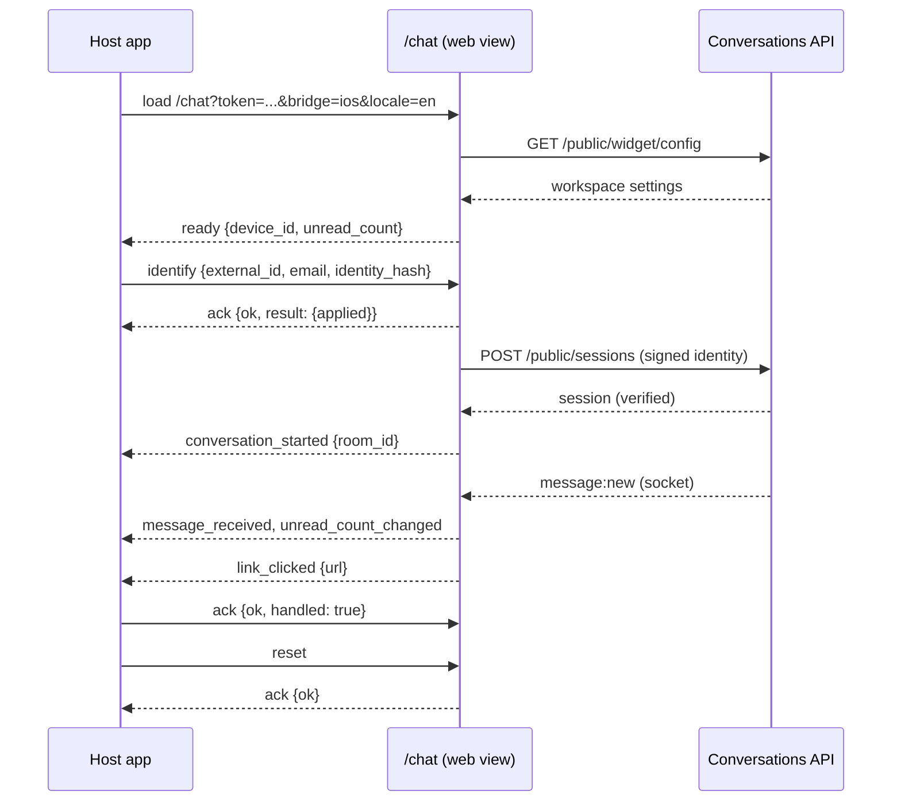
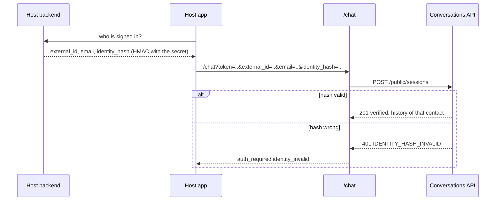

# Mobile: the hosted chat and its JavaScript bridge

How to put the chat into a native app (iOS, Android, React Native, Flutter) or an iframe: the full-page chat at `/chat`, the URL parameters, the origin and identity model, and the documented, versioned message bridge between your app and the page. Decisions: [ADR 0024](adr/0024-hosted-chat-origin-model.md), [ADR 0025](adr/0025-signed-visitor-identity.md), [ADR 0026](adr/0026-bridge-protocol-v1.md). Native wrappers: [MOBILE-SDKS.md](MOBILE-SDKS.md). Calling the API without a web view: [MOBILE-API.md](MOBILE-API.md).

Status: the page, the bridge and the server rules are implemented and tested in real Chromium (phone emulation, touch, light and dark) and with jsdom contract tests. Nothing here has been run inside a real `WKWebView` or Android `WebView` yet; the native wrappers are labelled in [MOBILE-SDKS.md](MOBILE-SDKS.md).

## Quick start

1. In the app: **Settings > Chat widget > Install**, choose (or create) a token, then switch on **Hosted chat for this token** under *Mobile apps and web views*. A token needs a "domain" even for a native app: use any hostname that identifies the app (for example `app.example.com`); it is also the list of sites that may frame the chat in an iframe.
2. Open `https://YOUR-APP/chat?token=cvt_...` in a web view. Optional parameters are below.
3. Listen for events and send commands with the bridge (iOS `WKScriptMessageHandler`, Android `@JavascriptInterface`, React Native `onMessage`, Flutter `JavaScriptChannel`, iframe `postMessage`).
4. Test the bridge against your deployment at `https://YOUR-APP/chat/bridge-test?token=cvt_...` (it plays the host and checks every command and event).

## URL parameters

Parameters never carry secrets other than the public embed token and the signed identity hash.

| Parameter | Meaning |
| --- | --- |
| `token` | required: the embed token (`cvt_...`) of a token with the hosted chat enabled |
| `name`, `email`, `phone` | what you know about the person; with `identity_hash` they identify them, without it they behave like the pre-chat form ([WIDGET.md](WIDGET.md#identity-checks-otp)) |
| `external_id`, `identity_hash` | your user id and the signature your backend made (see [Identity verification](#identity-verification)) |
| `locale` | BCP 47 tag; `en`, `es`, `fr`, `de`, `ja` are translated, `ar` and `he` switch to right-to-left, anything else falls back to English |
| `theme` | `light`, `dark` or `auto` (follow the system) |
| `primary_color` | `#rrggbb`; replaces the workspace colour (text colour is computed for contrast) |
| `bridge` | `ios`, `android`, `rn`, `flutter`, `iframe`, `none`; default `auto` detects the channel |
| `safe_area` | `1`: the page pads itself with `env(safe-area-inset-*)`; leave off when the web view already sits inside the safe area |
| `device_id` | the `device_id` from an earlier `ready` event, to continue the same anonymous visitor after the web view's storage was cleared |
| `close_button` | `1`: show a close button that emits `close_requested` |
| `debug` | `1`: log dropped bridge messages to the console and expose `window.__cv` |

## What the page does

Header (workspace title, intro, online dot), message list with sent and read receipts and times, typing indicator, composer with emoji and attachments (the system sheet offers camera, photo library and files; pictures and PDFs up to 10 MB, uploaded through `POST /public/attachments`), the pre-chat form when the workspace requires details you did not pass, the one-time-code step for a known contact, the satisfaction rating after a close, the welcome and away messages of the workspace (office hours are evaluated by the server), payment request cards.

Mobile behaviour that is built in and tested:

| Concern | How |
| --- | --- |
| keyboard | the page height follows `visualViewport` (CSS variable `--vvh`), `interactive-widget=resizes-content`, the list stays on the newest message, the composer font is 16 px so iOS does not zoom |
| safe areas | `safe_area=1`, `viewport-fit=cover` |
| touch | every control is at least 44 x 44 px (tested), no hover-only actions |
| history | the newest 30 messages load first; scrolling to the top (or pulling down, or the "Load earlier messages" button) pages older ones and keeps your place; new messages while you are scrolled up show a "New messages" pill |
| offline | an offline banner; unsent text stays in a queue (also saved in the page's storage) and goes out, idempotently by `client_msg_id`, when the network or socket returns; a failed message shows "Retry" |
| reconnect | Socket.IO with jittered back-off, jittered return after a server drain, REST polling every 5 s while the socket is down |
| background | `visibilitychange` and `pageshow`: on return the page resyncs, reconnects and marks read; messages that arrive while hidden raise `unread_count_changed` |
| language and direction | `lang` and `dir` follow the locale; logical CSS properties, so right-to-left works |
| motion and contrast | `prefers-reduced-motion` honoured; axe (WCAG 2.1 A/AA) passes in light and dark at 390x844 and 1024x768 |
| screen readers | the list is `role="log"` with polite live updates; every control has a translated label; focus rings on keyboard focus |

Screenshots (kept in [docs/design](design/)): `hosted-chat-390-light-2-conversation.png`, `hosted-chat-390-dark-2-conversation.png`, `hosted-chat-390-light-4-history.png`, `hosted-chat-390-light-5-offline.png`, `hosted-chat-102-dark-2-conversation.png`, `hosted-chat-102-light-3-emoji.png`, `hosted-chat-390-light-6-rtl.png`, `bridge-test-1024-light.png`.

## Origin and identity model

The page is served by the app itself, so its API calls are same-origin and the website widget's Origin allow-list is untouched ([ADR 0024](adr/0024-hosted-chat-origin-model.md)).

- A per-token flag `hosted_chat_enabled` (default off, `PATCH /api/tokens/:id`, permission `tokens:manage`, audited) lets requests with that token through when their `Origin` is exactly `PUBLIC_URL`'s origin, or when they carry no `Origin` and the header `x-hosted-chat: 1` (a same-origin GET, or a native client). `null`, other origins, and the app's origin for a token without the flag are refused (`ORIGIN_NOT_ALLOWED`); revoked tokens are `401`; a suspended workspace is refused. Sessions follow the flag: switching it off ends hosted use at once over REST and sockets.
- The token's own domain keeps working for the website widget. Hosted requests do not count as "seen on your site" in the install check.
- `GET /chat` answers `403` with a generic page (framing denied) for an unknown, malformed, revoked or flag-off token or a suspended workspace.
- Content-Security-Policy of the page: `default-src 'none'; script-src 'self'; style-src 'self'; connect-src` the app (HTTP and WebSocket); `form-action 'none'; base-uri 'none'; object-src 'none'`; no inline script or style. Only a validated `lang`, `dir` and `theme` and the token's own domain pattern are written into the HTML.
- `frame-ancestors 'self'` plus `https://<token domain>` (and `http://` only for `localhost`); `*.example.com` becomes `https://*.example.com`. `X-Frame-Options` is omitted when framing is allowed (it cannot express a list and would block the iframe) and `DENY` otherwise. A native web view is not subject to `frame-ancestors`.
- The browser-side limits do not stop a non-browser client from calling the API with a public token; they stop other websites from doing it from a visitor's browser. The embed token is public by design.

## Identity verification

Without it, anyone who types a customer's email into the form gets a code sent to that customer (the existing one-time-code step) and cannot read the history; with it, your signed-in users are recognised without a code on every device, and nobody can claim them.

1. **Settings > Chat widget > Install > Identity verification > Create secret.** The secret (`cvi_...`) is shown once. It is stored encrypted with `DATA_ENCRYPTION_KEY` ([CONFIGURATION.md](CONFIGURATION.md)); only a manager can create or replace it (`POST /api/identity/rotate`, audited).
2. Your **backend** computes `identity_hash = hex(HMAC_SHA256(secret, external_id + "|" + lower(email)))` (a missing part is an empty string; the email is trimmed and lower-cased) and passes `external_id`, `email` and `identity_hash` to the chat (URL parameters or the `identify` command).
3. The server recomputes it. Reference vectors for the secret `secret-for-docs`:

| external_id | email | identity_hash |
| --- | --- | --- |
| `u_42` | `ana@example.com` | `a584a401ae7c12353a79e19cc23d1747144c637916777606506ed0b3862e6336` |
| (none) | `ana@example.com` | `7b9a785b58d36ecd98dc92f490e82d59fbf5d78101be7f760836788b195f0743` |
| `u_42` | (none) | `25fb47472598367fc73affa8a5d2e4e5c973d6b5fffa4dd7aa7cdb3d3cfda24a` |

Matrix (tested in `server/tests/identity.test.ts`):

| Secret | Enforcement | Hash | Result |
| --- | --- | --- | --- |
| not created | any | sent | `422 IDENTITY_NOT_CONFIGURED` (an integration mistake, loud on purpose) |
| created | off | valid | identified and verified in one step, no code; same contact and history on every device |
| created | any | wrong, tampered, other secret | `401 IDENTITY_HASH_INVALID` (the page offers "Continue as guest" and emits `auth_required`) |
| created | off | missing | as before: typed email and phone identify the contact and a known contact needs the code; `external_id` is ignored |
| created | on | missing | `email`, `phone` and `external_id` are ignored; the visitor stays anonymous (required details are still asked for, but not used to identify) |
| unreadable (data key lost) | any | any | treated as not created; never "accept anything" |

An email that already belongs to another `external_id` is `409 IDENTITY_CONFLICT`. The same `external_id` in two workspaces is two contacts and a hash from one workspace never verifies in the other.

Server-side snippets. All of them print the first reference vector; the Node, Python, Ruby and PHP ones are executed by `server/tests/docs.examples.test.ts` where the interpreter exists.

```js identity-snippet
// Node
import { createHmac } from "node:crypto";
const sign = (secret, externalId, email) => createHmac("sha256", secret).update(`${externalId ?? ""}|${(email ?? "").trim().toLowerCase()}`).digest("hex");
console.log(sign("secret-for-docs", "u_42", "ana@example.com"));
```

```python identity-snippet
# Python
import hmac, hashlib
def sign(secret, external_id=None, email=None):
    msg = f"{external_id or ''}|{(email or '').strip().lower()}"
    return hmac.new(secret.encode(), msg.encode(), hashlib.sha256).hexdigest()
print(sign("secret-for-docs", "u_42", "ana@example.com"))
```

```ruby identity-snippet
# Ruby
require "openssl"
def sign(secret, external_id, email)
  OpenSSL::HMAC.hexdigest("SHA256", secret, "#{external_id}|#{email.to_s.strip.downcase}")
end
puts sign("secret-for-docs", "u_42", "ana@example.com")
```

```php identity-snippet
<?php
// PHP
function sign(string $secret, ?string $externalId, ?string $email): string {
    return hash_hmac('sha256', ($externalId ?? '') . '|' . strtolower(trim($email ?? '')), $secret);
}
echo sign('secret-for-docs', 'u_42', 'ana@example.com'), "\n";
```

Do **not** do this in the app: Swift (CryptoKit `HMAC<SHA256>`) and Kotlin (`javax.crypto.Mac`) can compute the same value, but then the secret ships inside the app, anyone can extract it and sign any user, and the verification is worthless. The app must ask its own backend for `{external_id, email, identity_hash}` after the user signs in and pass the three values on.

## The bridge (protocol v1)

Envelope, in both directions: `{ "v": 1, "id": "<1-64 chars>", "type": "<name>", "payload": { ... }, "reply_to": "<id>" }`. `reply_to` is only on acks. JSON Schemas: [bridge/envelope.schema.json](bridge/envelope.schema.json), [bridge/commands.schema.json](bridge/commands.schema.json), [bridge/events.schema.json](bridge/events.schema.json). Contract tests tie the shipped `bridge.js` to these files in both directions (`server/tests/bridge.contract.test.ts`).

### Transport

| `bridge=` | Page to host | Host to page |
| --- | --- | --- |
| `ios` | `window.webkit.messageHandlers.conversations.postMessage(jsonText)` | `webView.evaluateJavaScript("ConversationsBridge.receive(<json string literal>)")` |
| `android` | `ConversationsAndroid.postMessage(jsonText)` (`@JavascriptInterface`) | `webView.evaluateJavascript("ConversationsBridge.receive(<json string literal>)", null)` |
| `rn` | `ReactNativeWebView.postMessage(jsonText)` | `webViewRef.injectJavaScript("ConversationsBridge.receive(<json string literal>); true;")` |
| `flutter` | `ConversationsFlutter.postMessage(jsonText)` (a `JavaScriptChannel` named `ConversationsFlutter`) | `controller.runJavaScript("ConversationsBridge.receive(<json string literal>)")` |
| `iframe` | `parent.postMessage(envelopeObject, origin)` to the token's allowed origins only | `iframe.contentWindow.postMessage(envelopeObject, appOrigin)`; accepted only when `event.source` is the parent and `event.origin` matches the token's domain (or the app itself) |
| `none` | nothing | nothing |

`<json string literal>` is the envelope as JSON text, itself JSON-encoded as a JavaScript string (so quotes and newlines inside are safe). The page never evaluates host-supplied strings; `receive` parses JSON and validates it.

### Commands (host to page)

Every command is answered with an `ack` whose `reply_to` is the command's id: `{ok: true, handled?, result?}` or `{ok: false, error: {code, message}}`. Unknown fields are rejected.

| `type` | `payload` | Effect, and the ack's `result` |
| --- | --- | --- |
| `identify` | `{external_id?, email?, name?, phone?, identity_hash?}` | set who the visitor is; before the first session it is used at start (send it right after `ready`, or put it in the URL), later it restarts the session when the identity changed. `result.applied`: `on_start`, `unchanged`, `restarting` |
| `setLanguage` | `{locale, strings?}` | switch language and direction; `strings` overrides known keys (see `server/public/chat/i18n.js`), at most 120 keys of 300 characters |
| `setTheme` | `{theme?, primary_color?, text_color?}` | light, dark or auto; brand colours (`#rrggbb`). `result.theme` is the effective theme |
| `setCustomAttributes` | `{attributes: {key: text|number|boolean|null}}` | up to 20 per call, keys `[a-z][a-z0-9_]{0,39}`, texts up to 200; stored on the contact under `attrs.app` (shown to your team; visitor-supplied, so untrusted); `null` removes a key |
| `open` | `{}` | focus the composer and scroll to the newest message |
| `close` | `{}` | blur the composer and close the emoji picker |
| `back` | `{}` | answer the system back action: `handled: true` when the page closed something (emoji picker), `false` when the host should leave the screen |
| `sendMessage` | `{text, send?}` | `send: false` (default) prefills the composer; `send: true` sends and acks after the server accepted it, `result: {sent, message_id}` |
| `reset` | `{}` | log out: ends the server session, forgets the stored session, queue and identity, gets a new `device_id`, and starts again (anonymous, or the form) |
| `restoreSession` | `{device_id}` | adopt an earlier `device_id` when no session exists; `result.applied` |
| `ack` | `{ok, handled?}` | answers `link_clicked` (see below) |

### Events (page to host)

| `type` | `payload` | When |
| --- | --- | --- |
| `ready` | `{protocol: 1, page_version, device_id, locale, theme, features[], unread_count}` | the workspace configuration loaded and the page is showing; store `device_id` |
| `unread_count_changed` | `{count}` | team messages arrived while the page was hidden or scrolled up, or were read |
| `message_received` | `{message_id, sender_type: agent\|bot, preview (<=140), has_attachments, in_foreground}` | a team message arrived (use it to raise a local notification when `in_foreground` is false) |
| `conversation_started` | `{room_id}` | the visitor's conversation was created |
| `conversation_closed` | `{room_id}` | the team closed it |
| `form_requested` | `{room_id, message_id, moment: handoff\|no_agent\|callback\|after\|agent, fields[]}` | the page showed a form card asking for contact details (field keys only). Informational: the page renders and validates the form itself |
| `contact_info_submitted` | `{room_id, fields[]}` | the visitor shared details; `fields` are the names, never the values |
| `handoff_started` | `{room_id, status: waiting_for_human\|open}` | the conversation went from the AI agent to a person (queued or assigned) |
| `agent_joined` | `{room_id}` | a person joined the conversation (use it for a local notification) |
| `call_requested` | `{room_id, kind: voice\|video}` | the visitor asked for a call from the page |
| `call_state` | `{room_id, call_id, state: ringing\|connecting\|active\|declined\|missed\|ended\|failed, kind}` | informational: a call in this conversation changed state. The page draws the incoming-call screen and the controls itself; use this to keep the host's audio session or an in-call indicator in step. A web view needs the microphone (and camera) permission, see [CALLS.md](CALLS.md) |
| `link_clicked` | `{url, source: message\|attachment\|payment}` | the visitor tapped a link. `url` is validated to `https:`, `mailto:` or `tel:`. Open it yourself and ack `{ok: true, handled: true}`; without that ack within 800 ms the page tries `window.open` |
| `attachment_requested` | `{kinds: ["image", "pdf"]}` | informational: the visitor tapped the attach button; the file chooser opens in the same tap (a web view needs the camera and photo permissions, see [MOBILE-SDKS.md](MOBILE-SDKS.md)) |
| `auth_required` | `{reason: identity_invalid\|verification_required\|session_expired\|conflict}` | sign-in problems: refresh your signed identity and call `identify`, or let the visitor continue |
| `error` | `{code, message, fatal}` | the chat cannot run (`fatal: true`: show your own error screen) |
| `close_requested` | `{}` | the header close button (with `close_button=1`) |
| `ack` | `{ok, handled?, result?, error?}` | answers a command |

Error codes in acks: `INVALID_PAYLOAD`, `UNKNOWN_COMMAND`, `RATE_LIMITED`, `COMMAND_FAILED`, `NOT_READY`.

### Rules and security

- A message with a `v` other than 1 is ignored without a reply, so a newer host can talk to an older page. New commands and events are added within v1 only when old hosts can ignore them; anything else becomes v2.
- Every inbound message is limited to 16 KiB and, for commands, 30 per 10 seconds (`RATE_LIMITED` after that; acks are never limited). Payloads are validated strictly; there is no `eval`, no `innerHTML`, and no host string is ever executed.
- Tokens, session secrets and session ids never cross the bridge. `device_id` is not a credential (a session also needs its secret). `identity_hash` is a signed claim, not a secret, but keep it out of logs.
- iframe mode checks `event.source` and `event.origin` on the way in and posts only to origins that match the token's domain (or the app itself) on the way out.
- Native hosts must open links, not the page: `link_clicked` URLs are validated, and your handler should still apply your own policy.





## Sessions and storage

One active session per device per contact: the page stores the session in `localStorage` under keys derived from the token, with an in-memory fallback when storage is blocked. Sessions expire after 30 days like the widget's. When the web view's storage is cleared (iOS can evict it, an uninstall clears it), pass the `device_id` you stored from `ready` as the `device_id` parameter (or `restoreSession` before the first session): an anonymous visitor then continues the same contact and conversation; a signed identity always does. Stop passing identity without calling `reset` and the stored identified session continues; call `reset` on log-out.

## Conformance page

`/chat/bridge-test?token=cvt_...` (add `&autorun=1` to run on load) loads the chat in an iframe, plays the host, and records pass or fail for: `ready`, `identify`, `conversation_started`, `setLanguage` and string overrides, `setTheme`, `setCustomAttributes`, `open`, `sendMessage` (prefill and send), `link_clicked` with an ack, `back`, `restoreSession`, `close`, an ignored unknown version, `UNKNOWN_COMMAND`, `INVALID_PAYLOAD`, an oversized message, `reset`, a fresh conversation after `reset`, the command rate limit, and the schema of every event received. It runs against your real workspace (it starts real conversations, named "Bridge Test"; close or delete them). The Playwright suite runs it in Chromium (`e2e/tests/10-hosted-chat.spec.ts`).

## Troubleshooting

| Symptom | Cause and fix |
| --- | --- |
| "Chat is not available" (HTTP 403) | the token is unknown, revoked, or the hosted chat is not switched on for it; or the workspace is suspended |
| `ORIGIN_NOT_ALLOWED` on `/public/...` | the token has the hosted chat off, or `PUBLIC_URL` is not the address the web view loads (compare scheme, host and port); behind a proxy set `PUBLIC_URL` to the public address |
| blank page in an iframe | your site is not in the token's domain; the console says `frame-ancestors` |
| the file chooser does nothing in a web view | the web view needs a file chooser delegate and the camera and photo permissions ([MOBILE-SDKS.md](MOBILE-SDKS.md)) |
| `IDENTITY_HASH_INVALID` | wrong secret, wrong string (check lower-casing, the `|`, and that the same `external_id` and `email` are passed), or the hash was made for a different email |
| no events arrive | wrong `bridge=` for the platform, or the native handler is not registered before the page loads |
| messages do not arrive while the app is in the background | a web view is suspended with the app; use the native API ([MOBILE-API.md](MOBILE-API.md)) with push, or resync when the app returns (the page does this by itself) |

## Limits and what is not verified

- Not run inside a real iOS or Android web view, or a physical device; Chromium phone emulation is not Safari. Behaviours that differ between engines (keyboard resize, file chooser, storage eviction, background suspension) are designed from documentation and need a device pass.
- The page does not register push notifications ([MOBILE-API.md](MOBILE-API.md#push-notifications-design-note)).
- Voice notes and GIFs are not sent from the visitor side; the team can send them and they display as attachments.
