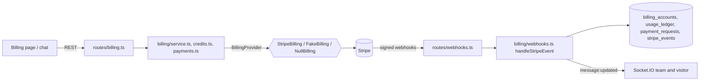

# Billing with Stripe

Three things use Stripe, and they are kept apart on purpose:

| Feature | Whose money | Stripe mechanism | Webhook endpoint |
| --- | --- | --- | --- |
| **Subscription plans** (Free, Pro, Business) | workspace pays the platform | Checkout (`mode=subscription`) + Customer Portal | `POST /webhooks/stripe` |
| **Message credits** (top-ups, monthly plan credits, auto-recharge) | workspace pays the platform | Checkout (`mode=payment`) and off-session `PaymentIntent` on the saved card | `POST /webhooks/stripe` |
| **Customer payment requests** (a workspace asks *its* customer to pay, inside a conversation) | customer pays the workspace | **Connect Standard**: Checkout created *on the workspace's own Stripe account* (direct charge) | `POST /webhooks/stripe/connect` |

Without `STRIPE_SECRET_KEY` the whole feature is off and the app still runs: `GET /api/billing` answers with `configured: false`, checkout/portal/Connect answer `503 BILLING_NOT_CONFIGURED`, and an owner can still add credits by hand (`POST /api/credits/grant`). With Stripe configured the manual grant is refused (`403 CREDIT_GRANT_DISABLED`): credits are bought, or granted by a platform admin ([ADMIN.md](ADMIN.md)).

## Setup

1. Create two Prices in Stripe (recurring, monthly) and set `STRIPE_PRICE_PRO` and `STRIPE_PRICE_BUSINESS` to their ids. The catalogue (seats, monthly credits, list price shown in the UI) lives in `server/src/billing/plans.ts`; the amount actually charged is whatever the Stripe Price says.
2. Set `STRIPE_SECRET_KEY` (use a restricted key if you can: Customers, Checkout Sessions, Billing Portal, Payment Intents, Accounts and Account Links need write access).
3. Add a webhook endpoint `https://YOUR-HOST/webhooks/stripe` ("Events on your account") subscribed to:
   `checkout.session.completed`, `checkout.session.async_payment_succeeded`, `customer.subscription.created`, `customer.subscription.updated`, `customer.subscription.deleted`, `invoice.paid`, `invoice.payment_failed`, `payment_intent.succeeded`. Put its signing secret in `STRIPE_WEBHOOK_SECRET`. The server refuses to start with a key but no webhook secret, because subscriptions and top-ups could never be confirmed.
4. For customer payment requests add a second endpoint `https://YOUR-HOST/webhooks/stripe/connect` ("Events on Connected accounts") subscribed to:
   `account.updated`, `checkout.session.completed`, `checkout.session.async_payment_succeeded`, `checkout.session.expired`, `charge.refunded`. Its secret goes in `STRIPE_CONNECT_WEBHOOK_SECRET`. Enable Connect in the Stripe dashboard (Standard accounts).
5. Optional: `CREDIT_PRICE_CENTS` (default 2, so 1,000 credits = 20.00), `BILLING_CURRENCY` (default `usd`), `BILLING_GRACE_DAYS` (default 7), `CONNECT_APPLICATION_FEE_BPS` (platform fee on customer payments, default 0). All variables are listed in [CONFIGURATION.md](CONFIGURATION.md).

Local testing without exposing a port: `stripe listen --forward-to localhost:3000/webhooks/stripe` and, in a second terminal, `stripe listen --forward-connect-to localhost:3000/webhooks/stripe/connect`; each prints the signing secret to use for that endpoint. (Not run as part of the test suite: there is no Stripe account in CI, see "What is tested".)

## Architecture

* `BillingProvider` (`billing/types.ts`) is the only thing that talks to Stripe; no other module imports the SDK. `StripeBilling` is the real one, `FakeBilling` (in-memory, records every call, builds correctly signed events) is what tests and local development use, and `NullBilling` answers 503 when no key is set.
* Webhook signatures are checked with the SDK's verifier over the **raw request body** (HMAC-SHA256, constant-time comparison, `WEBHOOK_TOLERANCE_SECONDS` replay window, default 300). The platform and Connect endpoints have different secrets: one does not open the other. Signature failures count towards the per-IP `webhook.badsig` strike limit (10 in 10 minutes blocks the address, escalating).
* Every route is declared in `authz/routePerms.ts` and `ratelimit/routePolicies.ts`; checkout, portal and Connect calls share a small per-user limit (`billing.checkout`) because each one is a paid API call to Stripe.

## Data

| Table | Purpose |
| --- | --- |
| `billing_accounts` (one per workspace) | Stripe customer and subscription ids, `plan`, `status`, `current_period_end`, `cancel_at_period_end`, `grace_until`, saved card (brand and last four only), auto-recharge and low-balance settings, `sub_event_at`, Connect account id and `connect_charges_enabled` |
| `stripe_events` | One row per Stripe event id, written before the event is applied. Statuses: `processing`, `processed`, `ignored`, `failed` |
| `usage_ledger` (+ `idem_key`) | Append-only credit movements. A unique index on `(workspace_id, idem_key)` is what makes credit additions idempotent |
| `payment_requests` | Customer payment requests: amount (minor units), currency, status `open / paid / expired / canceled / refunded`, Stripe session and payment intent ids, the message that carries the card |

Card numbers are never stored or logged: Stripe holds them, we keep a payment method id, the brand and the last four digits. The `workspaces.plan` column is what the rate limiter reads (see [RATE-LIMITING.md](RATE-LIMITING.md)), so an upgrade raises every plan-scaled limit on the next request.

## Webhook processing: exactly-once effect on at-least-once delivery

`handleStripeEvent(ctx, event, kind)`:

1. `INSERT INTO stripe_events(id, ...) ON CONFLICT DO NOTHING`. If the row already exists and is `processed`/`ignored`, the delivery is acknowledged (`result: "duplicate"`) and nothing runs.
2. If an earlier attempt ended `failed` (we answered 5xx), the row is claimed with a conditional `UPDATE ... WHERE status = 'failed'` and re-run; only one node wins that claim.
3. The handler runs. Errors propagate as a 5xx so Stripe retries with backoff, and the row is marked `failed` with the message.
4. Every handler is itself idempotent (absolute state writes, ledger idempotency keys), so even a lost claim or a crash between steps cannot double-apply.

Ordering is not guaranteed by Stripe, so `customer.subscription.*` events carry `created` and an older event never overwrites a newer state (`billing_accounts.sub_event_at`). An event that names a workspace in its metadata but belongs to a different Stripe customer than the one linked to that workspace is not applied.

| Event | Effect |
| --- | --- |
| `checkout.session.completed` (subscription) | remember the subscription id; plan and status arrive with `customer.subscription.*` |
| `checkout.session.completed` / `async_payment_succeeded` (top-up, `payment_status=paid`) | add `metadata.credits` once, idempotency key `cs:<session id>`; save the card (brand, last four, payment method id) for auto-recharge |
| `customer.subscription.created/updated` | set `plan` from the price id (`STRIPE_PRICE_*`) or `metadata.plan`, `status`, period end, cancel-at-period-end; set `workspaces.plan`; `past_due`/`unpaid` starts the grace period; audit `billing.plan_changed` |
| `customer.subscription.deleted` | plan back to `free`, subscription id cleared |
| `invoice.paid` | clear the grace period at once (this lifts the soft lock); add the plan's monthly credits once, idempotency key `inv:<invoice id>` |
| `invoice.payment_failed` | `status=past_due`, `grace_until = now + BILLING_GRACE_DAYS`; one alert to the owners per failure episode (not one per Stripe retry) |
| `payment_intent.succeeded` (`metadata.kind=auto_recharge`) | add the credits, idempotency key `pi:<payment intent id>` (the same key the recharge job uses, so whichever of the two runs second adds nothing) |
| Connect `account.updated` | `connect_charges_enabled` |
| Connect `checkout.session.completed` / `async_payment_succeeded` | request `paid` (see below) |
| Connect `checkout.session.expired`, `charge.refunded` | request `expired`; request `refunded` (full refunds only, partial refunds leave it `paid`) |

## Plans, seats and the soft lock

`plans.ts` defines Free (3 seats), Pro (10 seats, 500 credits a month) and Business (50 seats, 5,000 credits a month). With `PLAN_ENFORCEMENT=true`:

* adding a live seat (`POST /api/members`) or inviting someone is refused with `402 SEAT_LIMIT` once the plan's seats are used;
* per-workspace socket connection caps follow the plan tier.

**Grace and soft lock.** When a payment fails the workspace keeps working until `grace_until`. After that it is *locked* (evaluated lazily from the clock, so no sweep job can miss it and paying unlocks it immediately): external SMS and email sends and new seats are refused with `402 ACCOUNT_LOCKED`, auto-recharge is skipped. Reading conversations, replying in live chat, exports, the billing pages and every webhook keep working, so a customer can always pay their way out. Every member sees a banner (`workspace.billing_access` is `ok | grace | locked`); only `billing:manage` holders can fix it. Locking is only enforced when `PLAN_ENFORCEMENT=true`; the `grace` state is tracked either way.

## Credits

* One ledger (`usage_ledger`), one balance (`workspaces.credit_balance`), both changed in one transaction by `applyLedger`. Sends cost `CREDIT_COST_SMS` / `CREDIT_COST_EMAIL`; `credits_enforced` in workspace settings decides whether an empty balance blocks sending (`402 INSUFFICIENT_CREDITS`).
* **Top-up**: `POST /api/billing/checkout/topup` with `{pack}` (`pack_1000`, `pack_5000`, `pack_20000`) or `{credits}` (100 to 100,000). The price is `credits * CREDIT_PRICE_CENTS`. The Checkout session saves the card for off-session use.
* **Low balance**: set `low_balance_threshold`; when the balance falls to it the owners get one in-app notification and one email, re-armed when the balance rises above it again.
* **Auto-recharge**: needs a saved card (buy once first), a threshold and an amount. When the balance falls to the threshold a job is queued (at most one per workspace per 10 minutes); the job re-reads the balance, charges the saved card with Stripe idempotency key `recharge:<workspace>:<window>`, and credits the result with ledger key `pi:<payment intent>`. A decline is retried in the next window; after 3 consecutive failures, or immediately when the card needs authentication (3-D Secure, which cannot happen off-session), auto-recharge turns itself off and tells the owners.

## Customer payment requests (Connect Standard)

1. The owner connects their own Stripe account: `POST /api/billing/connect/onboard` returns a Stripe-hosted onboarding link. `account.updated` (or *Check status*, `POST /api/billing/connect/refresh`) sets `connect_charges_enabled`.
2. An agent with `payments:request` clicks *Request payment* in a conversation (or `POST /api/rooms/:id/payment-requests` with `{amount, description, currency?, source?, expires_in_hours?}`; amount in minor units, 50 to 99,999,999). A Checkout session is created **on the connected account** with `application_fee_amount` from `CONNECT_APPLICATION_FEE_BPS` (0 by default). The money and the dispute liability belong to the workspace's Stripe account.
3. A message is sent through the normal send path (so SMS/email delivery, credit cost and send limits all apply) with `meta.card = {type: "payment_request", id, amount, currency, description, status, url}`. The agent app and the widget render a card (amount, description, status, *Open payment page* / *Pay now*); SMS and email carry the link in text. If sending fails, the session is expired and the request cancelled, so no live link is left behind. Payment requests are limited per workspace and plan (`payments.workspace`: 20/hour on Free).
4. The Connect webhook finds the request by **our** id in the session metadata **and** requires it to belong to the account the event came from, then flips the card to `paid`, posts a line "Payment received: $25.00 (description)", notifies the agent who asked, and records `payment_request.paid` in the audit log. Replays and a second event for the same payment change nothing. A payment racing a cancellation still lands (money received is never ignored).
5. `POST /api/payment-requests/:id/cancel` expires the session at Stripe first (if Stripe refuses because the customer is paying, the request stays open and becomes paid by webhook), then marks it `canceled`.

## Permissions

| Permission | Allows | Default roles |
| --- | --- | --- |
| `billing:manage` | billing page, plans, top-ups, automation, portal, Connect onboarding | Owner |
| `payments:request` | send and cancel customer payment requests | Owner, Manager, Agent |
| `conversations:read` | list the payment requests of a conversation they can see | all |

## What is tested, and what is not

Covered by automated tests (`server/tests/billing.test.ts`, `stripe-provider.test.ts`; `web/src/pages/settings/BillingSettings.test.tsx`, `components/chat/PaymentCard.test.tsx`; widget card tests in `web/src/widget.test.ts`): signature rejection (missing, forged, wrong secret, stale, altered body, Connect secret on the platform endpoint), idempotency under redelivery, the same payment under two event ids and concurrent ledger writes, out-of-order subscription events, the whole plan lifecycle including audit rows, grace and soft lock with the clock advanced, seat limits, auto-recharge success/decline/3-D Secure/locked, the payment-intent-before-job race, Connect isolation between workspaces, expiry, partial and full refunds, cancellation, validation, permissions, rate limits, and the exact requests `StripeBilling` would send (against a recording stub of the SDK). The suite also runs on PostgreSQL.

**Not tested against Stripe itself.** There is no Stripe account in this environment, so nothing here has been run against Stripe's API or test mode: the request shapes follow the SDK's documented parameters and the stub tests pin them, but a first run in Stripe test mode with the `stripe listen` commands above is the verification step to do before going live. Known gaps: no tax or VAT handling, no proration credits, no credit refunds on refunded top-ups, no handling of disputes beyond the refund event, one currency per installation (`BILLING_CURRENCY`), no invoices for payment requests (Checkout receipts only).
