# User guide

This guide walks through the team web app page by page: what each page is for, every control (labels are quoted exactly as they appear), defaults, and the permission each action needs. It is written for workspace owners, managers and agents. Operators of the platform console (`/admin`) should read [ADMIN.md](ADMIN.md) instead.

Defaults come from the server's settings schema (`server/src/domain/settings.ts`), which is the source of truth; the web app's fallbacks match it. Permissions come from `server/src/authz/routePerms.ts` and `server/src/authz/permissions.ts`; [RBAC.md](RBAC.md) explains the model in depth.

Screenshots are in [design/](design/DESIGN.md) as `<screen>-<width>x<height>-<light|dark>.jpg`; this guide links the 1440x900 light versions and a few phone (390x844) versions.

Contents:

- [How access works](#how-access-works)
- [App shell](#app-shell)
- [Inbox](#inbox)
- [Tickets](#tickets)
- [Team chat](#team-chat)
- [Analytics](#analytics)
- [Settings](#settings)
- [Sign-in screens](#sign-in-screens)
- [Known gaps in the UI](#known-gaps-in-the-ui)

## How access works

Built-in roles:

| Role | Permissions |
| --- | --- |
| Owner | every permission |
| Manager | everything except `billing:manage`, `roles:manage` and `analytics_identity:manage` |
| Agent | `conversations:read`, `conversations:reply`, `contacts:read`, `contacts:write`, `members:read`, `settings:read`, `ai:use`, `payments:request`, `team_chat:use`, `tickets:read`, `tickets:write`, `tickets:close`, `calls:make`, `calls:internal` |
| Viewer | `conversations:read`, `contacts:read`, `members:read`, `settings:read`, `analytics:read`, `team_chat:use`, `tickets:read`. Its base role is manager, so a Viewer sees every conversation. |

How the app decides what to show:

- Buttons and pages check the member's permission list. If the list is missing, only an owner passes.
- The server checks every request again. A hidden button is a convenience, not the protection.
- The Settings navigation hides manager-only sections by **role** (owner or manager), not by permission. A member's role is the base role of their role, so a Viewer, or a custom role based on "a manager", sees every manager-only section. The server still refuses their saves with 403.
- Some routes are open to any signed-in member: your own profile, notifications, push devices, sessions, password, two-factor.
- Most settings pages save through `PATCH /api/workspace`, which needs `settings:write`. Reading them needs `settings:read`.

## App shell

Every signed-in page shares the same frame.

Banners at the top:

- "Connecting to live updates…", or "Connection lost. Reconnecting… You can keep working; messages send over a fallback connection."
- Billing, shown to every member: "Billing is overdue: SMS and email sending is paused." (locked) or "A payment failed. Please update the payment method soon." (grace), with a "Billing" link.
- Support access (when a platform operator opened a support view): "Support access: read-only view, ends automatically after 15 minutes."
- A "Skip to content" link for keyboard users. The browser tab title shows the unread count.

Navigation is an icon rail on desktop and a bottom bar on phones (hidden while a conversation or channel is open):

| Item | Shown when | Badge |
| --- | --- | --- |
| "Inbox" | always | unread conversations |
| "Tickets" | `tickets:read` | tickets waiting for a person |
| "Team" | `team_chat:use` | mentions, otherwise unread |
| "Analytics" | always (the page itself checks `analytics:read`) | none |
| "Settings" | always | none |

Rail footer:

- **Notifications bell**: a popover titled "Notifications" with "Mark all read". Empty: "You're all caught up" / "Mentions and assignments will show up here." Clicking an item opens the conversation or team channel.
- **Theme toggle** (light or dark).
- **"Account menu"**: your name and email; "Status: Available", "Status: Away", "Status: Inactive"; "Analytics", "Settings", "Keyboard shortcuts", "Sign out".

### Command palette

Open it with Cmd/Ctrl+K. Placeholder: "Search conversations or type a command…".

- "Recent conversations" / "Conversations": a server search of open conversations, up to 8.
- "This conversation": actions of the open conversation (see [Palette actions](#palette-actions-in-a-conversation)).
- "Go to": "Go to inbox", "Go to analytics", "Open settings", and "Open inbox: <name>" per inbox.
- "Actions": "New conversation" (n), "Switch to dark theme" / "Switch to light theme", "Keyboard shortcuts" (?).

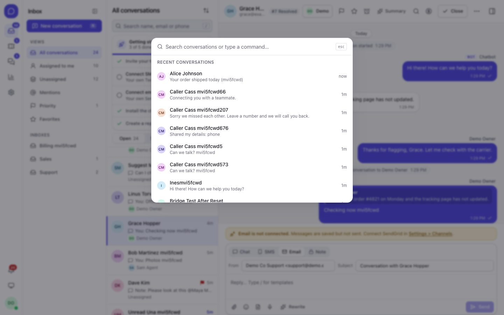

### Keyboard shortcuts

Press ? on any signed-in page for the list ("Keyboard shortcuts"). Letter shortcuts are ignored while you type in a field, while Ctrl, Cmd or Alt is held, and while a dialog or menu is open. Esc always works.

| Keys | Action | Where |
| --- | --- | --- |
| Cmd/Ctrl+K | Command palette | everywhere |
| ? | Show the shortcut help | everywhere |
| Esc | Close menus and dialogs | everywhere |
| j / k | Next / previous conversation | inbox |
| / | Search conversations | inbox |
| n | New conversation | inbox |
| i | Show or hide contact details | inbox |
| e | Close or reopen | open conversation |
| a | Open the assign menu | open conversation |
| s | Snooze | open conversation |
| p | Toggle priority | open conversation |
| f | Toggle favorite | open conversation |
| c | Focus the composer | open conversation |
| Enter / Shift+Enter | Send / new line | composer |
| / at the start of a reply | Pick a template | composer |
| @ in a note | Mention a teammate | composer |
| Alt+↑ / Alt+↓ | Previous / next channel or message | team chat |
| Alt+Shift+↑ / Alt+Shift+↓ | Next channel with unread messages | team chat |
| ↑ in an empty message box | Edit your last message | team chat |

Keys not listed in the help: ArrowLeft / ArrowRight in the image viewer; Esc closes in-thread search and the phone call dialog; Enter adds a contact tag; in the team message edit box Enter saves and Esc cancels; in composer suggestion lists ↑ / ↓ move, Enter or Tab picks, Esc dismisses.

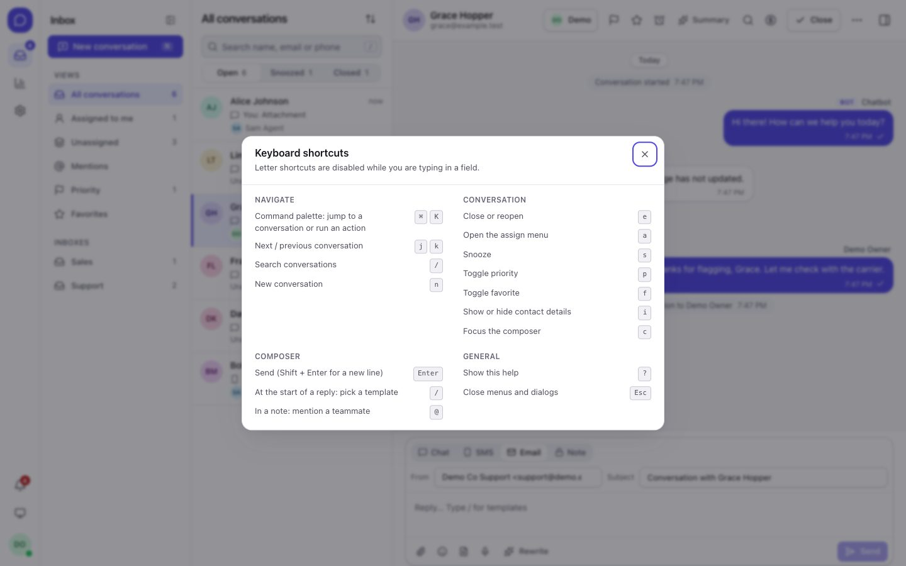

## Inbox

Routes: `/inbox` and `/inbox/:roomId`. Reading needs `conversations:read`; anything that changes a conversation needs `conversations:reply`. Agents see only conversations assigned to them, or also those of their inboxes, depending on "Can see" under [Members & seats](#members--seats).

Layout: sidebar, conversation list, thread, contact panel. Below the xl breakpoint the sidebar becomes a drawer; the contact panel is inline only at 2xl. With nothing open the thread area reads "Select a conversation" with a "New conversation" button. `?new=1` in the address opens the New conversation dialog.

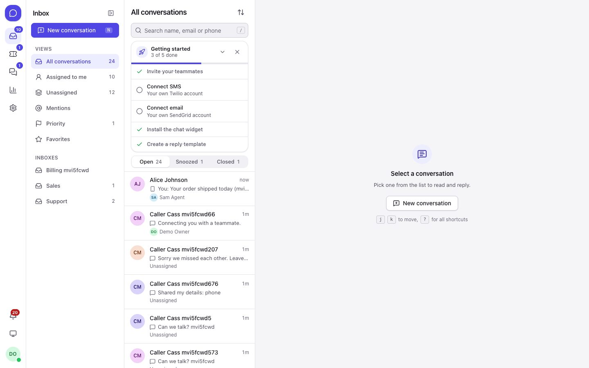

Phone layout: [inbox](design/inbox-390x844-light.jpg), [conversation](design/conversation-390x844-light.jpg).

### Sidebar

- "Hide sidebar" (desktop); a "Show sidebar" tab brings it back. The choice is remembered in this browser.
- "New conversation" (n).
- "Views", with counts: "All conversations", "Assigned to me", "Unassigned", "Mentions", "Priority", "Favorites" (no count).
- "Inboxes": one item per inbox with its open count. Empty: "No inboxes yet. Create one in Settings."

### Conversation list

- Title: the view or inbox name and "N conversations".
- Sort ("Sort: …"): "Newest" (default), "Oldest", "Waiting longest", "Priority first".
- Search: "Search name, email or phone"; / focuses it; debounced 300 ms into the address bar.
- Status tabs: "Open" (default), "Snoozed", "Closed", each with a count.
- Rows: contact name, priority flag, favorite star, time, channel icon (Chat, SMS or Email), a preview ("You:" or "Note:" prefix; "Voice note" or "Attachment" without text), unread badge, assignees or "Unassigned", subject, and the visitor's online dot.
- Empty states: "All caught up", "No snoozed conversations", "No closed conversations", "No matches" (with "Clear search"). More rows load as you scroll.

**Getting started card** (only with `channels:manage`, until dismissed in this browser): "N of M done", ticked from real server state: "Invite your teammates", "Connect SMS", "Connect email", "Install the chat widget", "Create a reply template". Buttons collapse or dismiss it.

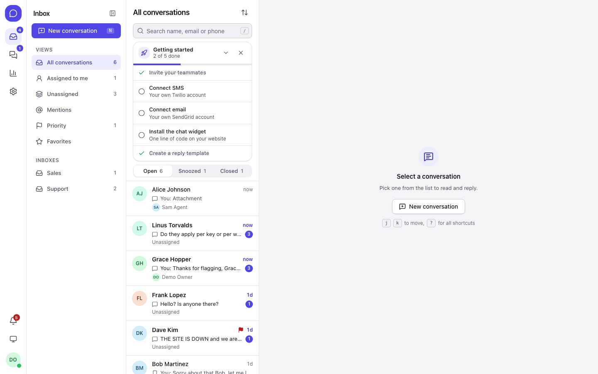

### New conversation dialog

Needs `conversations:reply` (the contact search needs `contacts:read`).

| Control | Default | Notes |
| --- | --- | --- |
| "Existing contact" / "New contact" | Existing contact | Existing: "Find a contact" (name, email or phone). New: "Name", "Email", "Phone". |
| "Inbox" | "Default inbox" | or a specific inbox |
| "Channel" | "Live chat" | "SMS", "Email" |
| "Subject" | pre-filled | email only |
| "First message (optional)" | empty | same checks as the composer |

The button reads "Start conversation", or "Start and send" when a message is typed.

### Conversation header

Shows the contact (avatar with online dot, name, email · phone, or the subject), and "Snoozed" / "Closed" pills. On phones a back arrow returns to the list.

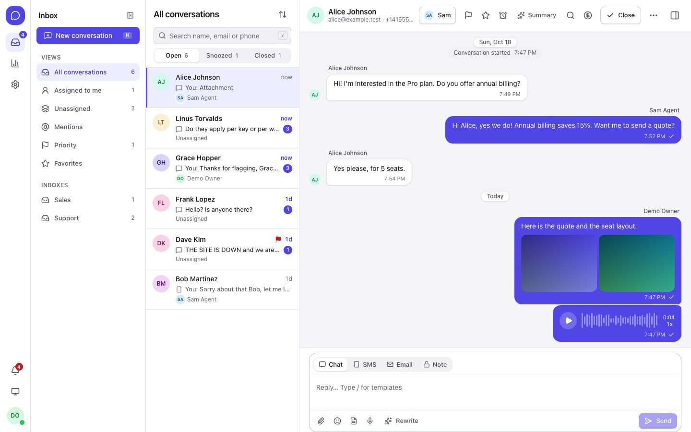

**Ticket chip and menu.** When the conversation has a ticket, a chip reads "#N <status>". Statuses: "New", "AI agent", "Waiting for a person", "Open", "Waiting for customer", "Resolved", "Closed". Without `tickets:write` or `tickets:close` you only see the chip. The menu ("Ticket #N"):

| Item | Permission | When |
| --- | --- | --- |
| "Take this ticket" / "Take over from the AI agent" | `tickets:write` | ticket is new, waiting or with the AI agent |
| "Hand back to the AI agent" | `tickets:write` | only the person handling it |
| "Mark as resolved" | `tickets:close` | not ended |
| "Close ticket" | `tickets:close` | resolved |
| "Reopen" | `tickets:write` | ended |
| "Waiting for the customer" / "Customer replied: mark open" | `tickets:write` | |
| "Priority": "Low", "Normal", "High", "Urgent" | `tickets:write` | |
| "Transfer to" a department ("N free" or "closed") | `tickets:write` | list needs `tickets:read` |

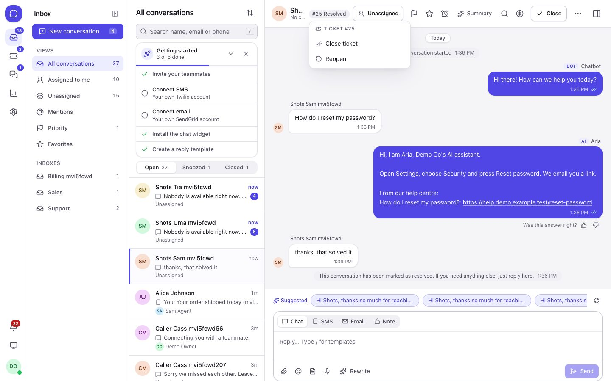

**Assign** ("Assign conversation", a): "Assign to me", "Auto-assign (round robin)", one item per teammate with a live seat, and "Unassign". The route needs `conversations:reply`; the catalogue also defines `conversations:assign` for assigning to others.

**Icon buttons** (inline on wide headers, otherwise under "More actions"):

- "Mark as priority" (p), "Favorite" (f).
- Snooze (s), "Snooze until": "In 1 hour", "In 3 hours", "Tomorrow, 9:00", "Next week, Mon 9:00", or "Custom date and time" (must be in the future); "Remove snooze".
- "Summary" ("Summarise with AI", needs `ai:use`): the summary, "Key facts", "Open questions", "Next action". Long conversations note that only the recent messages were summarised.
- "Search in this conversation": "N matches in M loaded messages", with "Load older messages".
- "Voice call" and "Video call": need `calls:make`, browser calls switched on in [Calls settings](#calls), the conversation open and the ticket not resolved or closed. Disabled with "You are already in a call" or "The visitor is not in the chat right now". See [CALLS.md](CALLS.md).
- "Call by phone": when phone calls are ready (see below).
- "Request payment" (`payments:request`).
- "Close" / "Reopen" (e) and "Contact details" (i).

**"More actions" menu.** On narrow headers it repeats the icon buttons. It also holds:

- "Copy call link" (`calls:make`; call links on and "Links to your team" allowed). The toast says the link "Works once, until <time>. A new link replaces the old one."
- "Copy AI call link" (call links on, "Links to the AI assistant" allowed, AI calls on).
- "Email a copy to the contact" (`conversations:reply` and a contact email). Toasts: "Copy emailed", "Not sent: test mode" (SendGrid not connected), or "Could not email a copy". See [TRANSCRIPTS.md](TRANSCRIPTS.md).
- "Share with the team" (`team_chat:use`): "Where" (a channel or person) and "Note (optional)". It posts a card in team chat.
- "Move to inbox": "No inbox" or an inbox.

**Call by phone.** Twilio calls your phone first, then the contact; nothing is recorded. "Your phone number" is remembered in this browser only. If the contact has not agreed to be called: "The contact has not agreed to be called on this number yet." with "Ask the visitor to agree". Without a phone: "This contact has no phone number yet." A floating "Phone call" panel shows the state and "Hang up". Needs `calls:make`.

**Request payment.** "Amount (USD)" (up to two decimals), "What is it for?", "Send it by" ("Chat" default, "SMS", "Email"). The card in the thread shows "Awaiting payment", "Paid", "Expired", "Cancelled" or "Refunded"; with `payments:request` also "Open payment page" and "Cancel request". See [STRIPE.md](STRIPE.md).

**In-call panel** (visitor calls): "Ringing...", "Connecting...", the timer, "Call ended"; quality "Connection: good / fair / poor"; "Mute microphone", "Turn camera off", "Share your screen" (when allowed), "End call" / "Cancel call". A visitor's call request shows as a system line with "Call now".

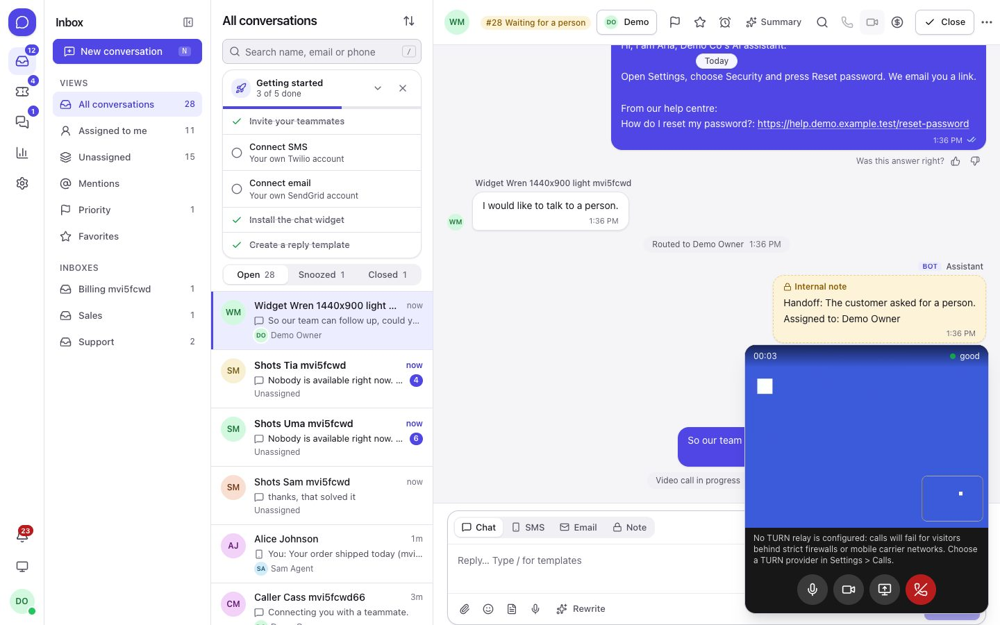

### Thread

- Day separators, "Load earlier messages", "Scroll to latest, N new", typing indicator.
- Bubbles show the sender, a channel tag (SMS / Email), "AI" or "Bot" tags, "Internal note" (dashed, lock icon), the email subject, a quoted reply, "edited", and delivery ticks ("Sending", "Sent", "Delivered", "Read", "Test mode: not sent").
- "Failed to send: <reason>" with "Retry".
- Test mode note: SMS/Email is not connected, so the message was only saved.
- The last AI answer asks "Was this answer right?" ("Helpful answer" / "Not helpful answer"). Votes feed [AI agents > Review](#ai-agents).
- Hover (or tap) actions: "Reply to this message", "Copy text", "Edit message" (your own text, within the edit window, default 900 s), "Delete message" (your own, with confirmation).
- Email bodies: "Show quoted text" / "Hide quoted text". Images open a viewer; voice notes play inline.

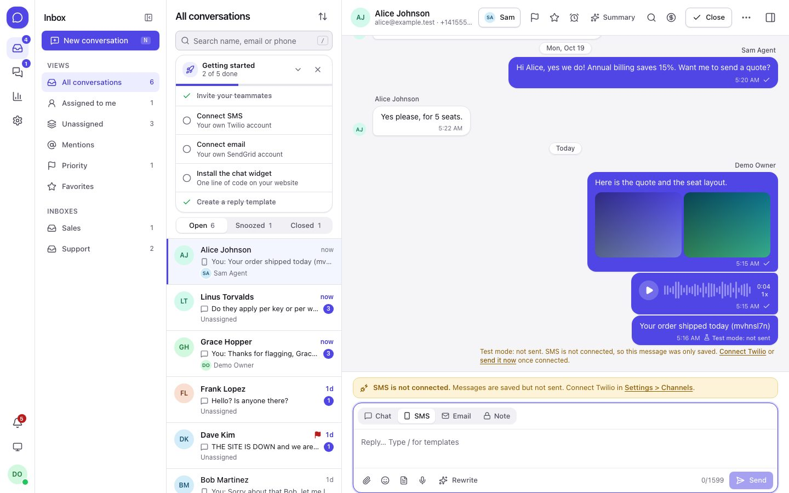

### Palette actions in a conversation

"Close conversation" / "Reopen conversation", "Assign to me", "Assign to someone…", "Mark as priority" / "Remove priority", "Add to favorites" / "Remove from favorites", "Snooze…", "Search in this conversation".

### Composer

Sending needs `conversations:reply`; AI features need `ai:use`.

- Channel tabs: "Chat", "SMS", "Email", "Note" (internal). The default is the channel of the last non-note message, otherwise Chat.
- Email adds "From" (verified senders only, otherwise "No verified sender") and "Subject" (seeded from the room subject, the last email subject or the contact name).
- "Suggested": up to 3 AI reply chips when the customer wrote last and the box is empty. A chip only inserts text; nothing is sent. "Refresh suggestions"; "AI unavailable" when the AI is down.
- A banner warns when SMS or email is not connected ("Messages are saved but not sent").
- Placeholder: "Reply… Type / for templates", or for a note "Write a note for your team. Type @ to mention someone."
- The draft is kept per conversation while the app is open. Drop or paste files to attach.
- Toolbar: "Attach files", "Insert emoji", "Insert template" (/), "Mention a teammate" (@, notes only), "Record voice note" (not in notes), "Rewrite" ("Improve writing", "Fix grammar", "Make shorter", "More friendly", "More professional", "More empathetic"), the SMS counter "n/1599", and "Send" ("Add note" in Note mode).

Checks before sending:

- "This contact has no phone number, so SMS is unavailable."
- "This contact opted out of SMS (STOP). Texts are blocked."
- "SMS is limited to 1599 characters (N over)."
- "SMS supports text only. Remove the attachments or switch channel."
- "Internal notes cannot have attachments."
- "This contact has no email address, so email is unavailable."
- "Choose a verified sender address to send email."
- "Add a subject for the email."

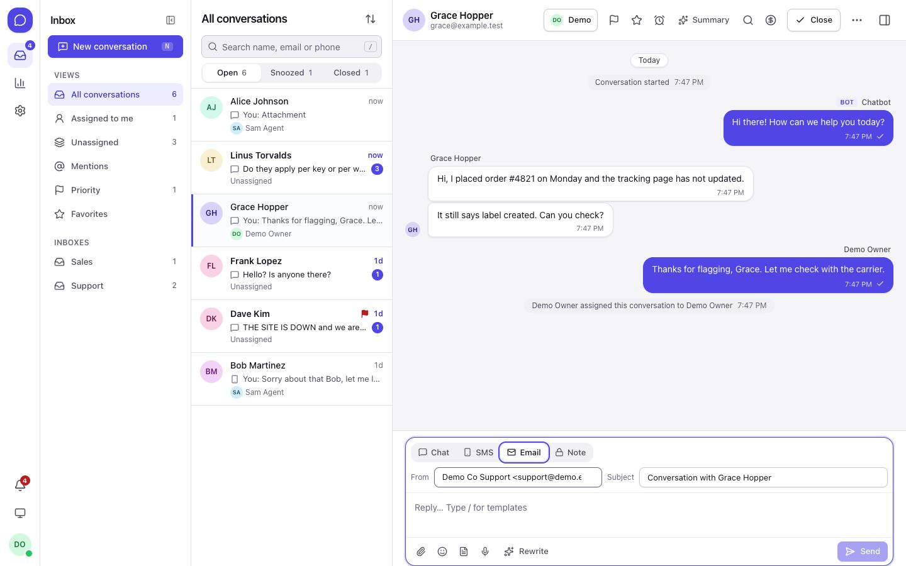

### Contact panel

Header "Contact". The card shows name ("Unnamed contact"), email and phone with copy buttons, "SMS opted out", and up to 4 tags. Sections (Notes is open by default):

- "Details" (saving needs `contacts:write`): "Name", "Email", "Phone" (international format), "Opted out of SMS" (set when the contact replies STOP; texts are blocked while on), "Tags", "Custom attributes", "Save contact".
- "Followers".
- "Tickets" (`tickets:read`): each with its status chip, subject and rating; links to the Tickets page.
- "Notes" (`contacts:write` to add or delete).
- "Shared media" and "Conversations" (the contact's other conversations).

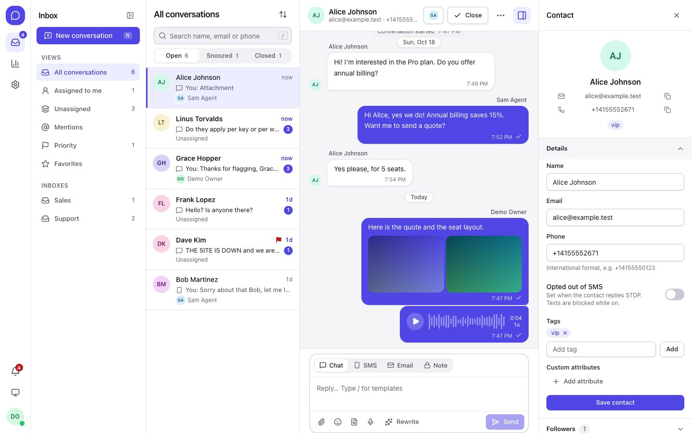

## Tickets

Route `/tickets`. Needs `tickets:read`; bulk resolve and close need `tickets:close`. A ticket is one episode of support inside a conversation; see [AI-AGENTS.md](AI-AGENTS.md).

- Summary buttons with counts: "Waiting for a person", "With the AI agent", "Open", "Waiting for customer".
- Filters (kept in the address bar): "Search number or subject"; "Status" ("All open tickets" default, "Waiting for a person", "New and with the AI agent", "Open", "Waiting for customer", "Resolved", "Closed", "Everything"); "Handled by" ("Anyone" default, "Me", "People", "AI agents", "Nobody yet"); "Department" ("Every department" default).
- Bulk bar: "N selected", "Resolve", "Close", "Clear". The toast reports partial results ("3 tickets resolved, 1 could not be changed").
- Table: "Ticket", "Customer", "Handled by", "Department", "Priority", "Last activity". Each row opens the conversation. Phones show a card list ([phone screenshot](design/tickets-390x844-light.jpg)).

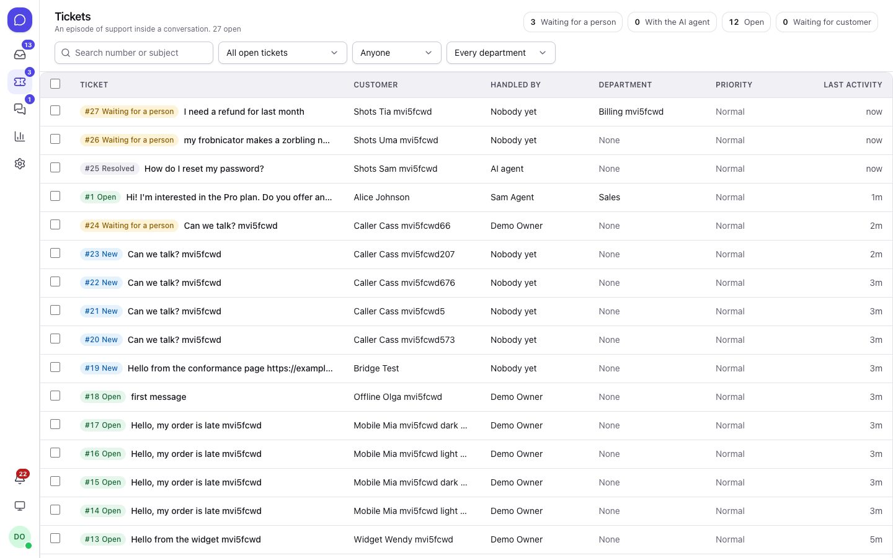

## Team chat

Routes `/team` and `/team/:channelId`. Everything needs `team_chat:use`. Creating channels needs `team_chat:manage_channels`; deleting other people's messages needs `team_chat:moderate`. Details: [TEAM-CHAT.md](TEAM-CHAT.md).

**Sidebar.** "Search team chat" (at least 2 letters). The "+" menu: "New message", "Create a channel" (manage_channels only), "Browse channels". Sections "Channels" (general first, then alphabetical) and "Direct messages". Rows show unread or mention badges, muted state and presence.

**Dialogs.**

- "New message": one person makes a direct message; up to 7 others make a group of 8.
- "Create a channel": "Name" (becomes `#slug`), "Topic (optional)", "Who can see it" ("Public" default / "Private"), "Add people (optional)".
- "Browse channels": public channels you have not joined, each with "Join".

**Channel view.** Header with title, "Muted", "Archived", topic; "Search this conversation", "Pinned messages", "Details, N members". Previewing a channel shows "Join channel"; archived channels are read-only.

- Message actions: "Add reaction" (6 emoji), "Reply in thread", "Pin message", and under "More actions" "Copy text", "Edit message", "Delete message".
- Share cards link a customer conversation, or say you do not have access to it.
- Composer: "Message #name"; "Attach files"; "Mention someone" (@channel notifies everyone here); Enter sends.
- Details panel: "Topic" (manage_channels or the channel owner), "Mute notifications" (a muted conversation stays quiet unless someone mentions you), members with call buttons and "Remove" (managers or the owner, not in #general), "Add people", "Leave channel", "Archive channel" / "Unarchive channel" (manage_channels, not #general).

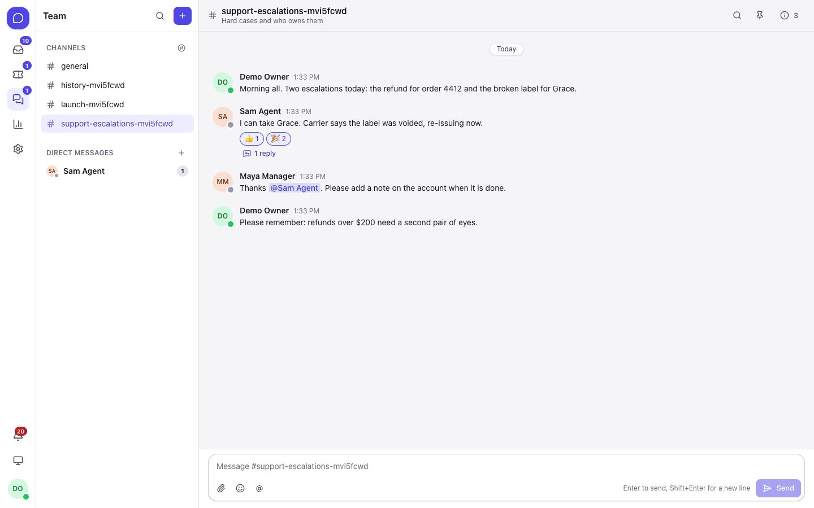

Phone: [team channel](design/team-channel-390x844-light.jpg). Threads: [team thread](design/team-thread-1440x900-light.jpg).

### Calls between teammates

Needs `calls:internal`, and "Let teammates call each other" on in [Calls settings](#calls).

- **Direct message**: "Voice call with X" / "Video call with X", disabled with "You are in a call" or "X is offline". The callee sees "Incoming call" with "Accept the call from X" / "Decline the call from X".
- **Group call** (channels and groups; on by default once teammate calls are on): "Start a group voice call" / "Start a group video call" opens a picker ("People to ring", "Start the call"). Up to 4 people including you (the cap is set in Calls settings). Others see "Incoming group call" and a card in the channel with "Join", "Full" or "You are in this call". In the call: mute, camera, screen share (one person at a time: "Someone else is sharing their screen"), "Add people to the call", "Leave the call". Tiles show "Connecting..." / "Reconnecting...". Group calls are a mesh: every browser sends to every other, which is why the cap is 4. See [CALLS.md](CALLS.md).

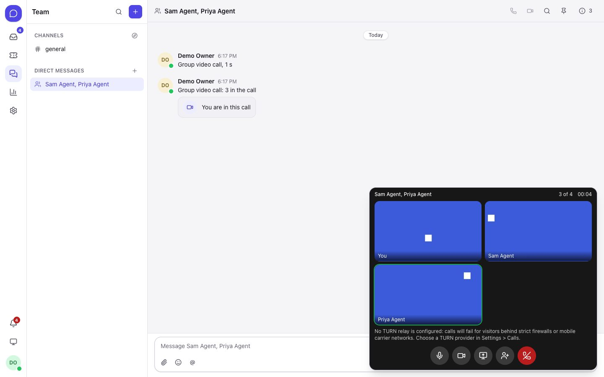

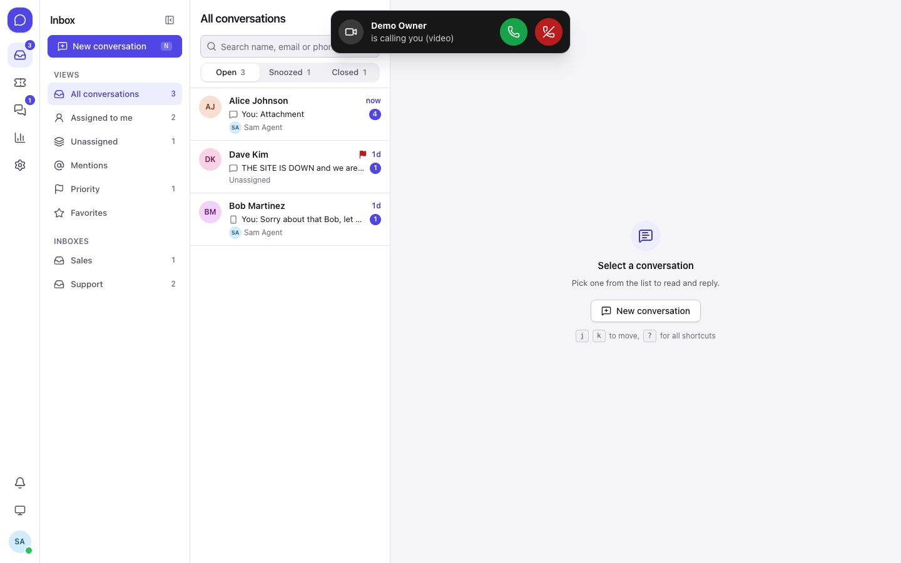

## Analytics

Route `/analytics`. Needs `analytics:read` (Owner, Manager, Viewer). Agents still see the nav item; the page then says "Analytics is not part of your role". Metric definitions: [ANALYTICS.md](ANALYTICS.md).

- Period: "7 days", "30 days" (default), "90 days".
- KPI cards with change against the previous period: "Conversations opened", "Conversations closed", "Messages received / sent", "First response (median, 90th)", "Resolution (median, 90th)", "Customer satisfaction".
- Charts: "Conversations opened per day", "Median first response per day", "Open conversations at the end of each day"; "Messages by channel".
- "Support": "Tickets opened", "Resolved by the AI agent", "Handed to a person", "Wait for a person (median)", "Service level breaches", "Satisfaction: AI / people"; "Why tickets go to a person"; tables "By department" and "By AI agent" (agents are labelled "AI agent 1, 2…", not by name); call tiles ("Calls", "Answered", "Missed", "Call length"); "Calls with the AI assistant" ("AI calls", "AI call length", "Handed to a person", "Live voice minutes").
- "By teammate": "Conversations", "Avg first response", "Avg resolution".

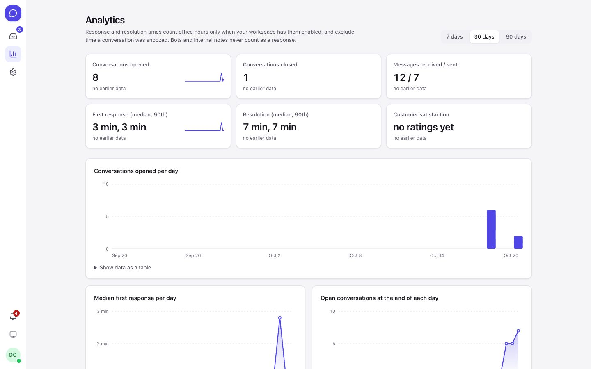

## Settings

`/settings`. On desktop it opens the first section you may see; on phones it shows the list. A section you may not see redirects to Notifications. Most forms end with a save bar: "Save changes", "Discard", and "Unsaved changes" or "Saved".

Navigation order ("MO" = shown only to owners and managers, by role):

| Group | Section | Shown to |
| --- | --- | --- |
| General | [General](#general) | MO |
| General | [Notifications & availability](#notifications--availability) | all |
| Channels & inboxes | [Inboxes](#inboxes) | MO |
| Channels & inboxes | [Departments & routing](#departments--routing) | MO |
| Channels & inboxes | [Visitor details](#visitor-details) | MO |
| Channels & inboxes | [Calls](#calls) | MO |
| Channels & inboxes | [SMS & email](#sms--email) | MO |
| Channels & inboxes | [Chat widget](#chat-widget) | MO |
| Channels & inboxes | [Embed tokens](#embed-tokens) | MO |
| Team | [Members & seats](#members--seats) | MO |
| Team | [Roles & invitations](#roles--invitations) | MO |
| Automation & AI | [Tickets settings](#tickets-settings) | MO |
| Automation & AI | [Templates](#templates) | MO |
| Automation & AI | [Knowledge base](#knowledge-base) | MO |
| Automation & AI | [AI assistant](#ai-assistant) | MO |
| Automation & AI | [AI agents](#ai-agents) | MO |
| Automation & AI | [Import contacts](#import-contacts) | all |
| Account | [Billing & credits](#billing--credits) | MO |
| Account | [Account security](#account-security) | all |

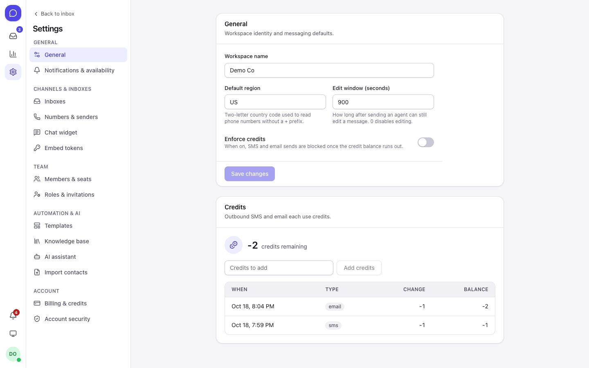

### General

Saves need `settings:write`.

| Control | Default | Notes |
| --- | --- | --- |
| "Workspace name" | set at sign-up | required, up to 100 characters |
| "Default region" | US | two-letter country used for phone numbers without a + |
| "Edit window (seconds)" | 900 | 0 to 86400; 0 disables editing |
| "Enforce credits" | off | when on, SMS and email stop once credits run out |

"Credits" shows the balance and the last 10 ledger rows. Owners see "Credits to add" / "Add credits" (needs `billing:manage`). Not in the UI: message retention, team chat retention and `routing.require_online` exist only in the settings API.

### Notifications & availability

Any member. Changes save immediately.

- "Availability": "Available" (receive new conversations), "Away" (skipped by round robin), "Inactive" (receive nothing). "Do not disturb until" with "Set" / "Clear".
- "Notifications" switches: "Assigned to you", "Assigned to your inbox", "Unassigned conversations", "Mentions", "Snoozed conversations returning", "Email me about missed notifications" (a digest when you were away).
- "Push notifications" (per device; see [NOTIFICATIONS.md](NOTIFICATIONS.md)):
  - If the server has no VAPID keys: "Push notifications are not set up on this server". On iPhone and iPad the app must be added to the home screen first (Safari 16.4 or later). If the browser blocked notifications the page says so.
  - "Name for this device", then "Turn on for this device".
  - Each device lists its name, "This device", "Stopped after errors", and when it last received one. Per-device switches, all on by default: "Missed calls", "Assigned to you", "Customer messages". Buttons "Send a test" and "Turn off".
  - Owners and managers: "Show message text in notifications (whole workspace)", default **off**. Off, a notification only says a customer wrote, without name or words, because lock screens can be seen by others.
  - Do not disturb pauses push too. Missed calls are pushed even while the app is open; the rest only when it is closed.

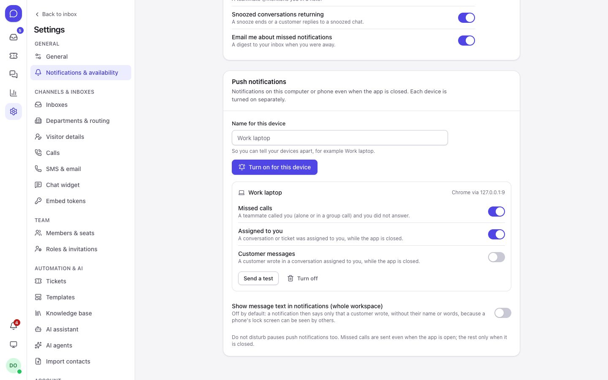

### Inboxes

Listing needs `conversations:read`; changes need `inboxes:manage`. Each row shows the assignment mode, member count and "Default for email" / "Default for SMS".

| Control | Default |
| --- | --- |
| "Name" | |
| "Assignment" | "Manual: agents pick up conversations" (or "Round robin: distribute automatically") |
| "Live routing visibility" | off |
| "Default inbox for inbound email" | off |
| "Default inbox for inbound SMS" | off |
| "Members" | none |

### Departments & routing

Needs `departments:manage`. A department is an inbox with hours, a routing mode, capacity and service levels; create inboxes and their members under Inboxes first. Concepts: [DEPARTMENTS.md](DEPARTMENTS.md).

Each row shows "Open" / "Closed", "N free", "N waiting", the mode, the per-person limit and the estimated wait. "Edit" opens the editor:

- "Description" (up to 300); "Offer in the chat widget" (works only when the widget's department selector is on, which has no UI control; see [Known gaps](#known-gaps-in-the-ui)).
- "Visitor details" overrides: "Name", "Email", "Phone number" and each workspace custom field can be "Workspace default" (default), "Never ask", "Ask, visitor may skip" (or "Ask before the chat, may skip"), "Required" (or "Required before the chat"), "Ask when needed". "Consent text in this department" and "Privacy policy address in this department" (empty uses the workspace wording).
- "Routing": "Mode" ("Follow the inbox setting" default, "Round robin", "Least busy", "Skills based", "Manual pick"); "Tickets per person" (0 = no limit); "When closed or full, send to" ("Nobody: keep it queued here" default, or another department).
- "Hours and holidays": "Restrict to opening hours" (off = takes tickets whenever someone is available), "Timezone", per-day hours, "Holidays".
- "Service levels": "First response (minutes)", "Resolution (hours)"; empty means no target.
- "What visitors read": "When closed", "When everyone is busy".
- "People": per member "Skills", "Languages", "Own limit".

"Routing rules": the first rule that matches wins, and a department the visitor picks beats the rules. Each rule has a "Name", up to 5 conditions ("Page address", "Language", "Channel", "Contact tag", "Email domain", "Contact attribute"; operators "is", "is not", "contains", "does not contain", "starts with", "ends with", "is set"), "Send the conversation to", and "Rule is on" (default on). Rules can be moved up and down. "Try the rules" tests a page address, language, channel and tags without creating anything.

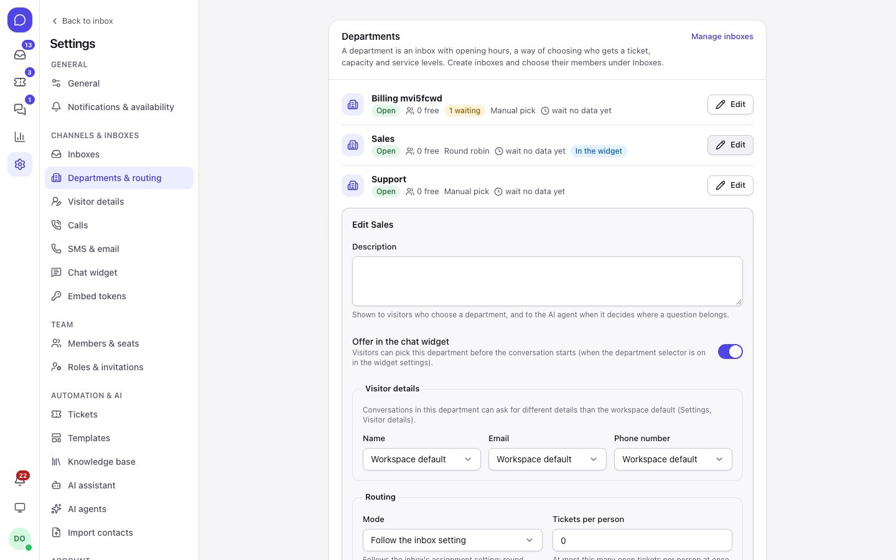

### Visitor details

Saves need `settings:write`. Decides what the widget and hosted chat ask visitors. Required fields and optional custom fields are asked before the chat starts; "Ask when needed" fields appear later as a form card at the moments you switch on. Details already given are never asked again. A department can override these.

| Control | Default | Notes |
| --- | --- | --- |
| "Name", "Email", "Phone number" | "Never ask" | or "Ask, visitor may skip", "Required", "Ask when needed" |
| Custom fields (up to 5) | | "Name in the form", "Key" (lower case, digits, underscores; saved on the contact), "Type" ("Text" default, "Choice", "Checkbox"), "When" (default "Ask when needed"), "Choices" (choice only, at least two) |
| "When a conversation goes to a person" | on | moment for "Ask when needed" |
| "When nobody is available" | on | |
| "When a callback or a call is requested" | on | |
| "After the conversation is resolved" | off | needs the email field to be asked |
| "Ask for consent with email and phone" | off | a box the visitor must tick before an email or phone is saved; a name alone needs none |
| "Consent text" | "I agree that you may contact me about this conversation." | up to 300 |
| "Privacy policy address" | empty | http or https |

A checkbox field is stored as yes or no; a required one must be ticked. When consent is on, typing an email or phone in the pre-chat form also requires ticking the consent box. The server enforces required fields too: a session without them is refused.

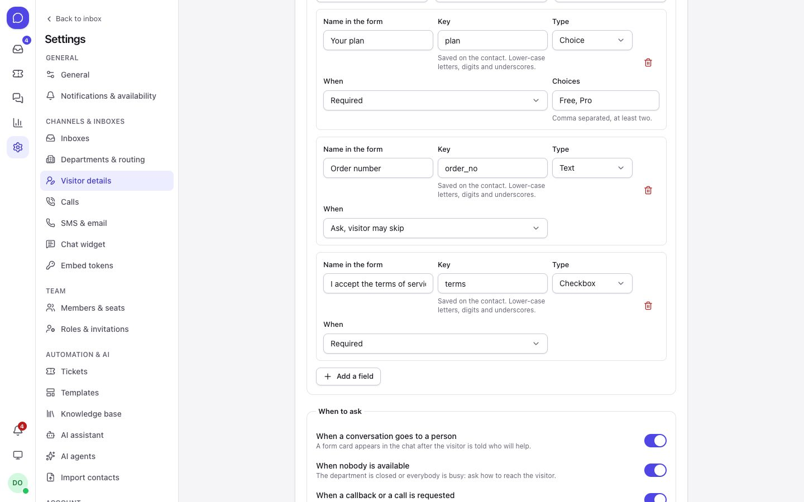

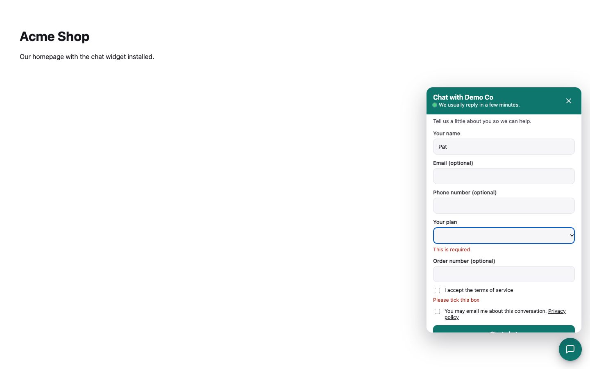

### Calls

Editing needs `calls:settings`; without it the form is read-only ("You can see these settings; changing them needs the call settings permission."). Placing calls needs `calls:make`; teammate calls need `calls:internal`. Calls are not recorded. See [CALLS.md](CALLS.md).

| Control | Default | Range / notes |
| --- | --- | --- |
| "Browser calls" | off | voice and video with visitors |
| "Voice calls", "Video calls", "Screen sharing" | on | shown when browser calls are on |
| "Ring time (seconds)" | 45 | 15 to 120; then missed, and the visitor is offered a callback form |
| "Relay (TURN) for hard networks" | "None (STUN only)" | "Your own TURN server", "Twilio Network Traversal" |
| "Let teammates call each other" | off | |
| teammate "Voice", "Video", "Screen sharing" | on | |
| teammate "Ring time (seconds)" | 30 | 10 to 90 |
| "Group calls" | on | mesh, up to four people |
| "Most people in a group call" | 4 | 2 to 4, the host included |
| "Let people join a call from a link" | off | |
| "Links to the AI assistant", "Links to your team" | on | |
| "Link lifetime (minutes)" | 30 | 5 to 1440 |
| "Let visitors talk to the AI assistant" | off | Chrome, Edge or Safari; an AI agent must be allowed the voice/video action |
| AI "Voice", "Video call with an AI avatar" | on | |
| "Speech engine" | "The visitor's browser (free)" | or "Live voice (OpenAI realtime, optional)", which needs server configuration |
| "Longest call (minutes)" | 10 | 1 to 30 |
| "Ends after silence (seconds)" | 120 | 30 to 600 |
| "Calls at the same time" | 3 | 1 to 20 |
| "Calls per day" | 100 | 1 to 1000 |
| "Live voice minutes per day" | 30 | realtime engine only |
| "Live voice calls at the same time" | 2 | 1 to 10, realtime only |
| "Phone calls (click-to-call)" | off | needs Twilio under SMS & email |
| "Caller ID" | none | an imported Twilio number |
| "Countries that may be called" | empty (nothing is called) | ISO codes |
| phone "Calls per day" | 50 | |
| phone "Longest call (minutes)" | 30 | 1 to 120 |
| "No calls at night" | on | 21:00 to 08:00 |

The teammate-calls note says custom roles must be given the permission under Roles; in fact the Roles page cannot grant it (see [Known gaps](#known-gaps-in-the-ui)).

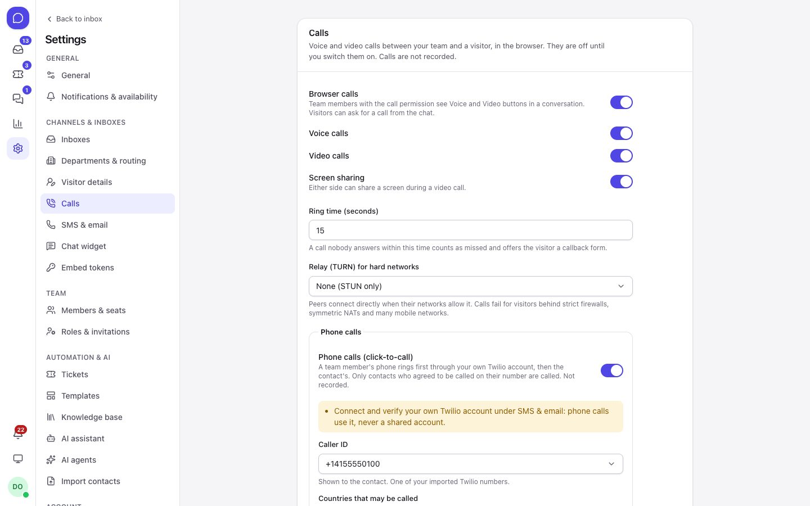

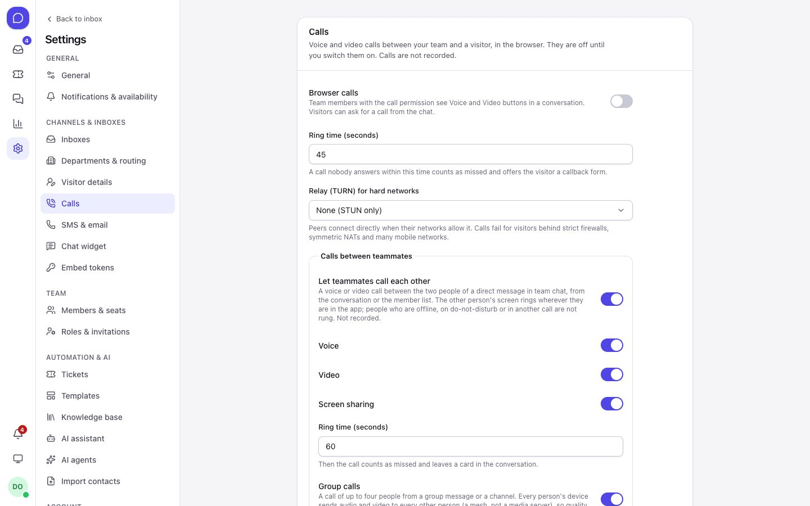

#### Photoreal avatar

Hidden without `calls:settings`. Optional: a hosted service (D-ID) shows the AI assistant as a realistic talking video in AI video calls. Until a key is connected **and** the switch is on, and whenever anything fails, calls show the built-in face. The service costs money per minute of video.

- Status chip: "Not connected", "Key saved, not tested", "Failing: using the built-in face", "Connected, switched off", "Connected and on", "Switched off on this server" (the operator set `AVATAR_PHOTOREAL_ENABLED` off).
- "Provider": "None (built-in face)" or "D-ID"; locked once connected.
- "How to set it up": five steps (D-ID studio, API key as `username:password`, save, add an avatar, assign it to an agent).
- "D-ID API key": write-only. It is stored encrypted and never shown again; the page shows only "Connected, ends …". If the server operator set `DID_API_KEY`, the page says the server provides a key; the workspace switch is still needed.
- "Save key" (tests the key), "Test connection" (asks D-ID for the credit balance; no video is made), "Disconnect" (deletes the key).
- Once connected: "Avatars" with "Add avatar": "Name", "Source" ("A D-ID stock presenter" default with "Presenter id", or "A photo (https address)" with a consent checkbox you must tick), "Voice" ("The avatar's own voice" default, "Microsoft (Azure) voice", "ElevenLabs voice") and "Voice id".
- "Which agent uses which avatar": per AI agent, "Built-in face" (default) or an avatar.
- "Use the photoreal avatar in AI video calls": default **off**; only AI video calls with the browser speech engine.
- "Minutes per day": 10 (1 to 600), with today's use and an estimated cost. "At the same time": 1 (1 to 5).

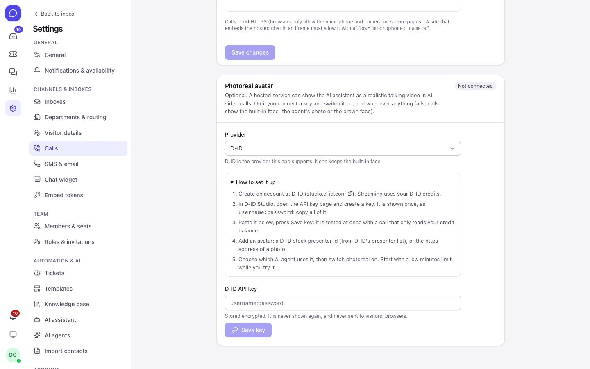

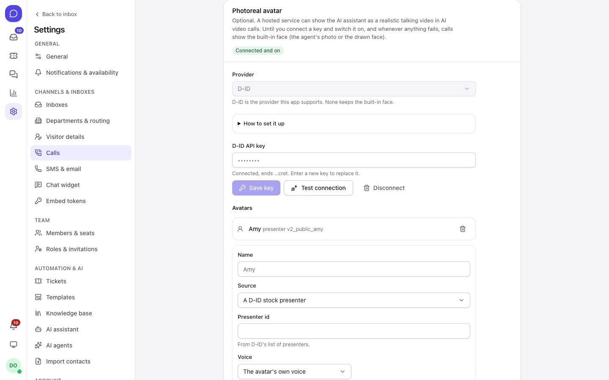

### SMS & email

Connections need `channels:manage`; listing numbers, senders and addresses needs `settings:read`. Full setup: [CHANNELS.md](CHANNELS.md).

- **"SMS: Twilio"**: status "Connected", "Needs attention", "Not verified", "Connected (platform account)" or "Test mode". Form "Account SID", "Auth Token" (stored encrypted, never shown), optional "API key SID" / "API key secret", "Connect and verify". Once connected: "Verify credentials", "Replace credentials", "Disconnect", "Import numbers from Twilio", the webhook URLs to copy, "Check webhook", "Send a test text to".
- **"Email: SendGrid"**: "API key", "Connect and verify". Once connected: "Verify API key", "Import verified senders", "Replace API key", "Disconnect", "Inbound domain (optional)", "Inbound Parse URL", "Generate a new secret", "Event Webhook URL", "Verification key", "Check webhook", "Send a test email to".
- **"SMS numbers"**: "Make default", "Remove", "Add number".
- **"Email senders"**: only verified senders can be used in the composer. "Verify", "Make default", "Remove", "Add sender".
- **"Inbound addresses"**: "Add address", "Remove".

Without a connection the channel runs in test mode: messages are saved and marked "Test mode: not sent".

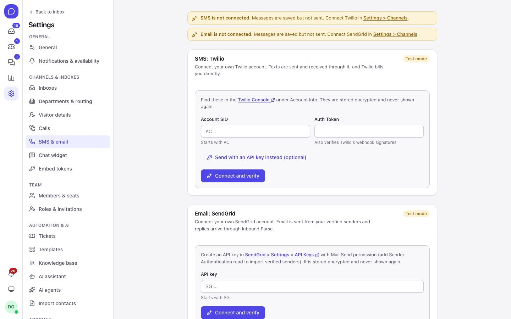

### Chat widget

Customise saves need `settings:write`; Install uses tokens (`tokens:manage`). Tabs "Install" and "Customise" (default). Full guide: [WIDGET.md](WIDGET.md).

**Install**: 1 "Choose your website" (pick or create a token for a domain), 2 "Add the code to your site" ("Plain HTML", "WordPress", "Shopify", "Google Tag Manager", plus a Content-Security-Policy note), 3 "Check that it works" ("Installed. The widget loaded on …" or "Waiting…" with "Check now"; "Try it now"). "Mobile apps and web views": "Hosted chat for this token", "Chat URL", "Identity verification" ("Create secret" / "Replace secret"), "Ignore unsigned identity" ([MOBILE-BRIDGE.md](MOBILE-BRIDGE.md)).

**Customise**:

| Control | Default |
| --- | --- |
| "Title" | "Chat with us" |
| "Intro text" | "We usually reply within a few minutes." |
| "Brand colour" / "Text colour" | #4f46e5 / #ffffff (a low-contrast warning offers "Fix automatically") |
| "Logo URL" | none |
| "Corner radius" | 16 px |
| "Launcher spacing (px)" | 20 |
| "Launcher style" | "Bubble" ("Pill", "Square") |
| "Launcher label" (pill) | "Chat with us" |
| "Launcher position" | "Bottom right" |
| "Notification sound" | on |
| "Welcome message" | "Hi there! How can we help you today?" |
| "Away message" | "We're currently away. Leave a message and we'll get back to you." |
| "Visitor details" (older setting) | none of "Ask for name/email/phone"; prefer [Visitor details](#visitor-details) |
| "Chat type" | "Live chat" (or "Text message (SMS)") |
| "Route new chats to" | "Default inbox" |
| "Enable office hours" | off; UTC, Mon to Fri 09:00 to 17:00 |

The preview shows "Chat", "Pre-chat" and "Closed" views, light and dark, desktop and phone, and an "Away state" switch.

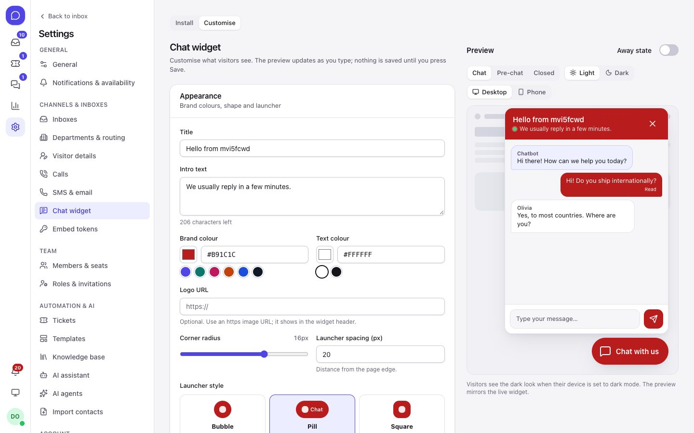

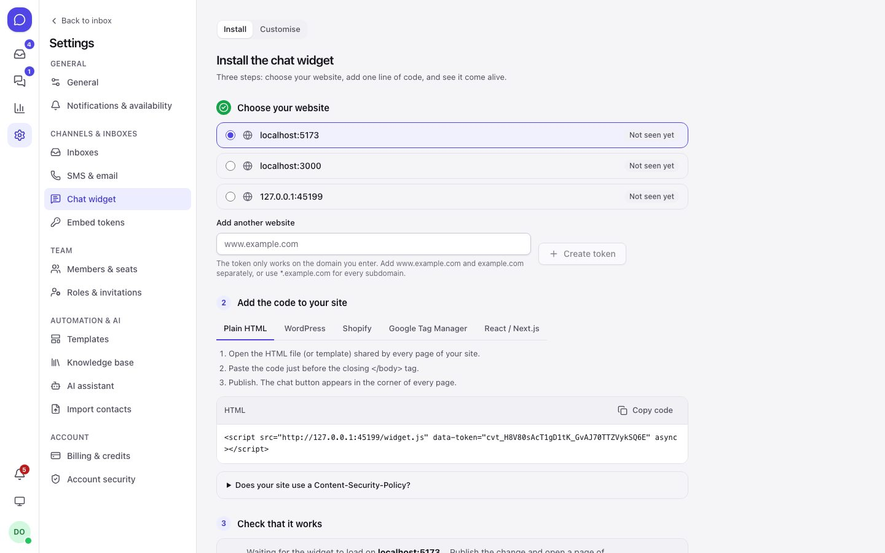

### Embed tokens

Needs `tokens:manage`. One token per website; the widget only works on the domain its token was issued for. "Website domain" / "Create token"; per token "Rotate", "Revoke", "Copy snippet", "Reveal token".

### Members & seats

Listing needs `members:read`; adding and removing need `members:manage`. Owners manage everyone, managers manage agents only, nobody edits themselves.

- Table: "Member", "Role" (owners get a select; others see a badge), "Live seat" (only live seats take conversations), "Can see" ("Only assigned" / "Their inboxes"), "Remove".
- "Add member": "Name", "Email", "Temporary password" (at least 8, "Generate"), "Role" ("Agent" default; "Manager" for owners only). The temporary password is shown once with "Copy password".

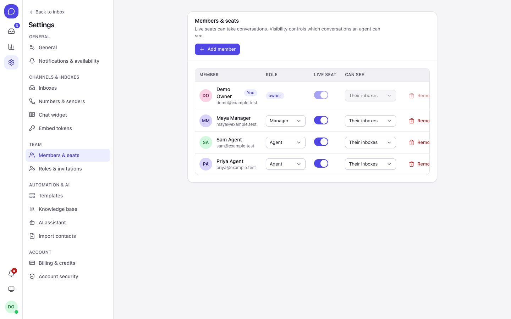

### Roles & invitations

Reading roles needs `members:read`; creating, deleting and assigning roles need `roles:manage` (owner only by default). Invitations need `members:manage`.

- "Roles": built-in roles cannot be changed. Custom roles combine permissions; nobody can grant a permission they do not have. "New custom role": "Name", "Sees conversations like" ("an agent" default / "a manager"), "Permissions" (conversations read and reply pre-ticked).
- "Pending invitations": links work for 7 days; "Revoke". "Invite someone": "Email", "Role" (Agent default), "Send invitation".

Limitation: the custom-role checklist does not offer the team chat, ticket, department, AI agent, call or payment permissions, and existing custom roles cannot be edited. See [Known gaps](#known-gaps-in-the-ui).

### Tickets settings

Saves need `settings:write`.

| Control | Default | Notes |
| --- | --- | --- |
| "Reopen window (hours)" | 72 | 0 to 720; 0 always opens a new ticket |
| "Close resolved tickets after (hours)" | 72 | 1 to 720 |
| "AI agent idle time (minutes)" | 30 | 0 off, otherwise 5 to 1440 |
| "Waiting for customer (hours)" | 72 | 0 off |
| "Message when a ticket is resolved" | "This conversation has been marked as resolved. If you need anything else, just reply here." | up to 500 |
| "Ask for a rating" | on | a 1 to 5 rating card |

"Copies by email" ([TRANSCRIPTS.md](TRANSCRIPTS.md)):

| Control | Default | Notes |
| --- | --- | --- |
| "Visitors can ask for a copy" | off | shows "Email me a copy" in the chat; AI agents can send one; at most 3 per contact per hour |
| "Also send a copy when a ticket is resolved" | off | needs the first switch; once per ticket, to a confirmed address, with an unsubscribe link |
| "Hide personal data in copies" | off | also on when "Redact personal data" is on in AI settings |

Copies never contain internal notes. In test mode they are recorded but not sent.

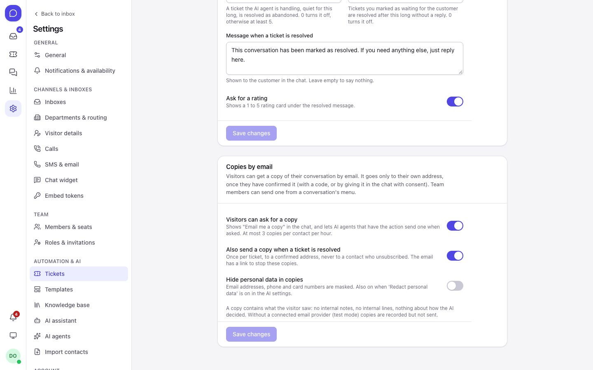

### Templates

Listing needs `conversations:read`; changes need `templates:manage`. Fields: "Name", "Shortcut" (letters, digits, - and _), "Channel" ("Any channel" default, "Live chat", "SMS", "Email"), "Subject" (email), "Message" with merge fields `{{contact.first_name}}`, `{{contact.name}}`, `{{agent.name}}`, `{{workspace.name}}`.

### Knowledge base

Needs `kb:manage`. Questions and answers the AI uses for grounded replies. "Question" (3 to 500), "Answer" (up to 4000), "Collection" (optional), "Page address" (optional). "Write an entry" on the AI agents Unanswered tab pre-fills the question.

### AI assistant

Saves need `settings:write`. Shows the provider, or "(offline heuristics, no API key configured)". See [AI.md](AI.md).

| Control | Default | Notes |
| --- | --- | --- |
| "AI triage" | off | tags new conversations with intent, sentiment and urgency |
| "Auto-responder" | off | answers simple questions from the knowledge base, then hands off |
| "Redact personal data" | off | masks emails, phone numbers and card numbers before text goes to the AI provider |
| "Tone of voice" | Friendly | Professional, Concise, Empathetic |

### AI agents

Needs `agents:manage` (Owner, Manager). The "SMS and email answers" form uses the workspace settings (`settings:write`). Tabs "Agents" (default), "Review", "Unanswered". Concepts: [AI-AGENTS.md](AI-AGENTS.md).

**Agents.** Up to 5 agents. On the first visit with none, the app creates "Aria" and switches it on, and says so. Presets: "Aria" (warm and patient), "vb" (direct and efficient), "Blank". Each row has an on/off switch, "Edit" and "Delete".

Editor (defaults for a blank agent):

- "Who it is": "Name", "Label shown to visitors" ("AI assistant"), "Role and rules", "Greeting", "Tone" (Friendly), "Languages" (empty = any).
- "Picture": a bundled picture, an upload with a cropper, or none; "Description of the picture".
- "What it may do": "Autonomy" ("Suggest only", "Answer on its own" default, "Answer and resolve"); action switches, all on: quick replies, choose the department, resolve, hand over, ask for contact details, offer a callback, offer a call, talk by voice or video, send a call link; "Knowledge collections" (empty = all).
- "Where it works": "Chat (widget, hosted chat, apps)" (on), "SMS" (off), "Email" (off); at least one stays on. SMS and email only work when also switched on for the workspace below. Departments (none = all). "Restrict to hours" (off).
- "When it hands over to a person": triggers, all on (asks for a person, uncertain answer, keeps rephrasing, upset, urgent, sensitive topic, VIP tag, an action fails); "Sensitive topics"; "Most turns before a person steps in" (6); "Unanswered tries before a person steps in" (2); "Confidence needed to answer" (0.6); "Knowledge match needed" (0.5); "While a ticket waits for a person" ("Ask for contact details once" default / "Stay silent").
- "Switched on": off for a new agent.
- "Try <name>": a sandbox that shows the outcome, confidence, sources, routing and "How it decided" without a real conversation.

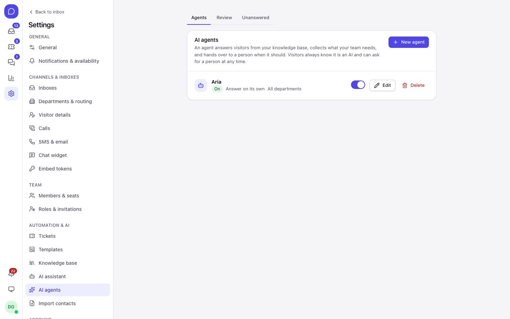

**"SMS and email answers"** (below the list): off until you switch a channel on here **and** give an agent that channel.

| Control | Default | Notes |
| --- | --- | --- |
| "AI agents answer texts" | off | HUMAN keyword reaches a person; numbered options; never to STOP contacts, short codes or automated texts |
| SMS "AI replies per conversation per day" | 5 | 1 to 50 |
| "Longest text (segments)" | 3 | 1 to 10 |
| "No AI texts at night" | on | 21:00 to 08:00 |
| "AI agents answer emails" | off | |
| email "AI replies per conversation per day" | 5 | |
| "Longest answer (characters)" | 2000 | 200 to 10000 |
| "Extra signature line" | empty | up to 300 |

Replies use credits and your own provider; in test mode they are saved but not sent.

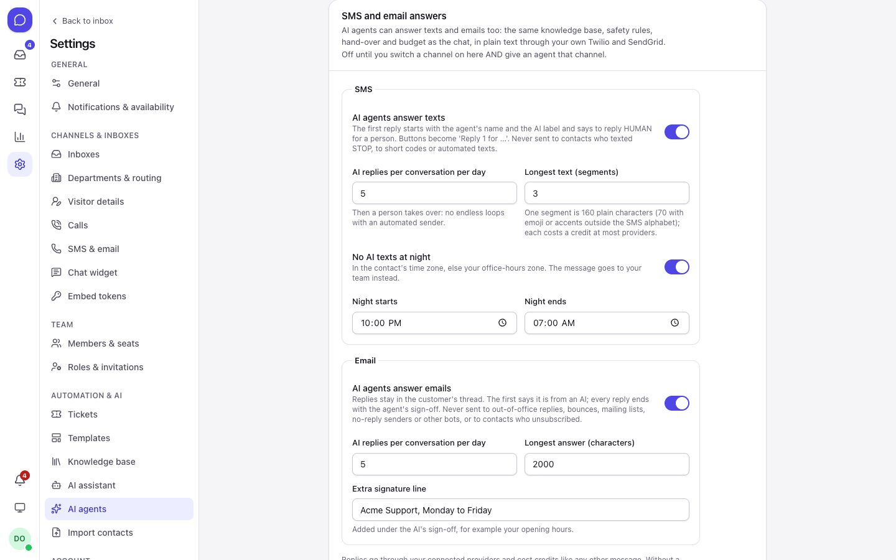

**Review**: filter by "Rating", "Outcome" and "Agent"; each AI turn shows the outcome, reason, ticket, visitor text, answer, sources and votes. **Unanswered**: questions the AI could not answer, grouped, for the last 7, 30 (default) or 90 days, with "Write an entry".

### Import contacts

Visible to all members; importing needs `contacts:import` (Owner and Manager by default). Upload a CSV (up to 5 MB) with name, email, phone and tags (separated by ;); other columns become custom attributes. A preview shows valid rows and problems; "Import N contacts" reports created, updated and skipped.

### Billing & credits

Needs `billing:manage` (owner only by default); otherwise "You need the billing permission to see this page." See [STRIPE.md](STRIPE.md).

- "Plan": plan, seats used, renewal date, plan cards, "Manage subscription, invoices and card".
- "Credits": balance, packs, "Other amount (100 to 100,000)", ledger.
- "Low balance and auto-recharge": "Email me when credits fall to" (0 = off), "Auto-recharge" (needs a saved card), threshold and amount.
- "Get paid by customers": Stripe Connect status, "Connect Stripe account", "Check status".

### Account security

Any member.

- "Password": "Current password", "New password" (at least 8), "Change password". Other devices are signed out.
- "Two-factor authentication": "Set up two-factor" shows the secret; enter a "Code" and "Turn on"; recovery codes are shown once ("Copy codes", "Download"). There is no button to turn two-factor off.
- "Signed-in devices": "Sign out" on any other device.

## Sign-in screens

| Route | Screen |
| --- | --- |
| `/login` | "Sign in": "Email", "Password"; with two-factor a second step "Authentication code" (or a recovery code). Links "Forgot your password?" and "Create a workspace". |
| `/register` | "Create your workspace": "Your name", "Workspace name", "Work email", "Password" (at least 8). |
| `/forgot-password` | "Reset your password": "Email", "Send reset link". |
| `/reset-password` | "Choose a new password". |
| `/accept-invitation` | "Join your team": "Your name", "Password". |
| `/impersonate` | opens a read-only support view for 15 minutes (platform operators). |

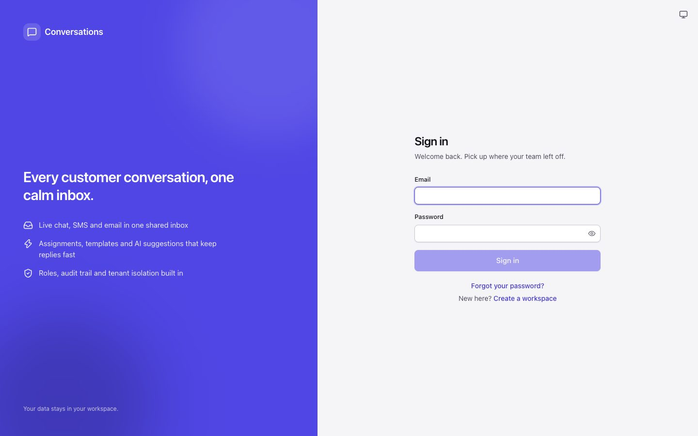

## Known gaps in the UI

These are true of the current code and are listed so nobody is surprised:

1. The custom-role checklist omits the team chat, ticket, department, AI agent, call and payment permissions, so custom roles made in the UI cannot hold them. The Calls page note suggesting otherwise is wrong. Existing custom roles cannot be edited.
2. The Settings navigation is gated by role, not permission. A Viewer (base role manager) sees manager-only sections but cannot save them.
3. The SMS/email banner says "Settings > Channels"; the navigation label is "SMS & email".
4. The widget's department selector has no control, but the department switch "Offer in the chat widget" depends on it.
5. The older "Visitor details" card on the Chat widget page (ask for name, email, phone) coexists with the newer Visitor details page.
6. The analytics "By AI agent" table labels agents "AI agent 1, 2…", not by name.
7. Two-factor cannot be turned off from the app, although the API supports it.
8. Agents see the "Analytics" navigation item but not the page.
